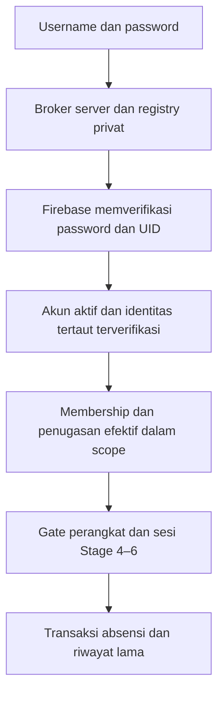

# MSA — Kajian arsitektur akun personal

**26 Oktober 2026 · Stage 9B.1 lifecycle/kalender tersedia dengan gate/grant terpisah; Stage 9A draf tersedia dengan gate/grant terpisah; Stage 8 core tersedia hanya pada fixture emulator dengan grant eksplisit; AUTH A1, A2.1, A2.2, A2.3, A2.4A dan A2.4B: IMPLEMENTED terbatas pada akun fiktif/emulator; login email tetap default. Branding MSA tersedia pada aplikasi. A2.4C menambahkan asesmen baca-saja dan simulasi terisolasi; cutover produksi NO-GO.** Status pengujian aktual ada di [PROJECT_STATUS.md](PROJECT_STATUS.md). Bagian AUTH berikut memperbarui status kajian awal; bagian 1–11 merekam rancangan/migrasi yang lebih luas dan tidak mengaktifkan fitur lanjutan. Kajian awal berdasarkan HEAD `370714c4da0a370a928dea0a77d130f3a11f9aca`; penyempurnaan UI PIC berdasarkan HEAD `88f88c1cfee4187b4189b134c557286b8b7fabdb`. [MASTER_BRIEF.md](MASTER_BRIEF.md) tetap acuan kebutuhan; [MSA_PRODUCT_VISION.md](MSA_PRODUCT_VISION.md) memuat konteks perluasan.

## Stage 9B.1 — publikasi dan kalender pelayanan, 26 Oktober 2026

**IMPLEMENTED hanya pada emulator fiktif.** Gate independen `ABC_MSA_STAGE9B1=1` mati default, memerlukan Stage 9A/Stage 8/A1/A2.2 dan konfigurasi Auth/Firestore demo valid pada namespace `test-*`. Hasil tes aktual ada di PROJECT_STATUS.md. Kepemilikan, direktori PIC dan pemberian grant tetap provisional; cutover produksi NO-GO. Kontrak Stage 9A di bawah menjadi dasar; pembatasan draf/publish yang disebut di sana merekam checkpoint sebelum perluasan ini.

| Izin eksplisit per organisasi | Perilaku |
|---|---|
| `events:read` | Hak internal Stage 9A dipertahankan: baca draf, terbit, batal dan audit melalui endpoint internal. Tidak memberi create/edit/publish/cancel |
| `events:calendar:read` | Baca jadwal terbit/batal dan detail saat ini; tidak membaca draf, versi draf terdahulu atau actor audit. Tidak memberi izin mutasi |
| `events:create` / `events:edit` | Tetap terpisah. Edit draf cukup edit; edit event terbit juga memerlukan publish dan gate Stage 9B.1. UI editor memerlukan read internal untuk pilihan program/PIC |
| `events:publish` | Publikasi draf valid dalam organisasi; bukan akses publik atau publikasi rundown |
| `events:cancel` | Pembatalan event terbit dalam organisasi dengan alasan, konfirmasi, revisi dan UUID. Tidak memberi edit/publish |
| `events:pic` | Kelayakan PIC tetap terpisah dan tidak memberi izin baca atau mutasi |

Tidak ada inheritance dari owner/manager, Admin/PIC legacy maupun penetapan PIC. Grant mengikat revisi akun/identitas/membership yang sama seperti Stage 9A. Permissions baru hanya diakui ketika gate Stage 9B.1 hidup; format grant dengan permission baru ditolak ketika gate mati. Tidak ada API/UI pemberian atau pemulihan grant. Fixture owner diberi tujuh permission secara eksplisit oleh setup trusted, bukan oleh role.

Lifecycle provisional hanya **draft → published → cancelled**. Pembatalan draf, publish ulang, unpublish, restore dan edit event cancelled ditolak; tidak ada hard delete atau pembangkitan event baru. Publikasi memeriksa kembali seluruh field tersimpan dengan validator Stage 9A, kesesuaian startAt UTC, organisasi aktif, program aktif/null, PIC verified/provider aktif dengan membership/grant yang sah, sesi dan izin publish. Cancel tetap dapat dilakukan ketika PIC/program lama sudah tidak eligible, selama actor/organisasi/grant cancel sah; ini tidak mengaktifkan kembali identitas atau izin lama.

`msaServiceEvents` tetap memakai ID/organizationId yang sama. Transisi menambah publishedAt/publishedBy atau cancelledAt/cancelledBy/cancellationReason, menaikkan revision dan updatedAt/updatedBy. Edit terbit mempertahankan status serta metadata publikasi awal dan memvalidasi field/PIC/program baru. Audit append-only menyimpan previous/next, actor, alasan dan operasi `event-published`, `published-edited`, `event-cancelled`; riwayat lama tetap utuh.

Receipt tetap di `msaEventReceipts`. Fingerprint lifecycle mengikat operasi+organisasi+eventId+revisi+alasan+konfirmasi; key mengikat actor+requestId. Reuse lintas operasi/target/body ditolak 409. Retry receipt memeriksa izin sekarang sebelum mengembalikan hasil lama dan tidak menulis ulang state. Receipt edit terbit menandai kebutuhan izin publish pada replay. Hasil receipt adalah hasil mutasi awal; detail terbaru tetap menjadi acuan status saat ini, termasuk bila kemudian dibatalkan. Konflik concurrent publish/edit/cancel tidak menimpa revisi yang menang. Seluruh pemeriksaan authority dan pembacaan row berada dalam transaksi sebelum write; provider Auth tetap terpisah dari transaksi Firestore.

API same-origin Admin baru:

- `GET /api/stage9b1/catalog`: organisasi dengan membership dan minimal salah satu izin read internal/calendar yang efektif, program metadata untuk filter termasuk nonaktif, serta capabilities. Tidak ada daftar PIC kandidat bagi pembaca kalender terbatas.
- `GET /api/stage9b1/calendar?from=YYYY-MM-DD&to=YYYY-MM-DD&organizationId=...&programId=...&status=...`: from/to wajib, inklusif berdasarkan tanggal lokal event, maksimal 93 hari. Organization dihilangkan berarti semua scope sendiri; program kosong berarti null, dihilangkan berarti semua; status default published, opsi all/draft/published/cancelled. Query Firestore memfilter organisasi+status+tanggal+program di server; draf tidak dibaca bagi calendar-only scope. Semua status berarti hanya status yang boleh dibaca per organisasi. Scope eksplisit asing ditolak 403; tanpa scope efektif hasil kosong, tanpa data/grant baru.
- `GET /api/stage9b1/organizations/{organizationId}/events/{eventId}`: detail saat ini dengan organizationName/programName/PIC reference pseudonim dan capabilities. Tidak mengirim actor UID, kontak atau audit/versi terdahulu. Draf memerlukan read internal. Event batal ditandai jelas, tanpa hapus riwayat.
- `POST .../{eventId}/publish` atau `/cancel`: body strict requestId/expectedRevision/reason/confirmed; tidak menerima status, organizationId atau permissions. Terbit memerlukan publish, batal memerlukan cancel; revisi/status invalid 409.
- Edit rincian tetap memakai `POST /api/stage9a/organizations/{organizationId}/events/{eventId}` dan validator/receipt/audit yang sama, dengan pemeriksaan publish tambahan untuk event terbit.

Kalender mengurutkan startAt UTC lalu ID; tanggal/waktu/zona asli tetap dikirim. Dua event dengan waktu UTC sama atau nama serupa tetap dua ID. Pengelompokan UI memakai tanggal lokal event, sehingga event lintas zona yang melewati tengah malam tidak dipindah ke tanggal komputer. Tidak ada inferensi jadwal dari absensi lama, deduplikasi, recurrence, end time atau conflict-resolution otomatis.

Maksimum **200 hasil per query dan total kalender**, bukan pemotongan diam-diam. Overflow 409 tanpa daftar parsial, dengan instruksi mempersempit rentang/organisasi; respons berhasil menyatakan limit:200/truncated:false. Batas katalog Stage 8 tetap berlaku. Pagination dan indeks/retensi/skala produksi perlu desain tersendiri; tidak ada perubahan Firebase rules/indexes/config. Checkpoint A2.4C sudah mencakup seluruh row event, grant dan audit; perubahan status/metadata/grant baru mengubah digest dan snapshot stale tetap NO-GO. Tidak menambah restore path.

UI `/msa-events.html` dipakai ulang. Agenda gabungan menjadi halaman awal pilot; filter mobile dalam disclosure, navigasi tanggal ±7 hari, tampilan agenda atau kelompok per hari dan detail satu ketukan. Desktop memakai filter terbuka dan kartu/grid yang menyesuaikan ruang. Tombol publish/cancel mengikuti capabilities server; konfirmasi berfokus Kembali, cancel memerlukan alasan. Respons lifecycle yang hilang mempertahankan UUID/revisi/alasan dan mengunci perubahan alasan/penutupan sampai retry memastikan hasil. Error definitif mempertahankan isian; konflik memerlukan baca detail terbaru. Edit terbit memakai form lama dengan ID/status tetap. Tidak ada penyimpanan token atau write offline; auth loss/periksa ulang izin membersihkan area privat.

Auth Pilot memakai launcher/port/namespace lama dan memberi dua event fiktif terbit hari ini yang bertumpang tindih (09:00 WIB dan 10:00 WITA); satu tanpa program. Ini fixture baru terisolasi, bukan migrasi atau generator jadwal. Tidak ada sesi absensi, credential, Mentor grant, role atau assignment relawan otomatis. Stage 9B.2 memerlukan lingkup tersendiri; provisioning/governance produksi, direktori PIC, pagination/indeks, perluasan kalender dan lifecycle lain belum disahkan. Recurrence, rundown/BibleMax, Sheets, volunteer attendance, sharing publik, analitik dan Christmas workflow tetap di luar implementasi ini.

## Stage 9A — draf pelayanan terisolasi, 26 Oktober 2026

**IMPLEMENTED hanya pada Auth/Firestore Emulator fiktif.** Gate `ABC_MSA_STAGE9A=1` independen, mati default, memerlukan Stage 8/A1/A2.2 valid dan namespace `test-*`. Auth Pilot memberi fixture peninjau grant event eksplisit per organisasi; bukan inheritance ownership atau jabatan legacy. Status pengujian aktual ada di PROJECT_STATUS.md. Stage 9B dan cutover produksi belum diizinkan.

| Koleksi | Kontrak |
|---|---|
| `msaServiceEvents` | ID global stabil; organizationId immutable; name (2–120), venue (2–180); startDate/startTime/timezone/startAt UTC; picMembershipId eksplisit; programId null atau program aktif organisasi yang sama; status selalu draft; revision, createdBy/updatedBy dan createdAt/updatedAt |
| `msaEventGrants` | Trusted grant per hash organisasi+UID, status active/revoked, revision, accountRevision/identityRevision/membershipRevision dan permissions eksplisit. Tidak ada API pemberian grant atau perluasan role melalui event |
| `msaEventAudit` | Append-only eventId/organizationId/actorUid/operation/reason/previous/next/at. Fixture grant tercatat sebagai operasi terpisah tanpa eventId |
| `msaEventReceipts` | Actor+UUID v4; fingerprint organisasi+eventId+body lengkap, result ID/revisi. Replay tidak menambah event/audit; reuse lintas target/body memberi 409 |

Kebijakan provisional terbatas: `events:read`, `events:create`, `events:edit` diberikan terpisah, tanpa inheritance dari owner/manager/viewer maupun Admin/PIC lama. `events:pic` hanya kelayakan penanggung jawab; tidak memberi read/create/edit atau hak administratif. `events:publish` dicadangkan untuk Stage 9B, ditolak sebagai grant/tindakan saat ini. UI daftar organisasi memerlukan read; hak create/edit tetap diperiksa masing-masing di server. Grant event mengikat revisi membership sehingga revoke/regrant membership tidak menghidupkan grant event lama. Reaktivasi akun juga tidak memulihkan binding stale.

PIC dipilih dengan ID membership organisasi yang beridentitas personal active/ready/verified atau binding legacy A2.1 terverifikasi, provider aktif, membership kanonik aktif dan grant `events:pic` sah. Server menyelesaikan UID melalui row tersebut, bukan pencocokan nama/nomor. Pilihan PIC memakai label pseudonim `Anggota <referensi>` dan penanda Anda; kebijakan direktori nama operasional belum disahkan. Data kontak siswa/mitra, alias provider, UID asli dan credential tidak dikirim. Audit detail menampilkan actorReference hash dan previous/next event yang terproyeksi.

Waktu lokal wajib tanggal kalender valid **2000–2100** dan HH:mm (00:00–23:59). Zona tersimpan eksplisit dengan default `Asia/Jakarta`; pilot mendukung `Asia/Jakarta`, `Asia/Makassar`, `Asia/Jayapura` (UTC+7/+8/+9). Zona lain ditolak, tanpa inferensi timezone komputer atau konversi DST spekulatif. Filter tanggal inklusif memakai tanggal lokal event; daftar diurutkan startAt UTC lalu ID. Tidak ada pembatasan Jumat/sekolah/kelompok, recurrence, durasi atau service-type hardcoded.

Route same-origin Admin `/api/stage9a/organizations`:

- `GET /`: hanya organisasi yang memiliki membership dan grant read efektif sendiri, permissions event dan publishAvailable:false.
- `GET /{organizationId}/options`: program aktif serta identitas PIC eligible organisasi tersebut.
- `GET /{organizationId}/events?programId=&from=YYYY-MM-DD&to=YYYY-MM-DD`: filter program kosong berarti null; parameter program dihilangkan berarti semua. Filter asing/duplikat/rentang invalid ditolak. Satu organisasi per request, tanpa unified calendar.
- `GET /{organizationId}/events/{eventId}`: detail draf dan audit terproyeksi, hanya dengan read organisasi yang sesuai.
- `POST /{organizationId}/events/{eventId}`: create expectedRevision 0 atau edit revisi saat ini; body allowlist berisi field event serta requestId/reason/confirmed. organizationId/status/permissions/actor tidak diterima dari klien. Konflik revisi 409; reschedule tetap memakai ID yang sama.

Transaksi memeriksa sesi/provider, subject, organisasi, membership/grant, program, PIC dan receipt sebelum write; memeriksa actor serta PIC ulang sebelum commit. Membership/subject/program/grant dibaca dalam transaksi sehingga perubahan bersamaan berkonflik; Auth provider tetap layanan terpisah dan tidak membentuk snapshot atomik bersama Firestore. Tidak ada event/audit/receipt parsial ketika authorization gagal. Query dibatasi 200 row dan menolak overflow; pagination/retensi diperlukan sebelum skala operasional. Checkpoint A2.4C menyertakan grant/event/audit yang berisi record; koleksi kosong tetap kompatibel dengan digest lama. Tidak ada restore/anti-rollback eksternal baru.

UI `/msa-events.html` menyediakan organisasi, daftar/filter, detail/riwayat dan form Buat Pelayanan Baru. Program didisclosure opsional, satu aksi simpan utama, error koneksi mempertahankan isian dan retry dengan ID/requestId yang sama bila isi tetap. Konflik mempertahankan isian dan menyediakan muat ulang eksplisit. Perpindahan organisasi/auth loss atau pemeriksaan ulang izin membersihkan form/detail privat; token hanya di memori, tanpa offline write. PIC/referensi yang tidak lagi eligible harus dipilih ulang. Menyimpan draf tidak membuat program, attendance session/batch, role, credential/device grant atau penugasan relawan; tidak ada mapping/backfill legacy. Koleksi dan permissions Stage 8 tetap pada kontraknya.

**Dependensi Stage 9B:** sahkan governance event/PIC/direktori dan provisioning grant, transisi draft→publish serta izin/revisi publikasi, canonical calendar/timezone lintas wilayah dan aturan recurrence. Tidak ada publikasi, public sharing, unified calendar, rundown/BibleMax, Sheets atau volunteer attendance/analytics pada Stage 9A. Owner transfer/recovery, identity reconciliation dan blocker produksi A2.4C tetap terbuka.

## Stage 8 — MSA multi-program core foundation

**IMPLEMENTED untuk test/emulator; kebijakan organisasi/izin masih provisional dan cutover produksi tetap NO-GO.** Gate independen `ABC_MSA_STAGE8=1` memerlukan A1/A2.2 serta konfigurasi emulator demo dan namespace `test-*`. A2.3–A2.4C tetap dipertahankan, tidak menjadi izin migrasi. Startup reguler tidak menyalakan gate; Auth Pilot menyalakannya hanya pada proses miliknya.

### Model, ownership dan authorization

| Koleksi aktual | Kontrak Stage 8 |
|---|---|
| `msaCoreOrganizations` | ID stabil, name, status active/inactive, metadata.note tervalidasi, ownerUid, revision, createdAt/updatedAt. Ownership ditetapkan eksplisit dan immutable lewat API tahap ini. Tidak ada batas nama organisasi hardcoded |
| `msaCorePrograms` | ID stabil global, organizationId wajib dan immutable, name/description/status/revision/timestamps. Nol atau beberapa program per organisasi. Referensi program eksplisit null valid setelah izin organisasi diperiksa; program asing/nonaktif ditolak |
| `msaCoreMemberships` | Key hash organisasi+UID; UID, accountRevision, identityRevision, role, permissions kanonik server, active/revoked, revision/timestamps. Satu UID dapat berbeda role per organisasi |
| `msaCorePlatformGrants` | Grant trusted eksplisit UID+revisi identitas/akun, status dan `organizations:manage`. Tidak diterbitkan melalui API dan tidak diwarisi dari role legacy/A1 |
| `msaCoreAudit` / `msaCoreReceipts` | Audit append-only actor/operasi/organisasi/alasan/previous/next/waktu dan receipt actor/requestId/fingerprint operasi+organisasi+target+body. Tidak menyimpan password/token/alias provider |
| `msaCoreLegacySources` | Izin trusted baca sumber fiktif per organisasi, namespace dan tuple sekolah/kelompok/pelayanan. Bukan mapping kepemilikan data |
| `msaCoreLegacyMappings` | Hanya dibaca sebagai proposal belum disahkan; tidak ada API tulis/migrasi dan tidak ada event Stage 9 |

Katalog A1 `msaOrganizations` tetap pada kontrak/fixture authorization lama. Stage 8 memakai koleksi tersendiri agar role A1/legacy tidak menjadi membership atau privilege baru. Tidak ada backfill/sinkronisasi otomatis antar-katalog. Governance perlu memutuskan sumber kanonik dan migrasi terpisah sebelum pemakaian operasional.

Subject harus menunjuk UID personal A1 active/ready/verified tanpa recoveryLock, atau UID legacy aktif dengan binding identitas username A2.1 active/verified. UID tidak boleh sekaligus personal dan legacy. Sesi/password/provider tetap diverifikasi mekanisme lama; helper Stage 8 tidak menyimpan/mengubah password atau membuat UID. Grant/membership harus cocok dengan revisi akun dan identitas terkini. Provider disabled, suspension/recovery lock, identity/link revoked atau revisi stale tidak mengotorisasi operasi. Grant stale memerlukan re-review/regrant eksplisit; tidak otomatis pulih saat akun kembali aktif. Legacy email login tanpa bukti identitas A2.1 belum dapat memakai Stage 8 walaupun memiliki jabatan Admin/PIC.

| Wewenang sementara | Akses yang diberikan |
|---|---|
| Platform grant eksplisit | Katalog metadata seluruh organisasi, create/update organisasi dan penetapan owner awal yang sudah terverifikasi. Tidak memberi akses program/anggota/legacy organisasi tanpa membership |
| Owner organisasi | Baca organisasi/program/anggota, create/update program, grant/revoke manager/viewer, serta baca legacy jika sumber trusted persis mengizinkan |
| Manager organisasi | Baca organisasi/program/anggota serta create/update program organisasi tersebut. Tidak mengelola membership, ownership atau platform |
| Viewer organisasi | Baca metadata organisasi/program saja. Tidak membaca membership/legacy atau melakukan write |

Role/permissions ini kebijakan fixture sementara, bukan keputusan governance produksi. Permissions tidak diterima dari browser dan harus cocok dengan role kanonik; role owner tidak dapat ditambahkan lewat endpoint membership. Transfer/revoke owner, recovery owner organisasi, distribusi grant platform dan kebijakan inactive→active organisasi masih memerlukan kontrak lanjutan. Organisasi nonaktif menolak akses operasional; pengaktifan eksplisit tidak mengubah status revoked/stale membership.

### API, transaksi dan UI

Semua route di `/api/stage8/` memakai same-origin Admin, gate hidup dan sesi lama/A1 berwenang; tidak ada CORS Mentor atau credential perangkat sebagai hak Stage 8. Semua query selain tuple legacy ditolak. Body strict allowlist menolak organizationId/permissions/role privilege yang tidak disediakan kontrak.

- `GET /organizations`: organisasi dengan membership efektif sendiri, capabilities dan katalog platform hanya bila ada grant platform eksplisit. Pengguna terverifikasi tanpa grant menerima daftar kosong, bukan role baru.
- `POST /organizations/{organizationId}`: create saat expectedRevision 0 atau update revisi yang sama. Nama/status wajib; metadata dapat diperbarui secara eksplisit dan dipertahankan jika dihilangkan. Owner baru harus UID yang sudah terverifikasi/provider aktif. Create menulis organisasi dan membership owner secara atomik dengan audit ownership. Owner yang sudah ada tidak dapat diganti melalui update.
- `GET /organizations/{organizationId}/programs`: hanya anggota berizin. `POST .../programs/{programId}`: create/update sesuai revisi dengan organization reference server-derived. ID tidak berubah, program di organisasi lain ditolak, description dipertahankan bila tidak dikirim. Program tidak membuat membership/peran/session/event.
- `GET .../memberships`: hanya owner/manager, proyeksi reference/hash dan role/permission/status/revision/effective tanpa kontak/alias. `POST .../memberships/{uid}`: owner dapat grant/regrant manager/viewer ke UID terverifikasi atau mencabut row lama, termasuk ketika target suspended. Revocation mempertahankan identitas/revisi historis dan tidak mengubah role. Owner/self mutation ditolak.
- `GET .../legacy?schoolId=...&groupId=...&serviceSessionId=...`: hanya owner dengan izin sumber trusted persis; lihat kontrak adapter berikut.

Mutasi memerlukan UUID v4 requestId, expectedRevision, reason 5–300 karakter tanpa kontrol/bidi dan confirmed:true. Semua authorization/entity/receipt dibaca dalam transaksi sebelum write; actor diperiksa ulang sebelum commit. Receipt terikat target program/UID selain actor/operasi/organisasi/body; reuse lintas target memberi 409, bukan replay palsu. Konflik revisi 409 tidak menimpa data baru; kegagalan/race revoke tidak membuat program/audit/receipt parsial. Maksimum 200 row per query pilot; pagination/retensi sebelum perluasan. Tidak ada delete data/histori.

UI `/msa-core.html` memakai brand/CSS lama, login username dan seleksi organisasi/program, Tanpa program, empty/permission states, daftar anggota pseudonim dan program creation untuk role berizin. Katalog platform dipisahkan dan diberi penjelasan bahwa hak itu tidak memberikan akses operasional. Konfirmasi fokus Batal dan retry respons write hilang mempertahankan target/requestId/isian. Token hanya di memori. Error authorization menghapus area privat, fetch read menyembunyikan data lama sebelum memuat hasil baru, dan tidak ada write offline. UI inspeksi bukan panel pengelolaan grant platform/ownership/membership; mutasi tersebut diuji lewat API terlindungi.

### Adapter legacy dan checkpoint

Adapter tidak menganggap pilihan organisasi atau nama/tanggal sama sebagai mapping. Ia memeriksa membership owner dan source grant per root namespace+tuple, lalu memakai `repository.describe` lama untuk effective/default Mentor tanpa membuat sesi, batch, roster, student, code atau credential. Return hanya referensi ID legacy serta `mapping.state:unmapped` saat row kosong, atau `requires-review` saat proposal ada; organizationId/programId/eventId tetap null, `attendanceAccess:false`, `eventsImplemented:false`. Tidak mengirim data privat siswa. ID/histori dan Stage 6 backup/snapshot/resolver lama tidak ditulis ulang.

Checkpoint A2.4C kini menyertakan tabel security Stage 8 yang berisi record (org/program/membership/platform/source/proposal). Jika semuanya belum ada/kosong, digest lama tetap kompatibel. Revokasi/penghapusan/stale snapshot yang mengubah authority Stage 8 memberi NO-GO; tidak ada restore atau sumber anti-rollback eksternal yang baru dibangun. Resolusi governance mapping namespace, canonical event, ownership, banyak sumber dan proof/review harus disetujui sebelum adapter dapat dipakai migrasi sesungguhnya.

### Readiness setelah Stage 8 dan batas produksi

**Stage 9A draf kini tersedia terpisah di atas hanya pada fixture emulator.** Fondasi menyediakan organisasi, permission boundaries dan program nullable; jadwal/recurrence/unified calendar, rundown/BibleMax, Sheets, Christmas-specific schema dan volunteer attendance/analytics belum tersedia. Sebelum Stage 9B/operasional: sahkan ownership/membership/platform policy, direktori/provisioning PIC serta kontrak dan izin publikasi; kebijakan Stage 9A tetap provisional dan fiktif. Identity/grant reconciliation dan owner transfer/recovery perlu kontrak tersendiri. Cutover auth/produksi tetap NO-GO sesuai A2.4C; contoh fixture bukan persetujuan data ownership nyata.

## AUTH A2.4C — migration readiness dan cutover dry run

**IMPLEMENTED terbatas pada preflight/simulasi fiktif; bukan migrasi/cutover produksi.** Gate tambahan `ABC_MSA_A2_4C=1` memerlukan A1–A2.4B, namespace `test-*` dan konfigurasi Auth/Firestore demo. Default reguler tetap mati; Auth Pilot mengaktifkan gate pada prosesnya sendiri. Status tes aktual ada pada PROJECT_STATUS.md.

### Inventaris baca-saja dan batas kepercayaan

`GET /api/a2-4c/preflight` hanya untuk Superadmin aktif dengan sesi lama atau broker A1 yang tetap diotorisasi ulang sebelum query provider, dalam transaksi Firestore dan sebelum hasil dikembalikan. PIC, reviewer recovery terdelegasi dan sesi personal biasa tidak memperoleh hak inventaris global. Query/body/method mutasi tidak disediakan. Tidak ada endpoint publik untuk binding, apply, reconcile, path snapshot atau restore. Halaman `/migration-readiness.html` menyediakan shell login dan laporan yang diperiksa server; tidak menyimpan token/data ke localStorage/sessionStorage. Kegagalan refresh/otorisasi mengosongkan laporan sebelumnya.

Inventaris mencakup `adminAccounts/adminSecurity/adminPairingPermissions`, personal accounts/organizations/username registry/legacy username links, Mentor identity links, devices/associations/credentials/backup assignments, persistent Mentor admissions serta recovery requests/locks. Masing-masing koleksi dibatasi 200; provider dibatasi satu halaman 1000 dan hasil terpotong ditolak, bukan diklaim lengkap. Firebase Auth berada pada realm emulator bersama: UID provider tanpa record namespace ditandai **perlu review realm**, bukan otomatis orphan operasional. Pembacaan Auth terpisah dari transaksi Firestore; tidak ada snapshot atomik lintas provider.

Proyeksi allowlist hanya reference hash tipe/ID, jenis, status, kode alasan, penjelasan Indonesia dan remediasi. Tidak mengirim UID/username/deviceId asli, kontak/nama, provider alias, credential/recovery/session hashes, password atau siswa. Hash referensi adalah pseudonim untuk inspeksi, bukan bukti kepemilikan atau mekanisme otorisasi. Nama/HP serupa hanya warning duplikat dan tidak membuat mapping/link. Sesi opaque A1/Admin yang hanya berada di memori **tidak dienumerasi**; admission persisten diperiksa stale/state/revision/expiry. Restart masih menolak handle lama melalui mekanisme lama.

Klasifikasi mempertimbangkan UID/provider/owner, canonical case-insensitive uniqueness, record role/scope/katalog/tindakan/grant, identity/provisioning/state/lock, inverse Mentor link dan penugasan default/efektif melalui resolver lama, marker/association/key-binding/credential/grant/expiry/revisi perangkat, unresolved legacy, recovery uncertainty serta backup yang tetap memerlukan pemeriksaan Stage 6. Record nonaktif/revoked/expired yang konsisten diberi **ready untuk mempertahankan penolakan**, bukan izin aktif. Asosiasi stale/inkonsisten atau perangkat legacy aktif tanpa atribusi menjadi blocker. Tidak ada rebind atau retirement otomatis.

### Simulasi, snapshot dan rollback

`simulateUsernameMapping` bekerja pada clone tabel detached. Proposal trusted tes memuat UID sasaran, username dan hasil pemeriksaan reautentikasi/identitas; field tersebut **bukan bukti identitas mandiri dan tidak diterima oleh API**. Planner menolak UID baru, UID personal yang bertabrakan, account/provider nonaktif, username tidak kanonik/conflict, serta link parsial. Ia hanya mensimulasikan dua row username/legacy link pada clone, mengembalikan referensi tersamarkan, hasil dan `mutations:0`; tidak memiliki apply method. Fixture menyiapkan binding aktual melalui A2.1 lama, memverifikasi ulang password asli dan mempertahankan owner/PIC UID serta izin. `momor1n` hanya fixture Superadmin fiktif pada UID owner yang sama, tanpa Superadmin baru atau binding operasional.

`migrationCheckpoint` menghasilkan digest security tables/provider dan digest histori yang disiapkan operator tes. Helper trusted `verifyMigrationRollback` membaca `migration-checkpoint.json` dari **salinan snapshot tes**, memakai `verifySnapshotContents`/seal SHA-256 yang sudah ada dan membandingkan checkpoint terkini, format digest, mapping verified dan histori. Checkpoint disertakan sebelum snapshot disegel; perubahan sesudah seal ditolak. Integrasi membuat export Auth/Firestore nyata dari Hub emulator terisolasi ke folder tes baru, membuktikan export tidak mengubah domain/Auth, lalu menolak checkpoint lama sesudah revoke, termasuk setelah gate A2.4C off. Tidak mengimpor snapshot atau menjalankan restore.

Perbandingan sengaja konservatif: perubahan security tables/provider termasuk metadata dapat meminta review meskipun bukan revokasi. `GO` pada pemeriksaan checkpoint hanya berarti bukti yang diperiksa sama; hasil selalu `restoreAuthorized:false`. Seal membuktikan integritas berkas, **bukan freshness, autentisitas operator atau anti-rollback eksternal**. Tidak ada izin restore dari feature flag, checksum, kesamaan digest saja, atau hasil planner.

### Checklist dan kriteria keputusan

| Gate | Bukti yang harus diperiksa | Kondisi sekarang |
|---|---|---|
| Snapshot sebelum migrasi | Export Auth/Firestore, seal, checkpoint terikat salinan, baseline trusted dan quiescence/fencing lintas provider | Format/seal/checkpoint tes tersedia; snapshot produksi tidak dinilai |
| Expected mapping | UID/owner/role/actions/scope/username/Mentor/device persis baseline, tanpa UID privileged baru | Planner detached dan fixture A2.1 teruji; mapping operasional belum ada |
| Rekonsiliasi dry run | Digest domain/Auth/histori sebelum/sesudah, uniqueness dan konflik; nol write pada preflight/planner | Tersedia pada fixture terisolasi |
| Enrollment | Pemilik reautentikasi dan verifikasi independen, review duplikat/konflik, semua sasaran terdaftar | Operasional belum dilaksanakan; nama/HP bukan bukti |
| Recovery readiness | Tidak ada lock/hasil uncertain; trusted owner/delivery/step-up dan worker fencing yang dapat dipulihkan | Blocker lintas proses tetap terbuka |
| Retirement legacy | Atribusi key/owner dan keputusan retirement/rebind eksplisit; perangkat unresolved tetap tidak diklaim | Belum dilaksanakan; tidak ada auto-rebind |
| Rollback/revokasi | Sumber epoch/revokasi yang tidak ikut mundur, checkpoint terkini dan prosedur operator | Sumber eksternal/fencing belum tersedia; snapshot lama tidak boleh menghidupkan akses |
| Regresi sesudah migrasi | Login lama/username, scoped Mentor/backup, absensi/history, suspend/revoke/recovery serta uji lintas organisasi sesuai revisi | Runner tes fiktif ada; bukan hasil migrasi produksi |

- **GO:** hanya untuk pemeriksaan struktur/plan/checkpoint dalam lingkup tes yang dinyatakan, seluruh kondisi wajib tersedia dan valid, tanpa record blocked/review. Tidak mengizinkan cutover atau restore.
- **CONDITIONAL GO:** hanya inspeksi/perencanaan lokal dengan record perlu review dan tanpa blocker pada lingkup itu; selesaikan remediasi sebelum memperluas tahap. Hasil tidak boleh dipakai untuk memberi akses.
- **NO-GO:** ada konflik/lock/uncertainty, bukti belum lengkap/tidak valid, UID/role/scope/history berubah tak sesuai, unresolved legacy aktif atau snapshot security stale. **Cutover produksi selalu NO-GO saat ini** karena fencing/recovery lintas proses, trusted owner/delivery/step-up, external revocation dan legacy retirement/enrollment belum tersedia.

### Recovery reconciliation dan Stage 8

Tidak menambah mutasi reconciliation atau auto-unlock. Tes worker proses nyata mati setelah `auth.updateUser` berhasil sebelum completion Firestore; password provider baru terbukti berlaku di verifier, tetapi akun/sesi/device tetap ditolak karena lock. Retry worker/proses baru, server authentication instance baru dan suspension bersamaan tidak membuka akses. Operator trusted perlu menahan/fence semua worker, membuktikan hasil provider serta revision/epoch terkini, mencatat keputusan independen dan menyetujui rekonsiliasi dalam lingkup terpisah. Unknown outcome tidak boleh disamakan dengan write gagal. A2.4B tetap otoritas fail-closed, tanpa perubahan provider/lock implementasinya.

**Stage 8: CONDITIONAL GO untuk perencanaan fondasi dan fixture berikutnya; NOT IMPLEMENTED.** A2.4C menyediakan alat asesmen, bukan model organisasi/keanggotaan baru. Sebelum implementasi Stage 8 perlu lingkup disetujui, kepemilikan data dan mapping organization/program/legacy IDs yang otoritatif, serta acceptance penolakan lintas organisasi. Stage 8 tidak otomatis mengizinkan username-only cutover; semua blocker produksi di atas tetap berlaku. Acuan roadmap: MSA_PRODUCT_VISION.md bagian tahapan setelah Stage 7.

## AUTH A2.4B — kontrak recovery terisolasi

Gate `ABC_MSA_A2_4B=1` memerlukan A2.4A beserta seluruh gate pendahulu, Auth/Firestore demo dan namespace `test-*`. Default startup reguler mati; hanya launcher Auth Pilot mengaktifkan flag pada prosesnya sendiri. Security revision/lock tetap menolak akses ketika gate fitur dimatikan. Tidak ada perubahan password operasional atau binding `momor1n`.

- **Pengajuan:** `POST /api/a2-4b/request` same-origin Admin, atau `POST /api/a2-3/recovery-request` melalui origin Mentor lama. Hanya username dan UUID v4 requestId; username memakai allowlist ASCII A1. Respons 202 identik untuk dikenal/tidak dikenal/ineligible, dengan padding minimum 150 ms. Budget Firestore per menit: global 120 dan username 8; review global/actor 120, reset global 120/per request 8. Query transaksional membatasi satu pengajuan unresolved per UID, retry tidak mencabut approval. Pendaftar pending, akun suspended, alias legacy dan owner tidak diterbitkan pengajuan yang dapat dipulihkan. Tidak ada lookup publik status/UID, kontak atau delivery.
- **Review:** `GET /api/a2-4b/queue` dan `POST /api/a2-4b/requests/{id}/review` memakai sesi Admin lama/A1 berwenang. Antrean maksimum 200, proyeksi username/UID/state/revisi/waktu tanpa kontak/hash/secret/provider alias. Superadmin atau PIC dengan delegation per permintaan, reviewerRevision dan identity scope persis yang cocok dengan grants/adminPairingPermissions aktif. Delegasi identitas A2.2 tidak diwarisi. Setiap mutasi memeriksa ulang actor sebelum receipt, request/account revision, alasan 5–300 karakter dan confirmed:true. approve memerlukan evidence baru in-person/trusted-record + reference + confirmed; nama/HP/username/kode tidak termasuk metode bukti. Receipt actor/requestId/fingerprint dan audit append-only menyimpan alasan/bukti/scope/revisi; self-review ditolak. Keputusan pending/reject/revoke tidak memberikan login.
- **Delivery trusted:** `recovery.deliver(username)` hanya dipanggil terminal lokal launcher atau fixture tes tepercaya; **tidak ada route HTTP/IPC delivery**. Persetujuan terikat UID, request ID, request revision, account revision, epoch dan expiry 10 menit. Secret acak 256 bit dikembalikan hanya ke helper dalam proses, hash SHA-256 disimpan; satu penyerahan, tidak dicetak, ditulis ke file, URL, clipboard atau dikirim ke reviewer. Tidak mempercayai supplied phone. Password baru diisi sendiri oleh pemilik melalui hiddenInput, diserahkan langsung ke reset, dan tidak disimpan oleh aplikasi. Browser peninjau biasa tidak dapat menjalankan terminal operator.
- **Reset:** `POST /api/a2-4b/reset` menerima id/secret/password dengan origin lokal yang diperiksa, validasi password 12–128 karakter tanpa Cc/Cf/Cs seperti registrasi dan persistent attempt budget. Helper terminal menggunakan service yang sama secara langsung. Transaksi memeriksa hash/status/expiry/revision/epoch dan eligibility lagi, lalu memasang recoveryLock, menaikkan revision/securityEpoch dan state resetting **sebelum** `auth.updateUser(uid,{password})` serta `revokeRefreshTokens(uid)`. Tidak mengubah UID/username/link/roles/state. Firebase menyimpan/verifikasi password; aplikasi tidak menyimpan password maupun hash password. Lihat [Admin user management](https://firebase.google.com/docs/auth/admin/manage-users) dan [session revocation](https://firebase.google.com/docs/auth/admin/manage-sessions).
- **Kegagalan/race:** akun terkunci tetap ditolak pada A1 profile/access/login dan identity/admission/eligible perangkat A2.3 termasuk transaksi absensi dan backup Stage 6. Transaksi completion hanya membuka lock jika account revision/status dan operasi masih sama; suspension/role/review revoke yang mendahului completion tidak ditimpa. Audit prepared/uncertain/completed tanpa detail provider rahasia. Retry challenge yang sudah dikonsumsi hanya melanjutkan operasi resetting itu, serial di worker proses yang sama; sesudah completed tidak dapat digunakan lagi. Mutual exclusion dalam modul mencakup instance API/Admin proses pilot yang sama. Worker berbeda ditolak untuk mencegah dua penulis Firebase tanpa fencing; lock tidak auto-expire/unlock karena timeout provider bukan bukti write gagal. Gate off tidak memulihkan sesi/perangkat.
- **Pencabutan efektif:** kenaikan account revision membatalkan semua sesi/admission/asosiasi dan challenge approval revisi lama, tanpa perlu menghapus record historis/grant. DeviceId/credential lama tetap stale atau revoked; re-login sendiri tidak menghidupkannya. Aktivasi baru melalui Stage 4 dan konfirmasi asosiasi diperlukan; backup lama tidak disalin. Prosedur ini tidak mengatribusikan legacy device yang belum tertaut.

### Trusted owner recovery dan dependensi A2.4C

Owner marker, akun legacy Admin/PIC dan **setiap akun dengan record role Superadmin** dikecualikan dari recovery ini (termasuk role revoked); Superadmin terakhir tetap dijaga mekanisme A1. Untuk owner pilot yang kehilangan password, operator menghentikan run sementara dan memulai namespace fiktif baru. Ini bukan pemulihan akun operasional.

Prosedur owner persisten **PLANNED / NOT IMPLEMENTED**: hentikan/fence seluruh worker terkait, verifikasi operator lewat akses administratif provider/proyek dan bukti identitas di luar aplikasi, wajib reviewer independen serta audit/change record, identifikasi UID asli/owner marker/last-Superadmin dan catat revocation epoch yang tidak bisa mundur, baru jalankan perubahan credential provider dan rekonsiliasi aplikasi dalam lingkup yang disetujui terpisah. Jangan membuat owner kedua, menyalin role, mengaktifkan akun suspended atau memakai kesamaan profil sebagai bukti. Jika identitas/otoritas tidak dapat dipastikan, tetap terkunci dan eskalasi kepada pengelola proyek melalui kanal tepercaya yang telah disepakati; tidak ada bypass endpoint.

A2.4C membutuhkan kanal delivery/owner yang disetujui, reauthentication/step-up reviewer, worker fencing dan rekonsiliasi provider/DB lintas proses yang dapat dipulihkan, anti-rollback snapshot/epoch eksternal, kebijakan PIC/grant terbitan sebelum recovery, atribusi legacy/rebind, retensi/pagination serta budget abuse produksi. Pilot ini satu proses dan tanpa persistence; crash saat provider uncertain harus tetap fail-closed, lalu mulai run fiktif baru. Alur pengajuan/review responsif tidak membuktikan reset Android: password pilot diisi di terminal komputer lokal. Tidak ada klaim produksi atau username-only cutover.

## AUTH A2.4A — pengelolaan perangkat akun lokal

Lingkup fiktif/emulator, bukan izin migrasi operasional. Status pengujian aktual ada pada PROJECT_STATUS.md. Gate tambahan `ABC_MSA_A2_4A=1` memerlukan seluruh gate A2.3; fitur tetap mati pada startup reguler. Auth Pilot yang sudah ada mengaktifkannya hanya pada proses dan namespace/port pilot sendiri. Flag termasuk fingerprint lifecycle.

- Mentor: `GET /api/a2-3/devices` dan `POST /api/a2-3/devices/{deviceId}/revoke` pada listener Mentor API, memakai `X-MSA-Session` A1 + admission personal A2.3 valid. UID berasal dari sesi; tidak menerima target UID/credential/grant dari browser. Daftar hanya asosiasi milik UID sendiri. Mengelola perangkat tidak membuka roster tanpa credential/proof terpisah.
- Reviewer: `GET /api/a2-4/accounts/{uid}/devices` dan `POST /api/a2-4/accounts/{uid}/devices/{deviceId}/revoke` memakai sesi Admin lama atau A1 berwenang melalui same-origin Admin. Policy reviewer A2.2 digunakan ulang dalam transaksi. Superadmin mengawasi akun A2.2; PIC perlu delegasi target/revisi, primary scope dan grants server yang tepat serta tindakan `pairing:read` atau `pairing:revoke`. PIC dengan izin baca saja tidak mendapat tombol revoke. Akun personal biasa tidak diterima sebagai reviewer. Scope lama di luar delegasi tidak diwarisi.
- Proyeksi daftar dibatasi 100 asosiasi dan hanya memuat ID perangkat, status otorisasi (`active/revoked/expired/suspended/blocked/stale`), revisi asosiasi, waktu, kelompok/tanggal dan kemampuan revoke. Tidak mengirim key, credential/hash credential, provider alias, kontak, session admission atau raw grant. Daftar Admin perangkat lama memberi klasifikasi `account-linked`, `unresolved-legacy`, atau `inconsistent` hanya pada mode pilot A2.4A; tidak mengubah kepemilikan.
- Body revoke hanya `expectedRevision`, `expectedAccountRevision`, UUID v4 `requestId`, `reason` 5–300 karakter tanpa kontrol/bidi, `confirmed:true`. Actor, target, marker UID/revision dan scope diperiksa sebelum receipt maupun write. Transaksi memperbarui state/revision asosiasi dan marker/device menjadi revoked, menyimpan actor/alasan/waktu dan dua audit append-only, serta receipt berfingerprint actor/request/target/revisi/alasan. Tidak menghapus record atau mengganti credential/grant/ID lama. Endpoint revoke legacy menolak perangkat tertaut pada gate A2.4A dan meminta kontrol akun dengan alasan/revisi; pencabutan perangkat legacy yang belum tertaut tetap mengikuti kontraknya.
- Suspension/reactivation tetap lewat `accounts.change` A1, hanya Superadmin berwenang, dengan alasan/revisi/receipt/audit lama. Pemeriksaan akun/link/admission/asosiasi/credential/device dan backup pada transaksi absensi A2.3 dipakai ulang, termasuk sebelum replay receipt. Account revision tetap berbeda sesudah reaktivasi; sesi dan asosiasi lama tidak pulih. Revoke perangkat memperbarui dokumen yang dibaca transaksi write sehingga balapan berakhir sebagai urutan serial sah, tanpa history/batch/receipt parsial. Pencabutan satu perangkat tidak mencabut sesi akun atau perangkat lain yang masih sah.
- Aktivasi ulang berarti **aktivasi baru**, bukan menghidupkan record lama. Setelah akun active/verified dan link valid, Mentor login kembali; PIC menerbitkan kode Stage 4 single-use untuk tuple yang sama. Browser membuat key/proof dan menerima deviceId/credential baru, kemudian Mentor mengonfirmasi asosiasi. Tidak menyalin backup; PIC harus mengotorisasi backup baru secara eksplisit. Perangkat lama beserta ID, credential dan riwayatnya dipertahankan dalam keadaan ditolak. Rebind/transfer pada record yang sama sengaja tidak tersedia karena kontrak migrasinya belum disetujui.
- UI memakai halaman Mentor dan detail tinjauan identitas yang sudah ada. “Perangkat saya” membuka panel khusus pada halaman yang sama; “Kembali” mengembalikan absensi. Revoke memakai dialog dengan alasan dan fokus awal Batal. Sesi akun berakhir/suspension menutup akses, dan error koneksi tidak mengklaim pencabutan berhasil atau menyimpan antrean offline.

### Batas keamanan dan dependensi A2.4B

Perangkat tanpa asosiasi UID tetap **unresolved migration cases**. Tidak ada klaim suspension global untuk perangkat tersebut; nama/HP/ID perangkat bukan bukti kepemilikan. Sebelum operasi: setujui kontrak atribusi/rebind/transfer legacy yang membuktikan kontrol akun dan key, review independen, mapping historis/epoch/revision serta rollback yang tidak menghapus marker penolakan. Perluasan satu primary tuple, lifecycle link/reviewer lintas organisasi/program dan rekonsiliasi akun ganda tetap memerlukan kontrak terpisah. Recovery/password reset, phone verification, step-up, TLS/provider produksi, abuse limits, pagination/retensi audit/admission/receipt serta validasi perangkat fisik belum dikerjakan. Provider Auth tidak satu transaksi dengan Firestore; state/revision aplikasi tetap otoritas domain atomik. A2.4A tidak mengaktifkan public registration, migrasi, cutover atau deployment.

## AUTH A2.3 — kontrak akun Mentor dan asosiasi perangkat lokal

**Lingkup implementasi fiktif/emulator; hasil verifikasi aktual ada pada PROJECT_STATUS.md.** A2.3 menambahkan lapisan akun pada capability perangkat, bukan menggantikan Stage 4–6. Memerlukan flag A1, A2.2 dan `ABC_MSA_A2_3=1`, namespace `test-*`, project demo, Auth/Firestore loopback dan konfigurasi tanpa credential cloud/production. Flag default tetap mati dan masuk signature lifecycle; tidak ada perubahan default login, launcher, enrollment operasional atau cutover.

### Sesi personal dan penugasan

- API pada listener roster: `POST /api/a2-3/login` menerima username/password saja dan memakai broker A1 beserta limiter persistennya. Akun harus active, provisioning ready, identity verified dan mempunyai pointer/link Mentor aktif dengan UID/scope/revision yang cocok. Pending/rejected ditolak broker; verified tetapi unlinked ditolak alur Mentor. Legacy Admin/PIC/pilot username bukan sesi personal Mentor.
- Token opaque hanya di memori halaman. `msaMentorSessions/{sha256(token)}` menyimpan admission UID/revisi/expiry/state tanpa bearer/password/provider alias; expiry mengikuti sesi A1, maksimal 30 menit. Setiap request personal memakai `X-MSA-Session: Bearer …`, diverifikasi broker (termasuk provider/revocation) dan admission server. `GET /api/a2-3/context` hanya mengembalikan nama sendiri, mentorId dan penugasan efektif pada tuple link A2.2. Tidak menyediakan direktori relawan, roster privat atau perluasan scope berdasarkan username/nama/HP.
- `repository.describe` dan resolver default/efektif lama menentukan kelompok, tanggal/sesi, override dan snapshot. Mentor efektif harus cocok mentorId link. Saat ini A2.2 hanya menyetujui satu tuple primary per UID; A2.3 tidak memperluasnya ke semua sekolah/program atau seluruh sejarah. Backup ditampilkan terpisah melalui izin Stage 6 yang sudah ada.
- `POST /api/a2-3/logout` mencabut admission secara transaksional sebelum menutup sesi A1. Reload/restart memerlukan login ulang; token tidak disimpan pada URL/localStorage/sessionStorage/IndexedDB. Admission lama tidak menghidupkan kembali sesi broker yang hilang. Retensi/pruning admission menunggu hardening lanjutan.

### Asosiasi dan boundary legacy

- `GET /api/a2-3/device-status` dan `POST /api/a2-3/associate` memerlukan sesi personal valid serta Authorization credential perangkat + proof P-256/nonce Stage 4 yang asli. Tidak menerima UID, mentorId, scope atau deviceId sebagai klaim dari body. Device harus activation-v1 aktif, credential dan primary/tanggal sesuai resolver, link dan akun. Perangkat tidak dikenal menjalankan kode single-use/expiry/proof lama terlebih dahulu. Status belum diasosiasikan tidak membuka absensi personal.
- Transaksi asosiasi membuat `msaDeviceAssociations/{deviceId}` dan marker `devices/{deviceId}.msaAccountBinding` bersama audit actor UID/device/mentor/scope/revisi/alasan/waktu. Record mengikat hash credential, primary, accountRevision, linkRevision dan association revision. Retry pada asosiasi identik hanya mengonfirmasi record yang sama; tidak menambah audit atau menyalin grant. Tidak ada endpoint transfer/rebind/delete/konversi balik. Account/link revision berubah: perangkat lama tetap ditolak walaupun akun direaktivasi; perlu aktivasi perangkat baru yang diotorisasi PIC.
- `credentials.authenticate` selalu membaca record asosiasi, termasuk pada request tanpa personal header/ketika fitur tidak dipasang. Jika marker atau record pernah ada, keduanya harus konsisten dan valid: tidak ada fallback legacy saat akun/sesi/link/asosiasi dicabut, data malformed, revisi stale atau flag off. Perangkat yang sama sekali belum diasosiasikan mempertahankan jalur legacy; ini boundary migrasi yang disengaja, bukan klaim suspension global terhadap perangkat yang belum diketahui relasi akunnya.
- Client tetap memakai key non-exportable dan bearer terenkripsi pada IndexedDB yang sama. Proof lama tetap mengikat method/target/credential/body/timestamp/nonce; sesi personal diperiksa sebagai otoritas tambahan yang harus cocok UID asosiasi. Menghapus penyimpanan lokal tidak menghapus marker/revokasi server dan tidak menyalin izin ke perangkat lain.

### Absensi, backup dan konkurensi

Status/roster/metadata mengotorisasi ulang perangkat personal. Transaksi absensi membaca akun, identity link, admission sesi, association, device/credential dan grant backup pada transaksi yang sama sebelum mutasi maupun replay receipt. Perubahan dokumen otorisasi berkonflik dengan commit; hasil balapan harus setara urutan serial sah, bukan memaksa semua write bersamaan ditolak. Bila revoke sudah committed sebelum pemeriksaan write, tidak ada batch/history/receipt parsial. Histori baru menambahkan actorUid dan revisi akun/link/asosiasi; ID, batch, snapshot dan histori lama tidak ditulis ulang.

Stage 6 tetap menerapkan operator/scope/primary/target/session/expiry/revocation lama; kandidat perangkat personal dengan akun/link/asosiasi stale tidak menerima backup baru. Grant backup tidak menjadi default baru dan tidak memperluas link identity. Finalisasi/koreksi/idempotensi tetap per kelompok. Provider Auth dan Firestore tidak mempunyai transaksi bersama: penolakan domain yang harus atomik memakai state/revision aplikasi; verifikasi provider dilakukan saat admission/request. Mutasi provider langsung di luar backend tidak diklaim atomik dengan write domain.

### UX dan dependensi AUTH A2.4

`/mentor-account.html` adalah halaman uji terpisah pada shell Mentor: login → identitas/kelompok otomatis → aktivasi bila belum ada → konfirmasi gunakan perangkat → absensi utama/backup. Memakai client pairing, penyimpanan key dan controller absensi lama. UI tidak menjanjikan recovery/phone verification atau sinkronisasi offline; saat offline, roster editable ditutup dan tidak ada antrean write. CSS khusus halaman mempertahankan branding MSA dan layout desktop luas. Tidak merancang ulang layar Admin.

Lingkup A2.4 harus disetujui tersendiri: asosiasi/rebind/revoke perangkat operasional dan rekonsiliasi legacy yang belum tertaut; perluasan/review scope organisasi/program dan multi-penugasan; pengelolaan link/revision yang aman; recovery/phone verification/step-up; retensi/pagination, TLS/provider dan abuse controls produksi; rollback tanpa menghapus marker penolakan atau menghidupkan kembali izin dicabut. Belum ada public registration, account/device cutover, binding `momor1n` operasional atau deployment.

## AUTH A2.2 — kontrak implementasi intake dan review terisolasi

**Implementasi terbatas pada data fiktif/emulator; hasil pengujian aktual pada revisi terbaru PROJECT_STATUS.md.** Bagian kajian/rencana di bawah merekam konteks sebelumnya. Tidak membuka registrasi umum atau migrasi operasional. Memerlukan `ABC_MSA_A1=1` + `ABC_MSA_A2_2=1`, namespace `test-*`, project demo dan loopback Auth/Firestore; gate dibaca ulang saat request/provisioning. Flag tidak ditambahkan ke launcher/default. Signature lifecycle membedakan flag A2.2.

### Pendaftaran dan kegagalan parsial

- `/register.html` memakai empat field Indonesia; POST same-origin `/api/a2-2/register` menerima hanya `fullName`, `phone`, `username`, `password`, UUID v4 `requestId`. Tidak menerima role, scope, verified flag, `mentorId`, email atau UID. Nama NFC 2–120 karakter huruf/mark Unicode dengan spasi/apostrof/titik/hubung; kontrol, bidi, surrogate dan markup ditolak. Username memakai validator ASCII A1 dan reservasi transaksi yang sama. Password 12–128 karakter tanpa kontrol/format/surrogate; tidak disimpan oleh aplikasi.
- HP wajib memakai normalizer A1 (+628, 08 atau 628 dengan separator terbatas). `supplied`, `normalized`, `state:supplied`, `verifiedAt:null` privat; approval identitas tidak memverifikasi kepemilikan HP. Nomor bersama tidak dilarang atau dipakai untuk merge.
- UID stabil dari namespace + UUID pengajuan; registry canonical privat satu pemenang lintas A1/A2.1/A2.2. Reservasi tidak didaur ulang. Provisioning `reserved → ready` atau `failed`; akun selalu mulai pending/unverified, roles/eligibleRoles kosong. Retry pengajuan yang sama tidak menambah UID atau audit; bila provider sudah membuat UID, retry harus membuktikan password yang sama sebelum finalisasi. Tidak mengubah password provider yang sudah ada. Kegagalan worker tidak menimpa keberhasilan worker lain. UUID pengajuan hanya di memori halaman; reload membuangnya, sehingga rekonsiliasi setelah reload/intent hilang tetap urusan operator trusted, bukan recovery otomatis.
- Pendaftaran baru/username terpakai/sudah selesai memakai 202 dan pesan generik sama tanpa UID/status/profil/alias; validasi grammar 400, kegagalan infra 503 generik. Batas transaksional persisten: 60 pengajuan global dan 8 per canonical per menit kalender. Ada minimum jeda respons 150 ms untuk hasil valid; ini bukan jaminan bebas side-channel/DoS produksi. Query/method/origin/host/body JSON 4 KiB dibatasi seperti A1; tidak mempercayai forwarded IP. Tidak ada endpoint availability, direktori Mentor atau status pribadi pending.

### Kewenangan dan bukti review

- `/identity-review.html` memakai sesi Admin/PIC lama atau broker A1, token hanya di memori. `GET /api/a2-2/queue`, `GET /api/a2-2/accounts/{uid}` dibatasi reviewer server. Antrean memuat pending dan keputusan sebelumnya untuk oversight/link. Detail kontak dan audit hanya reviewer berwenang; daftar antrean tidak memuat nomor. Maksimum registry/antrean 200, audit detail 100; perlu pagination sebelum perluasan.
- Superadmin aktif A1 atau owner lama mengawasi seluruh akun **origin A2.2**. PIC lama dengan grant server tuple yang tepat memerlukan POST `.../{uid}/delegate` oleh Superadmin (reviewerUid, scope, alasan, expectedRevision, requestId). Delegasi melekat pada akun/revisi PIC tertentu; PIC tanpa delegasi tidak melihat akun atau antreannya. Delegasi tidak menambah tindakan `pairing:*`, role, grants atau izin organisasi. PIC A1 berbasis organisasi belum mempunyai adapter scope sekolah untuk review dan tetap ditolak; bukan fallback dari role browser.
- POST `.../{uid}/review`: decision `pending`/`reject`/`approve`, scope, alasan, revision, requestId. Pending/reject menyimpan keputusan dan alasan; approve memerlukan `{method:in-person|trusted-record, reference, confirmed:true}` sebagai deklarasi reviewer bahwa bukti independen telah diperiksa. Nama/HP sama hanya menghasilkan hitungan peringatan, tanpa detail akun lain bagi PIC. Referensi adalah catatan pemeriksaan fiktif, bukan upload dokumen/SMS/OTP atau pembuktian otomatis. Keaslian bukti tetap tanggung jawab reviewer; bila belum cukup pilih pending. Approval tidak menambah role/eligibility, tidak mengaktifkan akses absensi, dan hanya berlaku pada satu tuple yang diperiksa.
- Mutasi menolak self-review, akun legacy/A1 bukan origin A2.2, scope tak valid, actor/revision stale, provider disabled, serta account suspended/disabled untuk approval/link. Tindakan memakai limiter persisten 120 per actor/menit, transaksi + expectedRevision dan receipt berfingerprint actor/requestId; retry yang sama tidak menggandakan audit, payload berbeda dengan ID sama ditolak. Audit append-only actor/target/mentor/reviewer/scope/alasan/bukti/revisi/waktu, tanpa password, token, alias atau nomor HP otomatis.

### Link Mentor dan resolusi default

POST `.../{uid}/link` memerlukan akun active/verified, bukti independen terkonfirmasi, scope approval yang sama dan peninjau berwenang. `mentorIdentityLinks/{mentorId}` menjadi klaim unik global dalam namespace, ditulis atomik bersama pointer akun, revision, audit dan receipt. Satu UID hanya satu link pada fase ini; klaim yang sudah ada tidak dipindah/ditimpa walau akun suspended. Pelepasan/rekonsiliasi/penambahan scope menunggu tahap tersendiri. Akun Admin/PIC lama tidak di-merge, dipromosi, disalin atau diubah. Last-Superadmin tetap jalur A1; review tidak mengubah role/owner.

`GET .../{uid}/defaults` khusus reviewer memeriksa akun/link aktif dan menjalankan `repository.describe` lama beserta `defaultMentorAt`/`effectiveMentor` secara baca-saja. Hanya tuple link yang default **dan** efektifnya cocok `mentorId` yang dikembalikan; override/snapshot/tanggal/penugasan tetap memakai resolver lama. Penugasan lain di luar tuple tidak diwarisi sebagai izin; return `attendanceAccess:false, deviceAccess:false`. Tidak menyentuh absensi, snapshot, UID/mentorId/sesi, legacy device/proof, backup Stage 6 atau credential. Akun personal tetap ditolak endpoint Admin lama dan perangkat, pending/rejected/suspended ditolak broker A1.

### Dependensi AUTH A2.3 / NO-GO operasional

Definisi lingkup A2.3 memerlukan persetujuan terpisah. Sebelum operasi/cutover: asosiasi UID–device terverifikasi; gate akun/link/membership/revision dalam roster, backup, transaksi absensi dan retry receipt; race suspend/revoke/write dan rollback tanpa fallback; rekonsiliasi akun ganda dengan UID PIC/owner lama; perluasan scope/revoke link dengan audit; kebijakan bukti/reviewer/step-up, phone verification/recovery tanpa email, expiry/retensi/delegasi dan pagination; TLS/provider/abuse controls produksi. A2.2 tidak menerapkan recovery, undangan, suspension lintas device atau migrasi. `momor1n` tetap fixture A2.1 saja, tanpa binding operasional.

## AUTH A2.1 — branding dan pilot username UID lama

**IMPLEMENTED untuk tes terisolasi; status TESTED aktual ada di PROJECT_STATUS.md.** Identitas aplikasi memakai **ABC | Ministry Service App**, logo ABC asli tetap; Goes to School tetap nama program. Identitas instalasi manifest (`id`, scope, start URL), storage key, project, UID dan ID pelayanan tidak berubah. Cache aset naik ke `abc-school-v14` agar branding offline diperbarui; cache ini bukan credential/otorisasi. Tidak mengubah isi data program, ekspor, assignment atau absensi.

### Kontrak pengikatan pilot

- `ABC_MSA_A1=1` tetap prasyarat; `ABC_MSA_USERNAME_PILOT=1` adalah flag tambahan. Keduanya mati secara default. Pilot hanya dibuat pada namespace emulator `test-*` dan seluruh gate emulator lama tetap berlaku; namespace demo operasional/development biasa ditolak. Perbedaan kedua flag termasuk fingerprint lifecycle. Tidak mengaktifkan username secara global.
- Helper trusted `a1.legacyPilot.inspect/claim` tidak dipasang sebagai endpoint HTTP/registrasi atau UI klaim. Inspect memerlukan sesi email Superadmin asli; claim memerlukan sesi email Admin/PIC asli yang masih sah, `expectedUid` persis sama dengan UID sesi, konfirmasi, alasan dan verifikasi ulang password ke Firebase. UID provider harus sama, provider aktif dan kebijakan legacy diperiksa ulang dalam transaksi. Sesi username atau raw ID token tidak cukup untuk melakukan claim.
- Canonical uniqueness memakai **registry A1 yang sama** `msaUsernames`; entry bertipe `legacy-admin` menunjuk UID lama. `msaLegacyUsernameLinks/{uid}` mencatat canonical/display, status, revision dan bukti binding credential. Verifikasi ini membuktikan kontrol akun lama, bukan penautan identitas Mentor atau verifikasi manusia baru. Satu username per UID, satu pemilik per canonical, retry sama idempoten; konflik/rename/registry personal pada UID sama ditolak. Transaksi menyimpan claim + link + audit; tidak mengubah Auth user, owner marker, `adminAccounts`, permission, action/scope atau audit lama. Tidak membuat `msaAccounts` atau menyalin role untuk UID lama.
- Broker A1 tetap satu-satunya verifier username/password; untuk binding legacy, email provider lama diambil server dari UID, bukan dari form dan bukan diganti menjadi alias baru. Hasil UID dicocokkan, lalu sesi opaque A1 ditandai sebagai sesi legacy terikat. Hanya subtype ini boleh mengakses API Admin lama. Sesi personal A1 tetap tidak boleh mengaksesnya, walaupun mempunyai role A1. Otorisasi legacy memakai `adminPolicy` lama, owner marker, PIC actions/scopes dan revision setiap request; tidak berdasarkan username. Link dicabut/revision berubah, PIC dinonaktifkan atau flag pilot dimatikan menolak sesi pilot. Keluar mencabut tepat sesi tersebut; sesi email lain tetap berlaku.
- Rate limit dan error generik broker A1 dipakai kembali; reautentikasi claim memakai budget yang sama. Tidak mengembalikan email/alias, password atau ID/refresh token ke antarmuka username. Audit baru mencatat actor/target UID yang sama, username sebelumnya/baru, alasan dan timestamp tanpa rahasia; audit lama tidak ditimpa.
- `/` tetap form **Email Admin** dan endpoint lama. `/username.html` adalah halaman pilot terpisah yang hanya dilayani ketika pilot tersedia; menggunakan komponen isian username/password yang sama dengan pilihan username pada halaman A1, kemudian memeriksa `/api/admin/session` sebelum membuka navigasi lama. Tautan **Masuk dengan email** tetap ada; field email lama tidak diganti label semata. Tidak ada sesi di URL/storage atau transfer token antarlaman. Branding Admin, aktivasi Mentor, demo dan A1 memakai modul logo/identitas bersama.

### Status `momor1n`

Canonical `momor1n` valid dan tidak termasuk reserved names A1. **Ketersediaan serta binding hanya diperiksa pada namespace tes fiktif yang dibuat runner.** Pada fixture itu nama tersedia sebelum claim dan diikat ke UID Superadmin fixture yang telah diverifikasi oleh owner marker, sesi email dan password ulang; pengikatan tidak mengubah haknya. Tidak ada nama/UID orang nyata yang dibuat atau dimigrasikan. Ketersediaan di registry operasional **BELUM DIPERIKSA**, dan akun Superadmin operasional **BELUM TERIKAT**. Ketersediaan pada namespace tes tidak menyatakan nama bebas pada namespace lain.

### Prosedur aman untuk binding Superadmin operasional kelak — PLANNED, tidak dijalankan

1. Minta lingkup/persetujuan khusus untuk enrollment UID lama pada lingkungan tujuan. Implementasi saat ini sengaja menolak namespace selain `test-*`; jangan mengganti namespace, menyalin fixture atau menghapus guard untuk melewatinya. Produksi memerlukan gate transport, provider, sesi, recovery dan review keamanan terpisah.
2. Dari sesi email pemilik yang sah, baca owner marker, akun Superadmin aktif dan record provider; verifikasi UID semuanya sama, provider tidak disabled dan operator memang pemilik akun yang disahkan. Jangan menyimpulkan UID dari `momor1n`, nama/nomor, klaim browser atau akun A1 lain. Batalkan bila ada ketidaksesuaian.
3. Periksa registry canonical `momor1n` dan link UID pada namespace tujuan melalui operasi trusted baca-saja. Jika terpakai/reserved atau UID sudah terikat nama lain, hentikan untuk review; tidak menimpa, rename, merge atau memindahkan username otomatis.
4. Ambil snapshot terverifikasi/manifest baseline owner marker, UID/provider identifier, role/revision, actions/scopes serta audit/ID domain. Minta pemilik melakukan verifikasi ulang password secara langsung ke verifier server yang disetujui; cocokkan UID hasil. Jangan menyalin password ke terminal argument, log, dokumen atau fixture.
5. Dengan transaksi yang setara pilot, baca ulang status/otoritas/revision, reservasi canonical untuk UID yang sama, buat link dan audit atomik. Jangan memanggil `createUser/updateUser`, mengubah password/email/UID, owner marker, grant, scope, device atau riwayat. Binding tidak memberikan role baru dan tidak menonaktifkan login email.
6. Uji pada cohort yang disetujui: login username UID sama, exact permission set, penolakan eskalasi/out-of-scope, logout/revocation, kompatibilitas PIC/Mentor dan seluruh history. Rekonsiliasi baseline sebelum mengizinkan aktivasi terbatas. Perubahan default login tetap keputusan terpisah.
7. Bila hasil tidak sesuai, matikan pilot/restart dan periksa audit. Jangan menghapus sejarah atau me-restore snapshot lama sehingga revokasi hilang. Login email tetap jalur transisi; prosedur rollback/reconciliation operasional harus disetujui sebelum binding nyata.

Batas A2.1: belum ada public claim, approval/linking Mentor, inheritance, recovery/suspension migration, credential cutover atau modul operasional MSA. Pencabutan link diuji sebelum request berikutnya; penulisan manual provider/registry di luar backend tidak diklaim atomik dengan transaksi domain lama. Browser fisik/produksi dan recovery belum menjadi bukti kesiapan operasional.

## AUTH A1 — kontrak implementasi lokal

Lingkup A1 yang diminta pengguna mengizinkan broker/registry dan pengelolaan role untuk akun uji terisolasi. Tidak mengubah login utama email/password atau akun/perangkat lama. `ABC_MSA_A1=1` hanya dikenali oleh instance autentikasi yang sudah lolos seluruh gate Auth/Firestore Emulator, project `demo-abc-attendance`, loopback dan larangan konfigurasi produksi. Tanpa flag, endpoint `/api/a1/*`, halaman `/a1.html` dan skripnya tidak tersedia. Menonaktifkan flag saat proses berjalan menolak operasi; restart diperlukan untuk mengubah ketersediaan modul.

### Akun, identitas dan username — IMPLEMENTED A1

- Koleksi privat `msaAccounts/{uid}` dan `msaUsernames/{canonical}` di namespace emulator yang sama, terpisah dari `adminAccounts` lama. Tidak ada backfill. UID baru deterministik dari namespace + ID permintaan fixture; alias stabil `<uid>@msa.example.invalid`, tidak bergantung pada username atau telepon. Satu UID menyimpan beberapa role, bukan akun terpisah per role. Target satu manusia satu akun memerlukan review/linking A2; username unik saja tidak membuktikan manusia yang sama.
- Grammar A1: trim, ASCII `^[a-z0-9][a-z0-9._-]{2,31}$`, canonical lowercase, bentuk tampilan dipertahankan. Unicode/confusable ditolak. Nama cadangan: `admin`, `administrator`, `superadmin`, `root`, `system`, `support`, `api`, `msa`, `abc`, `login`, `register`, `null`, `undefined`. Rename/recycle belum tersedia; reservasi gagal tetap ditahan.
- Profil: nama lengkap, metadata opsional `preferredName`, telepon supplied/normalized dan status supplied terpisah dari verified. Terima `08…`, `628…`, `+628…` serta spasi/kurung/hyphen; canonical `+628` diikuti 8–11 digit. Ini validasi bentuk seluler Indonesia terbatas, bukan verifikasi kepemilikan/nomor aktif atau metadata operator nasional. Tidak menetapkan klaim phone Firebase dari input ini.
- State akun: `pending`, `active`, `suspended`, `disabled`; provisioning `reserved`, `ready`, `failed`. Akun baru pending/unverified dan tidak mempunyai role/eligibility. `provisionFixture` hanya helper trusted dengan marker fiktif eksplisit, tanpa endpoint registrasi. Tes menetapkan review/eligibility melalui fixture server, bukan input UI. Approval, perubahan kontak, linking mentor/volunteer dan recovery masih PLANNED.
- Reservasi canonical dan akun dalam transaksi tunggal: satu pemenang untuk kapital berbeda; retry request yang sama mempertahankan UID. Auth dan Firestore tidak berbagi transaksi: jika gagal, registry tetap reserved dan akun failed; tidak bisa login/diotorisasi. Tidak menghapus alias/Auth user atau membuat UID baru saat retry. Pemulihan partial failure memerlukan rekonsiliasi trusted terpisah; belum ada alat pemulihan otomatis.

### Broker dan sesi — IMPLEMENTED A1

`POST /api/a1/login` mengirim username/password ke backend same-origin. Backend mencari registry privat, lalu memverifikasi password melalui REST Firebase dan mencocokkan UID hasil dengan UID registry. Alias, ID token dan refresh token tidak dikirim ke UI. Password hanya transit ke Firebase, tidak disimpan di koleksi/log/audit. Username salah, password salah, akun pending/unverified/suspended/disabled/failed memakai error generik yang sama; username tidak ditemukan tetap memakai percobaan alias dummy dan lantai waktu 150 ms. Ini mengurangi perbedaan timing, bukan jaminan waktu identik pada provider nyata.

Rate limit Firestore transaksional per namespace: 8 percobaan/canonical dan 60 global per menit kalender, termasuk login berhasil. Kunci username di-hash; limiter berlaku lintas instance/restart, tidak mempercayai IP forwarded. Balasan 429 generik dengan Retry-After 60 detik. Review mitigasi DoS, retensi/pruning limiter dan perlindungan jaringan diperlukan sebelum perluasan.

Sesi aplikasi acak 256 bit, admission di memori server memakai hash bearer; token hanya di closure UI, tanpa localStorage/cookie/URL. Maksimal 30 menit dan tidak melampaui ID token Firebase; tidak ada refresh, restart mengakhiri admission. Maksimal 1.000 sesi per proses. Setiap request memeriksa `verifyIdToken(..., true)`, status identitas/akun dan revision Firestore; semua perubahan role/status menaikkan revision, sehingga sesi lama tetap ditolak setelah reaktivasi. Sesi personal A1 tidak diterima oleh API Admin lama atau API Mentor/absensi. Pengecualian A2.1 hanya sesi opaque untuk UID Admin/PIC lama yang terikat melalui pilot, tetap memakai policy legacy sebagaimana kontrak di atas.

Firebase tetap verifier password sesuai [REST password sign-in](https://firebase.google.com/docs/reference/rest/auth) dan pemeriksaan revokasi sesuai [pengelolaan sesi Firebase](https://firebase.google.com/docs/auth/admin/manage-sessions). Emulator memakai token unsigned dan bukan bukti keamanan provider/HTTPS produksi. Alias fiktif ini hanya keputusan A1; namespace provider produksi, recovery dan step-up/MFA belum diputuskan.

### Role dan scope — IMPLEMENTED A1

| Role | Kontrak izin A1 |
|---|---|
| Superadmin (`superadmin`) | Grant sistem eksplisit `{organizationId:null}`; mengelola registry, role/status dan audit. Bootstrap bukan endpoint publik; sesi Superadmin legacy yang diverifikasi server boleh mengelola akun uji tanpa membuat akun personal untuk dirinya. |
| Admin / Pengelola Tim (`admin`) | Grant wajib organisasi tertentu; program/event opsional membatasi lebih lanjut. Tidak mendapat `accounts:manage`, tidak memberi role atau mengubah keamanan global. |
| PIC (`pic`) | Organisasi/program/event eksplisit; tidak dapat mengubah izin dirinya atau orang lain. Delegasi review identitas/penugasan Mentor menunggu A2/adapter domain. |
| Mentor / Relawan (`volunteer`) | Grant berscope tanpa kemampuan administratif. Login tidak memberi izin roster, kelompok default, perangkat atau absensi. |

Tiap grant menyimpan ID deterministik `(role, scope)`, status `active/revoked`; beberapa role/scope didukung satu UID. Organisasi wajib ada dan aktif pada katalog trusted `msaOrganizations`; program/event harus milik organisasi itu. Katalog fiktif ini bukan implementasi modul organisasi/event MSA. Scope organisasi mencakup turunannya, scope program/event membatasi secara eksplisit. Tidak ada default seluruh organisasi untuk Admin/PIC. `POST /api/a1/access` menguji kontrak izin operasional berscope, tanpa membaca atau memutasi data pelayanan. Modul operasional multi-organisasi masih PLANNED dan wajib memakai pemeriksaan transaksional setara saat nanti diimplementasikan.

Mutasi hanya oleh Superadmin aktif (legacy atau A1), diperiksa ulang dalam transaksi. Tidak ada self-change/promosi sendiri. Target harus ada, provisioning ready, active, identitas verified dan eligible untuk pemberian role; tidak ada aturan employment/nama/telepon. Perubahan state tidak memverifikasi identitas. Penangguhan/nonaktif/pending tidak menghapus grants atau audit; role revoked tidak dihidupkan lagi oleh reaktivasi.

`expectedRevision` mencegah overwrite; konflik 409 meminta muat ulang. Receipt `(actor, requestId)` + fingerprint membuat retry/permintaan promosi berulang idempoten tanpa grant ganda. Transaksi membaca actor/target, memvalidasi scope, menulis revision, receipt dan audit atomik. Penjaga bersama dan query transaksional menolak pencabutan/penonaktifan Superadmin A1 aktif terakhir, termasuk dua pencabutan bersamaan. Owner legacy tidak dapat diedit lewat A1. Audit menyimpan actor UID, target UID, state/role/scope sebelum/sesudah, alasan dan timestamp; tidak menyimpan password/token/nomor penuh.

### HTTP, UI dan batas aktivasi

- Registry/list/search (`username`/nama + filter state/role), perubahan role/status dan audit hanya untuk Superadmin. Route `/api/a1/session` hanya profil sesi sendiri; tidak mengekspos alias atau nomor penuh. HTTP same-origin loopback, allowlist field, JSON maksimal 4 KiB, timeout baca 5 detik, cache no-store dan origin/host gate. Firestore browser tetap deny-all, termasuk registry baru. Klaim browser/localStorage, raw ID token dan direct Firebase signup tidak mengotorisasi A1.
- `/a1.html` adalah bagian pengguna terpisah yang memakai desain ABC/CSS yang ada. Superadmin lama mendapat tautan dari Akun PIC hanya ketika flag aktif; login utama tetap. Halaman uji mendukung login username akun fiktif, daftar/filter, profil terpisah dari kontrol izin, indikator role/organisasi, alasan wajib, dialog konfirmasi keyboard dan audit. Aliases tersembunyi. Tidak ada kontrol registrasi/approval/recovery palsu.
- Status suspended/disabled A1 menolak semua sesi A1. Tidak menyatakan suspension global perangkat legacy sudah selesai: tidak ada akun uji yang ditautkan ke perangkat/mentor lama. Adapter legacy/device dan gate suspension atomik di jalur tersebut tetap prasyarat migrasi. Tidak memperluas scope atau role Admin lama, tidak mengganti UID/PIC/kode/proof/TTL/backup/riwayat.
- Batas uji registry: 200 akun, 100 organisasi katalog dan 100 audit terbaru. Pagination, produksi, public registration, onboarding/linking, password recovery, cutover dan Stage 7 tidak diimplementasikan A1.

## 1. Rekomendasi

Pertahankan Firebase Authentication sebagai penyimpan/verifikator password dan UID, dengan lapisan username di backend Node.js yang ada. Pisahkan **akun personal**, **identitas relawan/Mentor**, **keanggotaan dan penugasan**, serta **izin perangkat/sesi**. Satu orang memakai akun yang sama ketika menjadi Mentor, PIC atau memiliki beberapa peran. Login membuktikan akun; akses domain tetap berasal dari relasi yang diverifikasi server.

Migrasi awal sebaiknya mempertahankan UID PIC/Superadmin lama, menautkan `mentorId` tanpa menggantinya, dan tetap memakai gate perangkat Stage 4–6 untuk absensi. Password-only attendance, penghapusan kode aktivasi, tenant Firebase baru dan penyedia OTP belum disetujui. Seluruh rancangan teknis di bawah merupakan usulan, bukan fitur yang tersedia.

## 2. Kebutuhan yang dikonfirmasi pengguna

- Satu akun personal per relawan, terlepas dari jumlah peran; daftar sendiri dengan nama lengkap, nomor telepon, username dan password. Email tidak wajib dan tidak menjadi isian/identitas login yang ditampilkan.
- Dukung undangan dan pendaftaran umum dengan persetujuan. Pendaftaran tidak memberi akses istimewa. Relawan baru harus diverifikasi sebelum menerima izin/penugasan terkait.
- Mentor lama mewarisi kelompok default terverifikasi secara otomatis **setelah penautan identitas terverifikasi**; bukan karena nama, nomor telepon atau kode perangkat cocok.
- Superadmin/PIC dapat menugaskan relawan yang layak dalam cakupan wewenangnya. Kelayakan PIC tidak bergantung pada status full-time; tidak ada pengecualian individu yang ditanam dalam kode.
- Pertahankan catatan mentor, seluruh ID/penugasan, sejarah absensi dan batas keamanan; rancang pemulihan password dan penangguhan akun.

Kontrak Mentor tanpa akun pada AGENTS.md dan implementasi lama tetap menggambarkan perilaku **saat ini**. Kebutuhan akun personal adalah target yang menggantikan asumsi itu setelah migrasi disetujui dan diuji, bukan alasan memutus akses lama dalam kajian ini. Akun Superadmin tetap milik orang yang berwenang, tidak menjadi akun bersama atau akun tambahan hanya karena orang tersebut juga melayani sebagai Mentor.

### 2.1 Kontrak keputusan dan kompatibilitas

**CONFIRMED** berarti kebutuhan target yang diminta pengguna, bukan fungsi yang sudah tersedia. **PROPOSED** berarti keputusan teknis yang direkomendasikan untuk fase broker. Seluruh akun personal/registrasi/linking di tabel ini **NOT IMPLEMENTED**; perapian UI PIC tidak mengaktifkannya.

| Kebijakan | Status/keputusan yang direkomendasikan | Kompatibilitas dan gate |
|---|---|---|
| Akun dan peran | CONFIRMED: satu akun personal per relawan, beberapa role assignment dengan scope/status/revision masing-masing | Pertahankan UID PIC/owner dan `mentorId`; jangan membuat akun baru per peran atau menyalin role berdasarkan nama |
| Form personal | CONFIRMED: Nama lengkap, Nomor HP, Username, Password; login Username + Password tanpa email wajib dalam UX | Backend akun PIC sekarang hanya menerima email/password/actions/grants; tiga field profil baru dan login username menunggu endpoint/broker baru |
| Username unik | CONFIRMED: unik tanpa membedakan kapital. PROPOSED: panjang 3–32 karakter setelah trim; karakter ASCII huruf/angka/titik/underscore/hyphen, diawali huruf/angka | Tolak Unicode/confusable dan input di luar grammar, jangan transliterasi otomatis. Simpan bentuk tampilan dan canonical lowercase; rekomendasi grammar canonical `^[a-z0-9][a-z0-9._-]{2,31}$` |
| Race username | PROPOSED: satu registry canonical privat; reservasi/create atomik, idempotency dan state provisioning | `Kak.Louis` dan `kak.louis` adalah satu kunci. Dua submit bersamaan hanya satu pemilik. Auth dan Firestore tetap perlu rekonsiliasi karena tidak punya transaksi bersama; orphan/pending tidak diberi izin |
| Nomor Indonesia | CONFIRMED: normalisasi Indonesia ke E.164 +62, supplied dibedakan dari verified. PROPOSED: terima `08…`, `628…`, `+628…`; hilangkan spasi/hyphen/kurung yang diizinkan, lalu normalisasi sekali | `081234567890`, `6281234567890`, `+6281234567890` menjadi `+6281234567890` (contoh fiktif, bukan nomor yang diverifikasi). Tolak prefix ambigu seperti `8…`, huruf/ext, country code lain dan `+620…`; jangan menebak nomor |
| Validasi/kepemilikan HP | PROPOSED: validator Indonesia yang disetujui dan batas E.164; simpan supplied, normalized, verifiedAt/method/actor/revision secara privat | Format bukan bukti nomor aktif/pemilik. Maksimal E.164 15 digit bukan validasi nasional lengkap. Perubahan nomor membatalkan status verified. Jangan mengisi klaim nomor Auth dari input belum terverifikasi atau menganggap nomor unik global |
| Lifecycle | CONFIRMED: pendaftar baru tidak berhak istimewa sampai approval/linking. PROPOSED: provisioning → pending verification/approval → active; membership/role/link masing-masing dapat pending/revoked | Login untuk melihat proses verifikasi sendiri boleh, tetapi tidak membuka roster, role PIC, grant perangkat atau sesi |
| Inheritance | CONFIRMED: default Mentor terverifikasi diwarisi setelah explicit identity linking | Link berbukti dan berscope, bukan nama/nomor/kode perangkat; evaluasi default/override efektif dan sesi yang sudah dikonfigurasi, bukan seluruh sejarah sebagai izin aktif |
| Otoritas PIC | CONFIRMED: PIC berwenang boleh approve/link Mentor hanya dalam scope yang diberikan; promosi PIC/hak lebih luas memerlukan Superadmin atau delegasi eksplisit | PROPOSED: kemampuan approve/link terpisah dari assignment dan `pairing:issue`. PIC tidak mengesahkan eskalasi dirinya; link Mentor dengan cakupan di luar reviewer menunggu otoritas yang sesuai |
| Eligibility | CONFIRMED: konfigurasi eligibility/status/provenance per scope, tanpa syarat full-time atau pengecualian individu hardcoded | Persetujuan operasional tetap diperlukan. Allowlist Mentor demo bukan sumber eligibility personal; jangan menghapus safeguard lama sebelum adapter baru siap |
| Suspension | CONFIRMED: suspend akun harus menolak sesi personal dan device legacy milik akun pada request/transaksi berikutnya | NOT IMPLEMENTED: status PIC sekarang bukan suspension global Mentor. Gate akun/revision/epoch harus dibaca pada semua jalur, termasuk device/backup/receipt; Auth disabled saja tidak cukup |

Rujukan format: [ITU E.164](https://www.itu.int/rec/T-REC-E.164/en), [kode negara Indonesia](https://www.itu.int/oth/T0202.aspx?lang=en&parent=T0202) dan [Firebase user fields/E.164](https://firebase.google.com/docs/auth/admin/manage-users). Pemilihan validator/metadata nomor belum dilakukan; tidak memasang dependency baru dalam pekerjaan UI ini.

**PROPOSED pilihan provider:** pertahankan Firebase password provider dan pilih broker username → UID → identifier internal sebagai rancangan minimal. Alias internal berbasis UID/ID acak untuk akun baru, identifier lama untuk PIC yang sudah ada, tidak dikirim ke UX dan bukan alamat recovery. Ini menghindari password store aplikasi sendiri dan menjaga UID/password lama. Kekurangannya: broker menangani credential transit, registry, redaction, rate limit, sesi dan recovery tanpa email; izin namespace alias dan kanal recovery masih gate sebelum implementasi. Custom auth memerlukan verifier kredensial tersendiri dan tidak otomatis lebih sederhana.

Broker harus memverifikasi password melalui Firebase, mencocokkan UID hasil dengan registry, menolak account/membership yang tidak sah, dan menerbitkan sesi aplikasi opaque. Terapkan TLS kelak, batas ukuran/attempt, respons generik, audit tanpa credential/nomor penuh, serta reauth tindakan sensitif. Signup langsung Firebase tidak memberi izin domain. Jangan memakai custom token sebagai pembuktian password atau registry publik untuk mengungkap identifier akun. Proses uniqueness/approval/link/suspension harus diuji race dan gagal tertutup saat penyimpanan/provider tidak tersedia.

**Cutover yang direkomendasikan:** pertahankan kode 48 jam, proof perangkat, expiry dan revocation Stage 4–6 selama transisi. Link perangkat lama hanya melalui verifikasi pemilik/proof; device tak teratribusi diselesaikan sebelum gate akun wajib. Sesudah gate aktif, suspend/reset sesuai epoch tidak boleh jatuh ke jalur legacy tanpa pemeriksaan akun; login baru tidak memperpanjang grant atau menyalin backup. Keputusan menghapus kode atau membuat password-only attendance belum disetujui. Fase A1 dimulai terbatas setelah A0; A2–A4 termasuk recovery/suspension harus lulus sebelum onboarding umum/cutover.

### 2.2 Batas UI PIC yang tersedia

Halaman Akun PIC saat ini tetap khusus Superadmin, dengan Email akun dan Kata sandi awal serta tindakan/cakupan yang diperiksa server. Label lama “Email fiktif” diringkas menjadi “Email akun”; petunjuk .test/.example.invalid tetap terlihat karena backend memang mensyaratkannya. Tidak menambah field Nama lengkap/Nomor HP/Username yang belum disimpan atau mengganti login menjadi username semu. API, UID, password lama dan kontrak autentikasi tidak berubah.

Perapian memakai section/card untuk detail akun, tindakan, cakupan per sekolah/ID sesi dan daftar PIC; label `for/id`, bantuan `aria-describedby`, ringkasan/inline error, focus visible dan target label sentuh minimal 44 piksel. Validasi izin mempertahankan input ketika gagal; status Nonaktif/Dicabut mempertahankan cakupan tersimpan sebagaimana backend. Acuan prinsip, bukan salinan branding: [W3C grouping](https://www.w3.org/WAI/tutorials/forms/grouping/), [W3C feedback](https://www.w3.org/WAI/tutorials/forms/notifications/) dan [GOV.UK hint text](https://design-system.service.gov.uk/patterns/question-pages/).

## 3. Kondisi aktual yang diperiksa

| Area | Temuan kode dan dampaknya |
|---|---|
| Admin/PIC | [backend/admin-auth.mjs](backend/admin-auth.mjs), [backend/admin-session-http.mjs](backend/admin-session-http.mjs): email/password diverifikasi melalui REST Auth Emulator; `verifyIdToken(..., true)` dan admission per-login server. Bearer saat ini berisi ID token plus nonce acak, hanya hash handle diakui server; bukan username login atau sesi produksi. Limiter login lokal masih process-local. |
| Role/scope | [backend/admin-accounts.mjs](backend/admin-accounts.mjs): `adminSecurity/owner`, `adminAccounts/{uid}`, state/revision, dan `adminPairingPermissions`. Tindakan PIC adalah `pairing:read/issue/revoke`; hanya Superadmin mengelola akun PIC. Tidak ada syarat employment/full-time. Record role tunggal belum memodelkan beberapa peran per orang. |
| Mentor/perangkat | [backend/device-pairing.mjs](backend/device-pairing.mjs), [backend/device-proof.mjs](backend/device-proof.mjs), [device-storage.js](device-storage.js): kode acak di-hash, tepat 48 jam, sekali pakai, assignment diselesaikan server; perangkat P-256/proof/nonce, credential ter-hash, akses maksimal satu jam dan akhir tanggal pelayanan WIB. IndexedDB menyimpan kunci non-exportable dan bearer terenkripsi; ini bukan bukti identitas manusia. |
| Default Mentor | [mentor-config.js](mentor-config.js), [assignments.js](assignments.js): `mentorId` stabil dapat dipakai di beberapa sekolah; default bertanggal efektif, override dan snapshot historis terpisah. Tidak ditemukan direktori username/telepon terverifikasi untuk menautkan akun. Allowlist Mentor pada prototipe lama bukan model kelayakan relawan/PIC baru. |
| Backup Stage 6 | [backend/backup-assignments.mjs](backend/backup-assignments.mjs): grant terikat perangkat, hash credential, primary assignment dan target; penerbit diperiksa ulang melalui policy PIC. Revoke/expiry berlaku pada server, penugasan tidak mengganti mentor tetap. Belum ada UID personal operator Mentor atau pemeriksaan suspension akun Mentor. |
| Absensi/Firestore | [backend/firestore-emulator.mjs](backend/firestore-emulator.mjs), [backend/attendance.mjs](backend/attendance.mjs), [firestore.rules](firestore.rules): namespace emulator, browser direct access ditolak seluruhnya, Admin SDK melewati rules sehingga backend wajib mengotorisasi. Transaksi memeriksa device/scope, revision, receipt, lock sesi dan history. Login Firebase saja tidak memenuhi kontrak attendance. |
| Registrasi/recovery | Belum ada self-registration, undangan akun, username registry, pengaitan identitas atau pemulihan personal. Pembuatan PIC sudah memakai state setup-pending/failed karena Auth dan Firestore tidak satu transaksi. [local-demo.mjs](local-demo.mjs) menyediakan reset pemilik demo lokal dengan konfirmasi; bukan recovery personal tanpa email. |

## 4. Kelayakan Firebase Authentication

Provider password Firebase memakai **email + password**, bukan field username. REST mengembalikan UID/token setelah verifikasi password. Karena itu username memerlukan adapter aplikasi; mengganti label form saja tidak cukup. [Dokumentasi REST Firebase](https://firebase.google.com/docs/reference/rest/auth).

| Pilihan teknis | Penilaian |
|---|---|
| **Usulan utama:** username privat → UID → identifier login Firebase internal | Akun baru memakai alias email teknis yang valid/unik dan stabil berbasis ID acak/UID, tidak berdasarkan nomor telepon atau username. Akun PIC lama tetap memakai identifier internal yang sudah ada sehingga UID/password tidak perlu diganti. Alias bukan alamat recovery, tidak ditampilkan atau ditandai sebagai email terverifikasi. Broker server memverifikasi password ke Firebase lalu memastikan UID hasil sama dengan mapping dan account state. |
| Firebase custom authentication | Secara resmi memungkinkan backend menerima username/password dan menerbitkan custom token **setelah autentikasi berhasil**. Namun custom token tidak memverifikasi password dengan sendirinya; jika membangun verifier sendiri, beban penyimpanan password/hash dan recovery bertambah. Bukan rekomendasi minimal. [Custom authentication Firebase](https://firebase.google.com/docs/auth/admin/create-custom-tokens). |
| Penyedia identitas lain dengan username native | Dapat dikaji jika alias internal dilarang. Menambah migrasi kredensial/integrasi dan belum dipilih; tidak perlu mengganti arsitektur sekarang. |

Admin SDK mengelola user, password dan disabled state; jangan menganggap `getUser` atau `createCustomToken` sebagai pengecekan password. Jangan menyimpan salinan password/hash di Firestore, log, audit atau localStorage. [Admin user management](https://firebase.google.com/docs/auth/admin/manage-users).

Usulan broker hanya mengembalikan sesi aplikasi opaque dan proyeksi profil aman, bukan alias internal, refresh token atau data kontak. Pola admission per-login dapat dipakai ulang, tetapi bentuk bearer lama yang memuat JWT perlu dikaji saat kontrak sesi baru dibuat. Perubahan username tidak mengganti UID/alias internal; username lama tidak langsung didaur ulang. TTL/refresh sesi, bearer di memori versus cookie HttpOnly+CSRF, dan step-up untuk hak istimewa harus diputuskan sebelum implementasi. Untuk produksi kelak wajib HTTPS, verifikasi token bertanda tangan/project yang benar dan penyimpanan rahasia yang disetujui; mode emulator unsigned tidak boleh dipromosikan menjadi autentikasi produksi.

## 5. Model identitas dan izin yang diusulkan

Nama berikut konseptual; belum membuat koleksi/index baru.

| Konsep | Invariant |
|---|---|
| Akun personal (`personalAccounts/{uid}`) | UID stabil, username tampilan, nama, state, revision/securityEpoch. Satu akun kanonik per identitas orang yang telah diverifikasi dalam realm MSA; peran bukan akun baru. Profil tanpa akun boleh tetap sebagai arsip belum diklaim selama migrasi. |
| Registry username | Klaim canonical username unik dan atomik ke UID sesuai kontrak 2.1; rekomendasi 3–32 karakter ASCII. Reserved names/rename/retensi masih keputusan produk. Tidak memakai `displayName` Firebase sebagai kunci unik. Registry tidak dapat dibaca publik. |
| Kontak privat | Nomor supplied, normalisasi Indonesia +62 dan status verifikasi/waktu/metode terpisah sesuai kontrak 2.1. Nomor bersama/daur ulang bukan dasar merge otomatis; jangan menganggap format valid sebagai bukti kepemilikan. |
| Pemetaan identitas (`mentorIdentityLinks`) | Namespace + `mentorId` lama → akun/person kanonik, status terverifikasi, bukti terkontrol, actor, cakupan/revision dan timestamps. Satu Mentor kanonik tidak boleh diklaim dua UID aktif secara bersamaan. Beberapa ID lama hanya ditautkan ke orang sama setelah peninjauan, tanpa mengganti ID historis. |
| Membership/role/eligibility | Akun global terpisah dari keanggotaan organisasi, eligibility dan kemampuan mengelola orang/penugasan. Seseorang boleh menjadi Mentor dan PIC sekaligus; izin berlaku per organisasi/sekolah/kelompok/sesi. Status pekerjaan tidak menjadi predicate kelayakan PIC. |
| Penugasan domain | Default Mentor/override/backup yang ada tetap sumber kebenaran untuk pelayanan sekolah. Relasi MSA baru kelak memakai adapter eksplisit, tidak mengubah session ID menjadi tanggal atau event ID. |
| Sesi dan device association | Hubungan akun terverifikasi dengan perangkat existing, revision/epoch dan proof. Login di perangkat lain tidak menyalin credential/grant atau menghidupkan kembali kode tertebus. |

**Warisan otomatis:** setelah link terverifikasi, server mengambil default yang berlaku untuk `mentorId`, tanggal dan sesi yang dikonfigurasi, dalam organisasi/cakupan link yang disetujui. Tidak perlu menugaskan ulang setiap kelompok lama. Tidak mengimpor seluruh riwayat sebagai izin aktif, tidak memperluas izin PIC, tidak membuka profil privat anak, dan tidak membuat grant perangkat atau sesi hanya karena login/tanggal dipilih. Jika PIC hanya berwenang atas sebagian cakupan Mentor, link di luar wewenangnya harus menunggu reviewer berwenang, bukan dilegalkan lewat inheritance global.

**Izin operasi usulan:** akun aktif + link/membership yang relevan + tindakan/cakupan server + sesi valid + penugasan default/backup efektif + device grant/proof yang sah + batas waktu. Untuk backup, operator harus tertaut pada primary Mentor perangkat; kelompok backup tetap mengikuti grant Stage 6, bukan menjadi default baru.

## 6. Registrasi, undangan dan pencegahan duplikat

1. Registrasi umum menerima empat isian yang diminta, tetapi tidak menerima role, `mentorId`, scope, approval atau verified flag dari browser. Akun pending hanya dapat mengelola proses verifikasinya sendiri; tidak mendapat daftar Mentor/roster publik atau akses admin.
2. Klaim username menggunakan transaksi/unique reservation dan idempotency. Auth dan Firestore tidak punya transaksi bersama: buat proses provisioning yang dapat direkonsiliasi, state pending/failed, penolakan default dan retry yang tidak membuat UID kedua. Orphan Auth user atau signup langsung ke Firebase tetap tidak memiliki izin domain tanpa record aplikasi yang sah.
3. Undangan adalah objek terpisah dari kode aktivasi perangkat: rahasia acak kuat yang di-hash, sekali pakai/expiry, penerima dan scope, actor/revision, status/revokasi. Penerima tetap membuktikan identitas; undangan bocor tidak cukup untuk mengklaim Mentor atau PIC. Redeem memeriksa ulang wewenang penerbit dan target. Gunakan akun yang sudah ada bila penerima sudah terdaftar; jangan membuat akun per undangan. TTL dan kanal pengiriman undangan belum diputuskan; tidak otomatis mengikuti 48 jam Stage 4. Jangan memasukkan rahasia dalam log/URL publik.
4. Verifikasi kontak dan penautan identitas dipisah dari persetujuan organisasi/eligibility. Nama yang cocok atau OTP telepon saja bukan bukti bahwa pemilik nomor adalah Mentor historis. Reviewer berwenang memakai bukti independen dan mencatat keputusan; konflik diparkir untuk peninjauan.
5. Usulan kewenangan: Superadmin mempertahankan kontrol pemberian kemampuan administratif; PIC dapat memverifikasi/menugaskan relawan dalam scope melalui kemampuan baru yang eksplisit bila didelegasikan. PIC tidak boleh menyetujui eskalasi dirinya, memberi hak di atas penerbit, atau mewariskan `accounts:manage`. Jangan memperluas arti `pairing:issue` lama menjadi seluruh administrasi relawan.

Username unik hanya mencegah benturan nama login, bukan menjamin satu manusia satu pendaftaran. Dengan nama/telepon saja, duplikat orang tidak dapat dihilangkan secara pasti. Target satu akun kanonik ditegakkan pada verifikasi/link/approval; kandidat duplikat tidak diberi akses sampai direkonsiliasi. Jangan menetapkan nomor telepon unik global sebelum kebijakan nomor bersama dan pemulihan disetujui. Kontak lintas organisasi tetap privat meskipun akun global sama.

## 7. Migrasi dan hubungan dengan Stage 6

| Populasi/dependensi | Jalur minimal yang diusulkan |
|---|---|
| PIC/Superadmin yang sudah punya Auth UID | Setelah login lama/reautentikasi dan review identitas, reservasi username untuk **UID yang sama**. Pertahankan owner marker, password, tindakan, scope, revision dan actor audit lama. Tambahkan kemampuan akun personal, bukan membuat PIC kedua atau mempromosikan semua pendaftar. |
| Mentor yang belum punya akun | Registrasi/undangan → verifikasi → link `mentorId` → inheritance default. Mentor lama tidak dapat dibuktikan oleh kepemilikan browser/kode perangkat saja; jangan membuat password awal bersama atau menebak nomor telepon. |
| Orang sudah punya PIC UID dan registrasi baru | Blok merge otomatis. Usulan utamakan UID PIC/owner lama sebagai akun kanonik setelah pembuktian kedua identitas/review; bekukan duplikat pending dan rekonsiliasi username/link dengan audit. Jangan menyalin role/password atau menulis ulang actor/history lama; langkah detail konflik perlu dry-run. |
| Penugasan/perangkat backup | Pertahankan ID row, original/primary/target Mentor, `deviceId`, hash credential, expiry dan audit lama. Tambahkan asosiasi akun berversi saat kelak diperlukan; jangan menargetkan ulang row ke perangkat baru atau mencatat akun sebagai operator historis yang belum terbukti. Perangkat baru tetap membutuhkan aktivasi dan penugasan eksplisit. |
| Suspension dan grant | Gate baru harus dipasang di `credentials.authenticate`, resolusi backup, HTTP terproteksi dan transaksi absensi, bukan hanya login/Admin UI. Akun operator, membership/link, penerbit dan revision dibaca ulang; pencabutan harus berkonflik atomik dengan write seperti Stage 6. Menonaktifkan akun Auth saja tidak mencabut bearer perangkat lama yang sekarang berdiri sendiri. |
| Kompatibilitas/cutover | Inventarisasi device tanpa akun dan kode pending; jalur kompatibilitas terbatas/tercatat, tidak menjadi fallback setelah login ditolak. Sebelum akun menjadi gate wajib, device tak teratribusi harus berakhir/dicabut dan diverifikasi ulang lewat proses yang disetujui. Membaca akun baru tidak boleh memberi akses melalui jalur legacy yang mengabaikan suspension. |
| Snapshot/rollback | Dry-run mapping, snapshot terverifikasi, manifest/checkpoint migrasi, rekonsiliasi ID/jumlah/revisi, dan retry idempoten. Rollback adapter tidak menghapus riwayat atau menyalakan grant dicabut. Setelah cutover, fallback yang mengabaikan suspension bukan rollback aman; hentikan write baru bila gate tidak tersedia. Restore snapshot lama membutuhkan peninjauan ulang status/revokasi. |

Stage 6 tidak memblokir kajian ini dan tidak perlu ditulis ulang. Ada konflik kontrak nyata bila username login langsung menggantikan device capability: absensi saat ini mensyaratkan proof perangkat, dan backup terikat primary/credential yang spesifik. Rekomendasi fase awal menambahkan identitas manusia **di atas** kontrak tersebut. Menghapus kode, mengubah TTL, atau memakai akun untuk menyetujui perangkat tanpa kode adalah keputusan terpisah yang belum disahkan.

## 8. Pemulihan password, suspension dan keamanan

**Recovery tanpa email:** alias teknis tidak dapat menerima email reset. Usulan jalur pertama adalah challenge ke nomor yang telah diverifikasi, jika penyedia/biaya/penanganan penyalahgunaan disetujui. Bila tidak ada kanal tepercaya atau nomor hilang/berpindah pemilik, gunakan peninjauan identitas oleh petugas berwenang; untuk pemilik/Superadmin gunakan prosedur pemulihan terkontrol dengan reviewer independen bila tersedia. Nomor baru yang baru diketik, jawaban tentang siswa, kode perangkat, undangan atau pengetahuan username tidak cukup. Tidak ada reset otomatis atau petugas yang mengetahui password pengganti.

Setelah bukti disahkan, server mengeluarkan otorisasi reset terbatas, sekali pakai, di-hash, dengan expiry/rate limit dan binding akun/revision. Pengguna memilih password baru yang dikirim hanya ke verifier tepercaya. Reset mengubah credential Firebase untuk UID yang sama, menaikkan epoch aplikasi dan menutup sesi lama; grant perangkat tidak otomatis ikut dicabut oleh Firebase sehingga perlu kebijakan aplikasi eksplisit. Reset tidak menyetujui pendaftaran, membuka suspension atau menambah role/scope. Rekomendasi untuk recovery/kompromi: tutup akses perangkat milik akun terkait dan pending recovery/invite yang berisiko, pertahankan row/audit/absensi, lalu otorisasi perangkat kembali secara eksplisit. Dampak pada undangan/grant yang pernah diterbitkan PIC harus diputuskan, bukan diasumsikan sama dengan reset demo Stage 3 yang sekarang mempertahankan izin perangkat.

**Suspension:** bedakan penangguhan global akun, pencabutan membership/role pada scope tertentu, dan pencabutan satu perangkat. Usulan state/revision server menjadi penolakan segera pada request/transaksi berikutnya; penangguhan global lalu disinkronkan ke Firebase disabled/revoke refresh tokens. Bila API Auth gagal, deny aplikasi tetap berlaku dan sinkronisasi menunggu retry. Reactivate memerlukan actor/reason berwenang, bukan otomatis menghidupkan sesi, link atau grant yang sudah dicabut. Akun sendiri/PIC tidak dapat menonaktifkan/mengambil alih owner di luar kewenangannya. Simpan sejarah, bukan delete user sebagai cara suspend.

Firebase membedakan refresh-token revocation dan pemeriksaan ID token; gunakan pemeriksaan revocation dan state aplikasi, jangan menunggu token kedaluwarsa untuk menjamin suspend. [Firebase session management](https://firebase.google.com/docs/auth/admin/manage-sessions).

Kontrol tambahan yang perlu dibangun: rate limit persisten untuk login/registrasi/invite/link/recovery, respons generik dan pencegahan enumerasi username/telepon, pembatasan percobaan reset, reautentikasi/step-up tindakan sensitif, CSRF bila cookie dipilih, CSP/XSS, origin/TLS, expiry server, audit tanpa password/token/telepon penuh, proyeksi kontak minimal dan retensi. Password policy server/provider harus konsisten; jangan memaksa reset massal akun lama tanpa keputusan migrasi. Perlindungan enumerasi Firebase tidak otomatis melindungi registry username buatan aplikasi. [Firebase password policy dan enumeration protection](https://firebase.google.com/docs/auth/web/password-auth).

## 9. Fase implementasi minimal yang direkomendasikan

Fase ini **usulan**, tidak menetapkan nomor Stage baru atau memulai Stage 7/fitur MSA lain.

| Fase | Lingkup | Gate penerimaan sebelum lanjut |
|---|---|---|
| A0 — keputusan kontrak | Pilih broker/alias, realm akun, policy username/telepon, verifier/recovery, matriks approval/assignment dan kompatibilitas perangkat | Pemilik produk/security menyetujui keputusan bagian 11; tidak ada code/data change |
| A1 — identitas dan username | Adapter akun/registry privat, state/revision, username login; enrolment username akun PIC dengan UID lama; invite/registrasi masih terbatas/flag | Race username satu pemenang; pending/no-profile ditolak; password/UID lama tetap; retry provisioning fail-closed |
| A2 — onboarding dan linking | Undangan + registrasi umum pending, verifikasi/approval, review duplikat, tautan Mentor dan inheritance default | Link hanya sesudah bukti, duplicate claim ditolak, tidak ada auto-role atau kebocoran kontak/roster |
| A3 — operasi dan Stage 6 | Adapter role/assignment, account-device association, gate akun dalam transaksi dan pencabutan lintas jalur | Seluruh regresi Stage 1–6 dan race suspend/revoke/write lulus; default/backup/ID/histori tetap |
| A4 — recovery/suspension dan cutover terbatas | Kanal recovery disetujui, epoch/revoke, rekonsiliasi/rollback, manual QA dan pilot data fiktif | Recovery tidak bisa mengambil alih akun; tidak ada legacy bypass, snapshot/rollback diuji; operasi approval tersedia sebelum pendaftaran umum dibuka |

Recovery/suspension harus siap sebelum membuka onboarding luas, walau prototipe login dapat diuji lebih dahulu dengan flag dan akun fiktif. Tidak ada pemasangan dependensi, SMS, billing atau produksi yang diizinkan oleh fase dokumentasi ini.

## 10. Rencana validasi implementasi kelak

**Belum dijalankan; bukan hasil PASS fitur akun baru.** Gunakan emulator/namespace/port serta data fiktif terpisah, dan inspeksi HTTPS/provider nyata kelak sebagai gate terpisah, bukan inferensi dari emulator.

| Area | Acceptance test wajib |
|---|---|
| Username/password | Login tanpa email tampilan; panjang 2/3/32/33, kapital berbeda dan confusable/rename, credential salah generik, password policy; perubahan username tidak mengubah UID/password/izin |
| Nomor HP | `08…`/`628…`/`+628…` setara; separator yang diizinkan konsisten; prefix ambigu/non-ID, `+620…`, nomor terlalu panjang/huruf/ext ditolak; supplied tidak menjadi verified; nomor diganti/bersama/daur ulang tidak auto-link atau membuka recovery |
| Registrasi/provisioning | Dua pendaftar username sama satu pemilik; crash sebelum/sesudah create Auth tidak memberi akses; retry satu UID; signup langsung Firebase/orphan tidak mengotorisasi domain |
| Undangan | Penerima salah, token bocor/expired/revoked/used, issuer kehilangan izin dan redeem bersamaan ditolak; user existing tidak menjadi akun kedua |
| Linking/duplikat | Dua UID mengklaim Mentor satu pemenang; nama/nomor sama tidak auto-link; PIC scope sempit tidak mengklaim mentor lintas scope; konflik PIC UID dengan registrasi baru perlu review |
| Inheritance | Semua default milik identitas terverifikasi dalam scope tersedia otomatis, tanggal efektif/override/snapshot benar; nol assignment/expired/missing session tidak memberi akses; multi-sekolah tidak bocor lintas organisasi |
| Multi-role/eligibility | Satu UID menjadi Mentor dan PIC tanpa akun kedua; relawan non-full-time tetap dapat dinilai layak; browser role flag/self-approval/out-of-scope role grant ditolak |
| Perangkat/Stage 6 | Username login tidak melewati pairing; proof/nonce/replay, kode 48 jam/single-use, batas satu jam/akhir WIB, backup multi-kelompok dan revoke segera tetap; perangkat baru tidak mewarisi credential lama |
| Recovery | Kontak tak terverifikasi/nomor diganti/token salah atau replay ditolak; reset UID sama, password baru dipilih user, sesi/perangkat sesuai epoch dicabut; gagal sinkron Auth tetap deny |
| Suspension/konkurensi | Suspend global dan revoke scope terisolasi; race suspend/revoke/finalize/receipt/write punya urutan atomik; fallback legacy/claim basi tidak membuka akses; reactivate tidak memulihkan grant dicabut |
| Data/migrasi/operasi | UID PIC/owner, seluruh ID/batch/history/default dan audit lama identik; dry-run/idempotensi/checkpoint/restore/rollback, private student/contact fields, rate limit/redaction, kalender non-Jumat dan regresi Stage 1–6 |

## 11. Keputusan yang masih terbuka

1. **Backend identifier:** apakah alias email teknis internal diperbolehkan? Jika ya, pilih namespace/domain teknis dan aturan agar tidak dipakai recovery/ditampilkan. Larangan email dalam UX sudah dikonfirmasi; larangan email dalam penyimpanan provider belum ditetapkan.
2. **Username dan nomor:** gunakan rekomendasi grammar/3–32 dan normalisasi +62 bagian 2.1 sebagai kontrak kandidat; pengesahan grammar final, reserved names/rename/retensi, validator/metadata nomor, verifikasi, nomor bersama/daur ulang dan pembaruan kontak masih gate implementasi. Case-insensitive uniqueness dan pemisahan supplied/verified sudah merupakan kebutuhan target.
3. **Identitas/approval:** otoritas PIC approve/link dalam scope dan larangan eskalasi sudah ditetapkan sebagai kebutuhan. Tentukan reviewer, bukti, kemampuan delegasi dan siapa yang mengelola konflik lintas scope/UID; promosi administratif memerlukan Superadmin/delegasi eksplisit. Kelayakan dapat dikonfigurasi dan tidak bergantung employment.
4. **Realm dan privasi:** satu akun dalam realm MSA dengan membership per organisasi direkomendasikan; isolasi organisasi/penanggung jawab data, penautan lintas realm/tenant dan akses reviewer masih perlu persetujuan. Jangan membuat Firebase tenant per organisasi bila target satu login belum dirancang kompatibel.
5. **Gate perangkat:** pertahankan kode/proof Stage 4–6 saat transisi direkomendasikan. Apakah kelak akun boleh mengotorisasi perangkat tanpa kode, masa coexistence, dan penanganan device lama/pending code memerlukan keputusan eksplisit.
6. **Recovery/step-up:** OTP atau verifikasi manusia, penyedia/biaya/TTL/attempt limit, recovery pemilik tanpa reviewer kedua, MFA untuk hak istimewa dan kebijakan sesi/perangkat/grant terbitan PIC sesudah reset.
7. **Sesi/cutover:** durasi sesi/refresh, media sesi browser, operator yang berwenang suspend global/per-scope, rekonsiliasi duplikat existing UID, urutan pilot dan gate rollback. Kewajiban deny akun suspended termasuk legacy device sudah tetap; mekanisme epoch/asosiasi perangkat belum diimplementasikan.

**Hasil penyempurnaan:** kontrak kandidat bagian 2.1 menjadi acuan fase broker berikutnya; blocker operasional di atas tetap harus disepakati. Yang diimplementasikan sekarang hanya perapian/validasi UI PIC dengan API lama. Tidak melakukan migrasi akun, perubahan autentikasi, rules, schema atau grant Mentor. Hasil tes UI/regresi aktual ada di PROJECT_STATUS.md.
