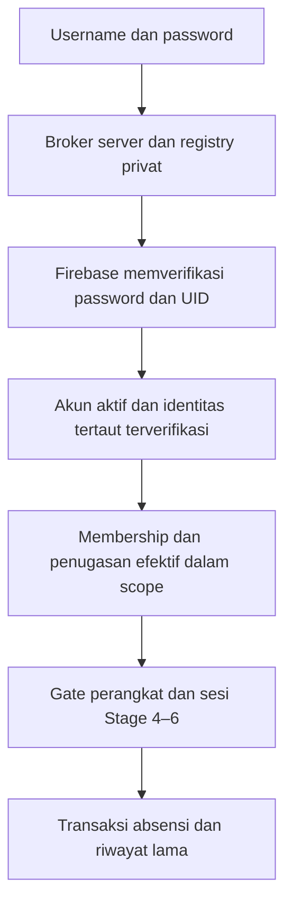

# MSA — Kajian arsitektur akun personal

**24 Oktober 2026 · AUTH A1: IMPLEMENTED terbatas pada akun fiktif/emulator, flag mati secara default.** Status pengujian aktual ada di [PROJECT_STATUS.md](PROJECT_STATUS.md). Bagian A1 berikut memperbarui status kajian awal; bagian 1–11 merekam rancangan/migrasi yang lebih luas dan tidak mengaktifkan fitur lanjutan. Kajian awal berdasarkan HEAD `370714c4da0a370a928dea0a77d130f3a11f9aca`; penyempurnaan UI PIC berdasarkan HEAD `88f88c1cfee4187b4189b134c557286b8b7fabdb`. [MASTER_BRIEF.md](MASTER_BRIEF.md) tetap acuan kebutuhan; [MSA_PRODUCT_VISION.md](MSA_PRODUCT_VISION.md) memuat konteks perluasan.

## AUTH A1 — kontrak implementasi lokal

Lingkup A1 yang diminta pengguna mengizinkan broker/registry dan pengelolaan role untuk akun uji terisolasi. Tidak mengubah login utama email/password atau akun/perangkat lama. `ABC_MSA_A1=1` hanya dikenali oleh instance autentikasi yang sudah lolos seluruh gate Auth/Firestore Emulator, project `demo-abc-attendance`, loopback dan larangan konfigurasi produksi. Tanpa flag, endpoint `/api/a1/*`, halaman `/a1.html` dan skripnya tidak tersedia. Menonaktifkan flag saat proses berjalan menolak operasi; restart diperlukan untuk mengubah ketersediaan modul.

### Akun, identitas dan username — IMPLEMENTED A1

- Koleksi privat `msaAccounts/{uid}` dan `msaUsernames/{canonical}` di namespace emulator yang sama, terpisah dari `adminAccounts` lama. Tidak ada backfill. UID baru deterministik dari namespace + ID permintaan fixture; alias stabil `<uid>@msa.example.invalid`, tidak bergantung pada username atau telepon. Satu UID menyimpan beberapa role, bukan akun terpisah per role. Target satu manusia satu akun memerlukan review/linking A2; username unik saja tidak membuktikan manusia yang sama.
- Grammar A1: trim, ASCII `^[a-z0-9][a-z0-9._-]{2,31}$`, canonical lowercase, bentuk tampilan dipertahankan. Unicode/confusable ditolak. Nama cadangan: `admin`, `administrator`, `superadmin`, `root`, `system`, `support`, `api`, `msa`, `abc`, `login`, `register`, `null`, `undefined`. Rename/recycle belum tersedia; reservasi gagal tetap ditahan.
- Profil: nama lengkap, metadata opsional `preferredName`, telepon supplied/normalized dan status supplied terpisah dari verified. Terima `08…`, `628…`, `+628…` serta spasi/kurung/hyphen; canonical `+628` diikuti 8–11 digit. Ini validasi bentuk seluler Indonesia terbatas, bukan verifikasi kepemilikan/nomor aktif atau metadata operator nasional. Tidak menetapkan klaim phone Firebase dari input ini.
- State akun: `pending`, `active`, `suspended`, `disabled`; provisioning `reserved`, `ready`, `failed`. Akun baru pending/unverified dan tidak mempunyai role/eligibility. `provisionFixture` hanya helper trusted dengan marker fiktif eksplisit, tanpa endpoint registrasi. Tes menetapkan review/eligibility melalui fixture server, bukan input UI. Approval, perubahan kontak, linking mentor/volunteer dan recovery masih PLANNED.
- Reservasi canonical dan akun dalam transaksi tunggal: satu pemenang untuk kapital berbeda; retry request yang sama mempertahankan UID. Auth dan Firestore tidak berbagi transaksi: jika gagal, registry tetap reserved dan akun failed; tidak bisa login/diotorisasi. Tidak menghapus alias/Auth user atau membuat UID baru saat retry. Pemulihan partial failure memerlukan rekonsiliasi trusted terpisah; belum ada alat pemulihan otomatis.

### Broker dan sesi — IMPLEMENTED A1

`POST /api/a1/login` mengirim username/password ke backend same-origin. Backend mencari registry privat, lalu memverifikasi password melalui REST Firebase dan mencocokkan UID hasil dengan UID registry. Alias, ID token dan refresh token tidak dikirim ke UI. Password hanya transit ke Firebase, tidak disimpan di koleksi/log/audit. Username salah, password salah, akun pending/unverified/suspended/disabled/failed memakai error generik yang sama; username tidak ditemukan tetap memakai percobaan alias dummy dan lantai waktu 150 ms. Ini mengurangi perbedaan timing, bukan jaminan waktu identik pada provider nyata.

Rate limit Firestore transaksional per namespace: 8 percobaan/canonical dan 60 global per menit kalender, termasuk login berhasil. Kunci username di-hash; limiter berlaku lintas instance/restart, tidak mempercayai IP forwarded. Balasan 429 generik dengan Retry-After 60 detik. Review mitigasi DoS, retensi/pruning limiter dan perlindungan jaringan diperlukan sebelum perluasan.

Sesi aplikasi acak 256 bit, admission di memori server memakai hash bearer; token hanya di closure UI, tanpa localStorage/cookie/URL. Maksimal 30 menit dan tidak melampaui ID token Firebase; tidak ada refresh, restart mengakhiri admission. Maksimal 1.000 sesi per proses. Setiap request memeriksa `verifyIdToken(..., true)`, status identitas/akun dan revision Firestore; semua perubahan role/status menaikkan revision, sehingga sesi lama tetap ditolak setelah reaktivasi. Sesi A1 tidak diterima oleh API Admin lama atau API Mentor/absensi.

Firebase tetap verifier password sesuai [REST password sign-in](https://firebase.google.com/docs/reference/rest/auth) dan pemeriksaan revokasi sesuai [pengelolaan sesi Firebase](https://firebase.google.com/docs/auth/admin/manage-sessions). Emulator memakai token unsigned dan bukan bukti keamanan provider/HTTPS produksi. Alias fiktif ini hanya keputusan A1; namespace provider produksi, recovery dan step-up/MFA belum diputuskan.

### Role dan scope — IMPLEMENTED A1

| Role | Kontrak izin A1 |
|---|---|
| Superadmin (`superadmin`) | Grant sistem eksplisit `{organizationId:null}`; mengelola registry, role/status dan audit. Bootstrap bukan endpoint publik; sesi Superadmin legacy yang diverifikasi server boleh mengelola akun uji tanpa membuat akun personal untuk dirinya. |
| Admin / Pengelola Tim (`admin`) | Grant wajib organisasi tertentu; program/event opsional membatasi lebih lanjut. Tidak mendapat `accounts:manage`, tidak memberi role atau mengubah keamanan global. |
| PIC (`pic`) | Organisasi/program/event eksplisit; tidak dapat mengubah izin dirinya atau orang lain. Delegasi review identitas/penugasan Mentor menunggu A2/adapter domain. |
| Mentor / Relawan (`volunteer`) | Grant berscope tanpa kemampuan administratif. Login tidak memberi izin roster, kelompok default, perangkat atau absensi. |

Tiap grant menyimpan ID deterministik `(role, scope)`, status `active/revoked`; beberapa role/scope didukung satu UID. Organisasi wajib ada dan aktif pada katalog trusted `msaOrganizations`; program/event harus milik organisasi itu. Katalog fiktif ini bukan implementasi modul organisasi/event MSA. Scope organisasi mencakup turunannya, scope program/event membatasi secara eksplisit. Tidak ada default seluruh organisasi untuk Admin/PIC. `POST /api/a1/access` menguji kontrak izin operasional berscope, tanpa membaca atau memutasi data pelayanan. Modul operasional multi-organisasi masih PLANNED dan wajib memakai pemeriksaan transaksional setara saat nanti diimplementasikan.

Mutasi hanya oleh Superadmin aktif (legacy atau A1), diperiksa ulang dalam transaksi. Tidak ada self-change/promosi sendiri. Target harus ada, provisioning ready, active, identitas verified dan eligible untuk pemberian role; tidak ada aturan employment/nama/telepon. Perubahan state tidak memverifikasi identitas. Penangguhan/nonaktif/pending tidak menghapus grants atau audit; role revoked tidak dihidupkan lagi oleh reaktivasi.

`expectedRevision` mencegah overwrite; konflik 409 meminta muat ulang. Receipt `(actor, requestId)` + fingerprint membuat retry/permintaan promosi berulang idempoten tanpa grant ganda. Transaksi membaca actor/target, memvalidasi scope, menulis revision, receipt dan audit atomik. Penjaga bersama dan query transaksional menolak pencabutan/penonaktifan Superadmin A1 aktif terakhir, termasuk dua pencabutan bersamaan. Owner legacy tidak dapat diedit lewat A1. Audit menyimpan actor UID, target UID, state/role/scope sebelum/sesudah, alasan dan timestamp; tidak menyimpan password/token/nomor penuh.

### HTTP, UI dan batas aktivasi

- Registry/list/search (`username`/nama + filter state/role), perubahan role/status dan audit hanya untuk Superadmin. Route `/api/a1/session` hanya profil sesi sendiri; tidak mengekspos alias atau nomor penuh. HTTP same-origin loopback, allowlist field, JSON maksimal 4 KiB, timeout baca 5 detik, cache no-store dan origin/host gate. Firestore browser tetap deny-all, termasuk registry baru. Klaim browser/localStorage, raw ID token dan direct Firebase signup tidak mengotorisasi A1.
- `/a1.html` adalah bagian pengguna terpisah yang memakai desain ABC/CSS yang ada. Superadmin lama mendapat tautan dari Akun PIC hanya ketika flag aktif; login utama tetap. Halaman uji mendukung login username akun fiktif, daftar/filter, profil terpisah dari kontrol izin, indikator role/organisasi, alasan wajib, dialog konfirmasi keyboard dan audit. Aliases tersembunyi. Tidak ada kontrol registrasi/approval/recovery palsu.
- Status suspended/disabled A1 menolak semua sesi A1. Tidak menyatakan suspension global perangkat legacy sudah selesai: tidak ada akun uji yang ditautkan ke perangkat/mentor lama. Adapter legacy/device dan gate suspension atomik di jalur tersebut tetap prasyarat migrasi. Tidak memperluas scope atau role Admin lama, tidak mengganti UID/PIC/kode/proof/TTL/backup/riwayat.
- Batas uji registry: 200 akun, 100 organisasi katalog dan 100 audit terbaru. Pagination, produksi, public registration, onboarding/linking, password recovery, cutover dan Stage 7 tidak diimplementasikan A1.

## 1. Rekomendasi

Pertahankan Firebase Authentication sebagai penyimpan/verifikator password dan UID, dengan lapisan username di backend Node.js yang ada. Pisahkan **akun personal**, **identitas relawan/Mentor**, **keanggotaan dan penugasan**, serta **izin perangkat/sesi**. Satu orang memakai akun yang sama ketika menjadi Mentor, PIC atau memiliki beberapa peran. Login membuktikan akun; akses domain tetap berasal dari relasi yang diverifikasi server.

Migrasi awal sebaiknya mempertahankan UID PIC/Superadmin lama, menautkan `mentorId` tanpa menggantinya, dan tetap memakai gate perangkat Stage 4–6 untuk absensi. Password-only attendance, penghapusan kode aktivasi, tenant Firebase baru dan penyedia OTP belum disetujui. Seluruh rancangan teknis di bawah merupakan usulan, bukan fitur yang tersedia.

## 2. Kebutuhan yang dikonfirmasi pengguna

- Satu akun personal per relawan, terlepas dari jumlah peran; daftar sendiri dengan nama lengkap, nomor telepon, username dan password. Email tidak wajib dan tidak menjadi isian/identitas login yang ditampilkan.
- Dukung undangan dan pendaftaran umum dengan persetujuan. Pendaftaran tidak memberi akses istimewa. Relawan baru harus diverifikasi sebelum menerima izin/penugasan terkait.
- Mentor lama mewarisi kelompok default terverifikasi secara otomatis **setelah penautan identitas terverifikasi**; bukan karena nama, nomor telepon atau kode perangkat cocok.
- Superadmin/PIC dapat menugaskan relawan yang layak dalam cakupan wewenangnya. Kelayakan PIC tidak bergantung pada status full-time; tidak ada pengecualian individu yang ditanam dalam kode.
- Pertahankan catatan mentor, seluruh ID/penugasan, sejarah absensi dan batas keamanan; rancang pemulihan password dan penangguhan akun.

Kontrak Mentor tanpa akun pada AGENTS.md dan implementasi lama tetap menggambarkan perilaku **saat ini**. Kebutuhan akun personal adalah target yang menggantikan asumsi itu setelah migrasi disetujui dan diuji, bukan alasan memutus akses lama dalam kajian ini. Akun Superadmin tetap milik orang yang berwenang, tidak menjadi akun bersama atau akun tambahan hanya karena orang tersebut juga melayani sebagai Mentor.

### 2.1 Kontrak keputusan dan kompatibilitas

**CONFIRMED** berarti kebutuhan target yang diminta pengguna, bukan fungsi yang sudah tersedia. **PROPOSED** berarti keputusan teknis yang direkomendasikan untuk fase broker. Seluruh akun personal/registrasi/linking di tabel ini **NOT IMPLEMENTED**; perapian UI PIC tidak mengaktifkannya.

| Kebijakan | Status/keputusan yang direkomendasikan | Kompatibilitas dan gate |
|---|---|---|
| Akun dan peran | CONFIRMED: satu akun personal per relawan, beberapa role assignment dengan scope/status/revision masing-masing | Pertahankan UID PIC/owner dan `mentorId`; jangan membuat akun baru per peran atau menyalin role berdasarkan nama |
| Form personal | CONFIRMED: Nama lengkap, Nomor HP, Username, Password; login Username + Password tanpa email wajib dalam UX | Backend akun PIC sekarang hanya menerima email/password/actions/grants; tiga field profil baru dan login username menunggu endpoint/broker baru |
| Username unik | CONFIRMED: unik tanpa membedakan kapital. PROPOSED: panjang 3–32 karakter setelah trim; karakter ASCII huruf/angka/titik/underscore/hyphen, diawali huruf/angka | Tolak Unicode/confusable dan input di luar grammar, jangan transliterasi otomatis. Simpan bentuk tampilan dan canonical lowercase; rekomendasi grammar canonical `^[a-z0-9][a-z0-9._-]{2,31}$` |
| Race username | PROPOSED: satu registry canonical privat; reservasi/create atomik, idempotency dan state provisioning | `Kak.Louis` dan `kak.louis` adalah satu kunci. Dua submit bersamaan hanya satu pemilik. Auth dan Firestore tetap perlu rekonsiliasi karena tidak punya transaksi bersama; orphan/pending tidak diberi izin |
| Nomor Indonesia | CONFIRMED: normalisasi Indonesia ke E.164 +62, supplied dibedakan dari verified. PROPOSED: terima `08…`, `628…`, `+628…`; hilangkan spasi/hyphen/kurung yang diizinkan, lalu normalisasi sekali | `081234567890`, `6281234567890`, `+6281234567890` menjadi `+6281234567890` (contoh fiktif, bukan nomor yang diverifikasi). Tolak prefix ambigu seperti `8…`, huruf/ext, country code lain dan `+620…`; jangan menebak nomor |
| Validasi/kepemilikan HP | PROPOSED: validator Indonesia yang disetujui dan batas E.164; simpan supplied, normalized, verifiedAt/method/actor/revision secara privat | Format bukan bukti nomor aktif/pemilik. Maksimal E.164 15 digit bukan validasi nasional lengkap. Perubahan nomor membatalkan status verified. Jangan mengisi klaim nomor Auth dari input belum terverifikasi atau menganggap nomor unik global |
| Lifecycle | CONFIRMED: pendaftar baru tidak berhak istimewa sampai approval/linking. PROPOSED: provisioning → pending verification/approval → active; membership/role/link masing-masing dapat pending/revoked | Login untuk melihat proses verifikasi sendiri boleh, tetapi tidak membuka roster, role PIC, grant perangkat atau sesi |
| Inheritance | CONFIRMED: default Mentor terverifikasi diwarisi setelah explicit identity linking | Link berbukti dan berscope, bukan nama/nomor/kode perangkat; evaluasi default/override efektif dan sesi yang sudah dikonfigurasi, bukan seluruh sejarah sebagai izin aktif |
| Otoritas PIC | CONFIRMED: PIC berwenang boleh approve/link Mentor hanya dalam scope yang diberikan; promosi PIC/hak lebih luas memerlukan Superadmin atau delegasi eksplisit | PROPOSED: kemampuan approve/link terpisah dari assignment dan `pairing:issue`. PIC tidak mengesahkan eskalasi dirinya; link Mentor dengan cakupan di luar reviewer menunggu otoritas yang sesuai |
| Eligibility | CONFIRMED: konfigurasi eligibility/status/provenance per scope, tanpa syarat full-time atau pengecualian individu hardcoded | Persetujuan operasional tetap diperlukan. Allowlist Mentor demo bukan sumber eligibility personal; jangan menghapus safeguard lama sebelum adapter baru siap |
| Suspension | CONFIRMED: suspend akun harus menolak sesi personal dan device legacy milik akun pada request/transaksi berikutnya | NOT IMPLEMENTED: status PIC sekarang bukan suspension global Mentor. Gate akun/revision/epoch harus dibaca pada semua jalur, termasuk device/backup/receipt; Auth disabled saja tidak cukup |

Rujukan format: [ITU E.164](https://www.itu.int/rec/T-REC-E.164/en), [kode negara Indonesia](https://www.itu.int/oth/T0202.aspx?lang=en&parent=T0202) dan [Firebase user fields/E.164](https://firebase.google.com/docs/auth/admin/manage-users). Pemilihan validator/metadata nomor belum dilakukan; tidak memasang dependency baru dalam pekerjaan UI ini.

**PROPOSED pilihan provider:** pertahankan Firebase password provider dan pilih broker username → UID → identifier internal sebagai rancangan minimal. Alias internal berbasis UID/ID acak untuk akun baru, identifier lama untuk PIC yang sudah ada, tidak dikirim ke UX dan bukan alamat recovery. Ini menghindari password store aplikasi sendiri dan menjaga UID/password lama. Kekurangannya: broker menangani credential transit, registry, redaction, rate limit, sesi dan recovery tanpa email; izin namespace alias dan kanal recovery masih gate sebelum implementasi. Custom auth memerlukan verifier kredensial tersendiri dan tidak otomatis lebih sederhana.

Broker harus memverifikasi password melalui Firebase, mencocokkan UID hasil dengan registry, menolak account/membership yang tidak sah, dan menerbitkan sesi aplikasi opaque. Terapkan TLS kelak, batas ukuran/attempt, respons generik, audit tanpa credential/nomor penuh, serta reauth tindakan sensitif. Signup langsung Firebase tidak memberi izin domain. Jangan memakai custom token sebagai pembuktian password atau registry publik untuk mengungkap identifier akun. Proses uniqueness/approval/link/suspension harus diuji race dan gagal tertutup saat penyimpanan/provider tidak tersedia.

**Cutover yang direkomendasikan:** pertahankan kode 48 jam, proof perangkat, expiry dan revocation Stage 4–6 selama transisi. Link perangkat lama hanya melalui verifikasi pemilik/proof; device tak teratribusi diselesaikan sebelum gate akun wajib. Sesudah gate aktif, suspend/reset sesuai epoch tidak boleh jatuh ke jalur legacy tanpa pemeriksaan akun; login baru tidak memperpanjang grant atau menyalin backup. Keputusan menghapus kode atau membuat password-only attendance belum disetujui. Fase A1 dimulai terbatas setelah A0; A2–A4 termasuk recovery/suspension harus lulus sebelum onboarding umum/cutover.

### 2.2 Batas UI PIC yang tersedia

Halaman Akun PIC saat ini tetap khusus Superadmin, dengan Email akun dan Kata sandi awal serta tindakan/cakupan yang diperiksa server. Label lama “Email fiktif” diringkas menjadi “Email akun”; petunjuk .test/.example.invalid tetap terlihat karena backend memang mensyaratkannya. Tidak menambah field Nama lengkap/Nomor HP/Username yang belum disimpan atau mengganti login menjadi username semu. API, UID, password lama dan kontrak autentikasi tidak berubah.

Perapian memakai section/card untuk detail akun, tindakan, cakupan per sekolah/ID sesi dan daftar PIC; label `for/id`, bantuan `aria-describedby`, ringkasan/inline error, focus visible dan target label sentuh minimal 44 piksel. Validasi izin mempertahankan input ketika gagal; status Nonaktif/Dicabut mempertahankan cakupan tersimpan sebagaimana backend. Acuan prinsip, bukan salinan branding: [W3C grouping](https://www.w3.org/WAI/tutorials/forms/grouping/), [W3C feedback](https://www.w3.org/WAI/tutorials/forms/notifications/) dan [GOV.UK hint text](https://design-system.service.gov.uk/patterns/question-pages/).

## 3. Kondisi aktual yang diperiksa

| Area | Temuan kode dan dampaknya |
|---|---|
| Admin/PIC | [backend/admin-auth.mjs](backend/admin-auth.mjs), [backend/admin-session-http.mjs](backend/admin-session-http.mjs): email/password diverifikasi melalui REST Auth Emulator; `verifyIdToken(..., true)` dan admission per-login server. Bearer saat ini berisi ID token plus nonce acak, hanya hash handle diakui server; bukan username login atau sesi produksi. Limiter login lokal masih process-local. |
| Role/scope | [backend/admin-accounts.mjs](backend/admin-accounts.mjs): `adminSecurity/owner`, `adminAccounts/{uid}`, state/revision, dan `adminPairingPermissions`. Tindakan PIC adalah `pairing:read/issue/revoke`; hanya Superadmin mengelola akun PIC. Tidak ada syarat employment/full-time. Record role tunggal belum memodelkan beberapa peran per orang. |
| Mentor/perangkat | [backend/device-pairing.mjs](backend/device-pairing.mjs), [backend/device-proof.mjs](backend/device-proof.mjs), [device-storage.js](device-storage.js): kode acak di-hash, tepat 48 jam, sekali pakai, assignment diselesaikan server; perangkat P-256/proof/nonce, credential ter-hash, akses maksimal satu jam dan akhir tanggal pelayanan WIB. IndexedDB menyimpan kunci non-exportable dan bearer terenkripsi; ini bukan bukti identitas manusia. |
| Default Mentor | [mentor-config.js](mentor-config.js), [assignments.js](assignments.js): `mentorId` stabil dapat dipakai di beberapa sekolah; default bertanggal efektif, override dan snapshot historis terpisah. Tidak ditemukan direktori username/telepon terverifikasi untuk menautkan akun. Allowlist Mentor pada prototipe lama bukan model kelayakan relawan/PIC baru. |
| Backup Stage 6 | [backend/backup-assignments.mjs](backend/backup-assignments.mjs): grant terikat perangkat, hash credential, primary assignment dan target; penerbit diperiksa ulang melalui policy PIC. Revoke/expiry berlaku pada server, penugasan tidak mengganti mentor tetap. Belum ada UID personal operator Mentor atau pemeriksaan suspension akun Mentor. |
| Absensi/Firestore | [backend/firestore-emulator.mjs](backend/firestore-emulator.mjs), [backend/attendance.mjs](backend/attendance.mjs), [firestore.rules](firestore.rules): namespace emulator, browser direct access ditolak seluruhnya, Admin SDK melewati rules sehingga backend wajib mengotorisasi. Transaksi memeriksa device/scope, revision, receipt, lock sesi dan history. Login Firebase saja tidak memenuhi kontrak attendance. |
| Registrasi/recovery | Belum ada self-registration, undangan akun, username registry, pengaitan identitas atau pemulihan personal. Pembuatan PIC sudah memakai state setup-pending/failed karena Auth dan Firestore tidak satu transaksi. [local-demo.mjs](local-demo.mjs) menyediakan reset pemilik demo lokal dengan konfirmasi; bukan recovery personal tanpa email. |

## 4. Kelayakan Firebase Authentication

Provider password Firebase memakai **email + password**, bukan field username. REST mengembalikan UID/token setelah verifikasi password. Karena itu username memerlukan adapter aplikasi; mengganti label form saja tidak cukup. [Dokumentasi REST Firebase](https://firebase.google.com/docs/reference/rest/auth).

| Pilihan teknis | Penilaian |
|---|---|
| **Usulan utama:** username privat → UID → identifier login Firebase internal | Akun baru memakai alias email teknis yang valid/unik dan stabil berbasis ID acak/UID, tidak berdasarkan nomor telepon atau username. Akun PIC lama tetap memakai identifier internal yang sudah ada sehingga UID/password tidak perlu diganti. Alias bukan alamat recovery, tidak ditampilkan atau ditandai sebagai email terverifikasi. Broker server memverifikasi password ke Firebase lalu memastikan UID hasil sama dengan mapping dan account state. |
| Firebase custom authentication | Secara resmi memungkinkan backend menerima username/password dan menerbitkan custom token **setelah autentikasi berhasil**. Namun custom token tidak memverifikasi password dengan sendirinya; jika membangun verifier sendiri, beban penyimpanan password/hash dan recovery bertambah. Bukan rekomendasi minimal. [Custom authentication Firebase](https://firebase.google.com/docs/auth/admin/create-custom-tokens). |
| Penyedia identitas lain dengan username native | Dapat dikaji jika alias internal dilarang. Menambah migrasi kredensial/integrasi dan belum dipilih; tidak perlu mengganti arsitektur sekarang. |

Admin SDK mengelola user, password dan disabled state; jangan menganggap `getUser` atau `createCustomToken` sebagai pengecekan password. Jangan menyimpan salinan password/hash di Firestore, log, audit atau localStorage. [Admin user management](https://firebase.google.com/docs/auth/admin/manage-users).

Usulan broker hanya mengembalikan sesi aplikasi opaque dan proyeksi profil aman, bukan alias internal, refresh token atau data kontak. Pola admission per-login dapat dipakai ulang, tetapi bentuk bearer lama yang memuat JWT perlu dikaji saat kontrak sesi baru dibuat. Perubahan username tidak mengganti UID/alias internal; username lama tidak langsung didaur ulang. TTL/refresh sesi, bearer di memori versus cookie HttpOnly+CSRF, dan step-up untuk hak istimewa harus diputuskan sebelum implementasi. Untuk produksi kelak wajib HTTPS, verifikasi token bertanda tangan/project yang benar dan penyimpanan rahasia yang disetujui; mode emulator unsigned tidak boleh dipromosikan menjadi autentikasi produksi.

## 5. Model identitas dan izin yang diusulkan

Nama berikut konseptual; belum membuat koleksi/index baru.

| Konsep | Invariant |
|---|---|
| Akun personal (`personalAccounts/{uid}`) | UID stabil, username tampilan, nama, state, revision/securityEpoch. Satu akun kanonik per identitas orang yang telah diverifikasi dalam realm MSA; peran bukan akun baru. Profil tanpa akun boleh tetap sebagai arsip belum diklaim selama migrasi. |
| Registry username | Klaim canonical username unik dan atomik ke UID sesuai kontrak 2.1; rekomendasi 3–32 karakter ASCII. Reserved names/rename/retensi masih keputusan produk. Tidak memakai `displayName` Firebase sebagai kunci unik. Registry tidak dapat dibaca publik. |
| Kontak privat | Nomor supplied, normalisasi Indonesia +62 dan status verifikasi/waktu/metode terpisah sesuai kontrak 2.1. Nomor bersama/daur ulang bukan dasar merge otomatis; jangan menganggap format valid sebagai bukti kepemilikan. |
| Pemetaan identitas (`mentorIdentityLinks`) | Namespace + `mentorId` lama → akun/person kanonik, status terverifikasi, bukti terkontrol, actor, cakupan/revision dan timestamps. Satu Mentor kanonik tidak boleh diklaim dua UID aktif secara bersamaan. Beberapa ID lama hanya ditautkan ke orang sama setelah peninjauan, tanpa mengganti ID historis. |
| Membership/role/eligibility | Akun global terpisah dari keanggotaan organisasi, eligibility dan kemampuan mengelola orang/penugasan. Seseorang boleh menjadi Mentor dan PIC sekaligus; izin berlaku per organisasi/sekolah/kelompok/sesi. Status pekerjaan tidak menjadi predicate kelayakan PIC. |
| Penugasan domain | Default Mentor/override/backup yang ada tetap sumber kebenaran untuk pelayanan sekolah. Relasi MSA baru kelak memakai adapter eksplisit, tidak mengubah session ID menjadi tanggal atau event ID. |
| Sesi dan device association | Hubungan akun terverifikasi dengan perangkat existing, revision/epoch dan proof. Login di perangkat lain tidak menyalin credential/grant atau menghidupkan kembali kode tertebus. |

**Warisan otomatis:** setelah link terverifikasi, server mengambil default yang berlaku untuk `mentorId`, tanggal dan sesi yang dikonfigurasi, dalam organisasi/cakupan link yang disetujui. Tidak perlu menugaskan ulang setiap kelompok lama. Tidak mengimpor seluruh riwayat sebagai izin aktif, tidak memperluas izin PIC, tidak membuka profil privat anak, dan tidak membuat grant perangkat atau sesi hanya karena login/tanggal dipilih. Jika PIC hanya berwenang atas sebagian cakupan Mentor, link di luar wewenangnya harus menunggu reviewer berwenang, bukan dilegalkan lewat inheritance global.

**Izin operasi usulan:** akun aktif + link/membership yang relevan + tindakan/cakupan server + sesi valid + penugasan default/backup efektif + device grant/proof yang sah + batas waktu. Untuk backup, operator harus tertaut pada primary Mentor perangkat; kelompok backup tetap mengikuti grant Stage 6, bukan menjadi default baru.

## 6. Registrasi, undangan dan pencegahan duplikat

1. Registrasi umum menerima empat isian yang diminta, tetapi tidak menerima role, `mentorId`, scope, approval atau verified flag dari browser. Akun pending hanya dapat mengelola proses verifikasinya sendiri; tidak mendapat daftar Mentor/roster publik atau akses admin.
2. Klaim username menggunakan transaksi/unique reservation dan idempotency. Auth dan Firestore tidak punya transaksi bersama: buat proses provisioning yang dapat direkonsiliasi, state pending/failed, penolakan default dan retry yang tidak membuat UID kedua. Orphan Auth user atau signup langsung ke Firebase tetap tidak memiliki izin domain tanpa record aplikasi yang sah.
3. Undangan adalah objek terpisah dari kode aktivasi perangkat: rahasia acak kuat yang di-hash, sekali pakai/expiry, penerima dan scope, actor/revision, status/revokasi. Penerima tetap membuktikan identitas; undangan bocor tidak cukup untuk mengklaim Mentor atau PIC. Redeem memeriksa ulang wewenang penerbit dan target. Gunakan akun yang sudah ada bila penerima sudah terdaftar; jangan membuat akun per undangan. TTL dan kanal pengiriman undangan belum diputuskan; tidak otomatis mengikuti 48 jam Stage 4. Jangan memasukkan rahasia dalam log/URL publik.
4. Verifikasi kontak dan penautan identitas dipisah dari persetujuan organisasi/eligibility. Nama yang cocok atau OTP telepon saja bukan bukti bahwa pemilik nomor adalah Mentor historis. Reviewer berwenang memakai bukti independen dan mencatat keputusan; konflik diparkir untuk peninjauan.
5. Usulan kewenangan: Superadmin mempertahankan kontrol pemberian kemampuan administratif; PIC dapat memverifikasi/menugaskan relawan dalam scope melalui kemampuan baru yang eksplisit bila didelegasikan. PIC tidak boleh menyetujui eskalasi dirinya, memberi hak di atas penerbit, atau mewariskan `accounts:manage`. Jangan memperluas arti `pairing:issue` lama menjadi seluruh administrasi relawan.

Username unik hanya mencegah benturan nama login, bukan menjamin satu manusia satu pendaftaran. Dengan nama/telepon saja, duplikat orang tidak dapat dihilangkan secara pasti. Target satu akun kanonik ditegakkan pada verifikasi/link/approval; kandidat duplikat tidak diberi akses sampai direkonsiliasi. Jangan menetapkan nomor telepon unik global sebelum kebijakan nomor bersama dan pemulihan disetujui. Kontak lintas organisasi tetap privat meskipun akun global sama.

## 7. Migrasi dan hubungan dengan Stage 6

| Populasi/dependensi | Jalur minimal yang diusulkan |
|---|---|
| PIC/Superadmin yang sudah punya Auth UID | Setelah login lama/reautentikasi dan review identitas, reservasi username untuk **UID yang sama**. Pertahankan owner marker, password, tindakan, scope, revision dan actor audit lama. Tambahkan kemampuan akun personal, bukan membuat PIC kedua atau mempromosikan semua pendaftar. |
| Mentor yang belum punya akun | Registrasi/undangan → verifikasi → link `mentorId` → inheritance default. Mentor lama tidak dapat dibuktikan oleh kepemilikan browser/kode perangkat saja; jangan membuat password awal bersama atau menebak nomor telepon. |
| Orang sudah punya PIC UID dan registrasi baru | Blok merge otomatis. Usulan utamakan UID PIC/owner lama sebagai akun kanonik setelah pembuktian kedua identitas/review; bekukan duplikat pending dan rekonsiliasi username/link dengan audit. Jangan menyalin role/password atau menulis ulang actor/history lama; langkah detail konflik perlu dry-run. |
| Penugasan/perangkat backup | Pertahankan ID row, original/primary/target Mentor, `deviceId`, hash credential, expiry dan audit lama. Tambahkan asosiasi akun berversi saat kelak diperlukan; jangan menargetkan ulang row ke perangkat baru atau mencatat akun sebagai operator historis yang belum terbukti. Perangkat baru tetap membutuhkan aktivasi dan penugasan eksplisit. |
| Suspension dan grant | Gate baru harus dipasang di `credentials.authenticate`, resolusi backup, HTTP terproteksi dan transaksi absensi, bukan hanya login/Admin UI. Akun operator, membership/link, penerbit dan revision dibaca ulang; pencabutan harus berkonflik atomik dengan write seperti Stage 6. Menonaktifkan akun Auth saja tidak mencabut bearer perangkat lama yang sekarang berdiri sendiri. |
| Kompatibilitas/cutover | Inventarisasi device tanpa akun dan kode pending; jalur kompatibilitas terbatas/tercatat, tidak menjadi fallback setelah login ditolak. Sebelum akun menjadi gate wajib, device tak teratribusi harus berakhir/dicabut dan diverifikasi ulang lewat proses yang disetujui. Membaca akun baru tidak boleh memberi akses melalui jalur legacy yang mengabaikan suspension. |
| Snapshot/rollback | Dry-run mapping, snapshot terverifikasi, manifest/checkpoint migrasi, rekonsiliasi ID/jumlah/revisi, dan retry idempoten. Rollback adapter tidak menghapus riwayat atau menyalakan grant dicabut. Setelah cutover, fallback yang mengabaikan suspension bukan rollback aman; hentikan write baru bila gate tidak tersedia. Restore snapshot lama membutuhkan peninjauan ulang status/revokasi. |

Stage 6 tidak memblokir kajian ini dan tidak perlu ditulis ulang. Ada konflik kontrak nyata bila username login langsung menggantikan device capability: absensi saat ini mensyaratkan proof perangkat, dan backup terikat primary/credential yang spesifik. Rekomendasi fase awal menambahkan identitas manusia **di atas** kontrak tersebut. Menghapus kode, mengubah TTL, atau memakai akun untuk menyetujui perangkat tanpa kode adalah keputusan terpisah yang belum disahkan.

## 8. Pemulihan password, suspension dan keamanan

**Recovery tanpa email:** alias teknis tidak dapat menerima email reset. Usulan jalur pertama adalah challenge ke nomor yang telah diverifikasi, jika penyedia/biaya/penanganan penyalahgunaan disetujui. Bila tidak ada kanal tepercaya atau nomor hilang/berpindah pemilik, gunakan peninjauan identitas oleh petugas berwenang; untuk pemilik/Superadmin gunakan prosedur pemulihan terkontrol dengan reviewer independen bila tersedia. Nomor baru yang baru diketik, jawaban tentang siswa, kode perangkat, undangan atau pengetahuan username tidak cukup. Tidak ada reset otomatis atau petugas yang mengetahui password pengganti.

Setelah bukti disahkan, server mengeluarkan otorisasi reset terbatas, sekali pakai, di-hash, dengan expiry/rate limit dan binding akun/revision. Pengguna memilih password baru yang dikirim hanya ke verifier tepercaya. Reset mengubah credential Firebase untuk UID yang sama, menaikkan epoch aplikasi dan menutup sesi lama; grant perangkat tidak otomatis ikut dicabut oleh Firebase sehingga perlu kebijakan aplikasi eksplisit. Reset tidak menyetujui pendaftaran, membuka suspension atau menambah role/scope. Rekomendasi untuk recovery/kompromi: tutup akses perangkat milik akun terkait dan pending recovery/invite yang berisiko, pertahankan row/audit/absensi, lalu otorisasi perangkat kembali secara eksplisit. Dampak pada undangan/grant yang pernah diterbitkan PIC harus diputuskan, bukan diasumsikan sama dengan reset demo Stage 3 yang sekarang mempertahankan izin perangkat.

**Suspension:** bedakan penangguhan global akun, pencabutan membership/role pada scope tertentu, dan pencabutan satu perangkat. Usulan state/revision server menjadi penolakan segera pada request/transaksi berikutnya; penangguhan global lalu disinkronkan ke Firebase disabled/revoke refresh tokens. Bila API Auth gagal, deny aplikasi tetap berlaku dan sinkronisasi menunggu retry. Reactivate memerlukan actor/reason berwenang, bukan otomatis menghidupkan sesi, link atau grant yang sudah dicabut. Akun sendiri/PIC tidak dapat menonaktifkan/mengambil alih owner di luar kewenangannya. Simpan sejarah, bukan delete user sebagai cara suspend.

Firebase membedakan refresh-token revocation dan pemeriksaan ID token; gunakan pemeriksaan revocation dan state aplikasi, jangan menunggu token kedaluwarsa untuk menjamin suspend. [Firebase session management](https://firebase.google.com/docs/auth/admin/manage-sessions).

Kontrol tambahan yang perlu dibangun: rate limit persisten untuk login/registrasi/invite/link/recovery, respons generik dan pencegahan enumerasi username/telepon, pembatasan percobaan reset, reautentikasi/step-up tindakan sensitif, CSRF bila cookie dipilih, CSP/XSS, origin/TLS, expiry server, audit tanpa password/token/telepon penuh, proyeksi kontak minimal dan retensi. Password policy server/provider harus konsisten; jangan memaksa reset massal akun lama tanpa keputusan migrasi. Perlindungan enumerasi Firebase tidak otomatis melindungi registry username buatan aplikasi. [Firebase password policy dan enumeration protection](https://firebase.google.com/docs/auth/web/password-auth).

## 9. Fase implementasi minimal yang direkomendasikan

Fase ini **usulan**, tidak menetapkan nomor Stage baru atau memulai Stage 7/fitur MSA lain.

| Fase | Lingkup | Gate penerimaan sebelum lanjut |
|---|---|---|
| A0 — keputusan kontrak | Pilih broker/alias, realm akun, policy username/telepon, verifier/recovery, matriks approval/assignment dan kompatibilitas perangkat | Pemilik produk/security menyetujui keputusan bagian 11; tidak ada code/data change |
| A1 — identitas dan username | Adapter akun/registry privat, state/revision, username login; enrolment username akun PIC dengan UID lama; invite/registrasi masih terbatas/flag | Race username satu pemenang; pending/no-profile ditolak; password/UID lama tetap; retry provisioning fail-closed |
| A2 — onboarding dan linking | Undangan + registrasi umum pending, verifikasi/approval, review duplikat, tautan Mentor dan inheritance default | Link hanya sesudah bukti, duplicate claim ditolak, tidak ada auto-role atau kebocoran kontak/roster |
| A3 — operasi dan Stage 6 | Adapter role/assignment, account-device association, gate akun dalam transaksi dan pencabutan lintas jalur | Seluruh regresi Stage 1–6 dan race suspend/revoke/write lulus; default/backup/ID/histori tetap |
| A4 — recovery/suspension dan cutover terbatas | Kanal recovery disetujui, epoch/revoke, rekonsiliasi/rollback, manual QA dan pilot data fiktif | Recovery tidak bisa mengambil alih akun; tidak ada legacy bypass, snapshot/rollback diuji; operasi approval tersedia sebelum pendaftaran umum dibuka |

Recovery/suspension harus siap sebelum membuka onboarding luas, walau prototipe login dapat diuji lebih dahulu dengan flag dan akun fiktif. Tidak ada pemasangan dependensi, SMS, billing atau produksi yang diizinkan oleh fase dokumentasi ini.

## 10. Rencana validasi implementasi kelak

**Belum dijalankan; bukan hasil PASS fitur akun baru.** Gunakan emulator/namespace/port serta data fiktif terpisah, dan inspeksi HTTPS/provider nyata kelak sebagai gate terpisah, bukan inferensi dari emulator.

| Area | Acceptance test wajib |
|---|---|
| Username/password | Login tanpa email tampilan; panjang 2/3/32/33, kapital berbeda dan confusable/rename, credential salah generik, password policy; perubahan username tidak mengubah UID/password/izin |
| Nomor HP | `08…`/`628…`/`+628…` setara; separator yang diizinkan konsisten; prefix ambigu/non-ID, `+620…`, nomor terlalu panjang/huruf/ext ditolak; supplied tidak menjadi verified; nomor diganti/bersama/daur ulang tidak auto-link atau membuka recovery |
| Registrasi/provisioning | Dua pendaftar username sama satu pemilik; crash sebelum/sesudah create Auth tidak memberi akses; retry satu UID; signup langsung Firebase/orphan tidak mengotorisasi domain |
| Undangan | Penerima salah, token bocor/expired/revoked/used, issuer kehilangan izin dan redeem bersamaan ditolak; user existing tidak menjadi akun kedua |
| Linking/duplikat | Dua UID mengklaim Mentor satu pemenang; nama/nomor sama tidak auto-link; PIC scope sempit tidak mengklaim mentor lintas scope; konflik PIC UID dengan registrasi baru perlu review |
| Inheritance | Semua default milik identitas terverifikasi dalam scope tersedia otomatis, tanggal efektif/override/snapshot benar; nol assignment/expired/missing session tidak memberi akses; multi-sekolah tidak bocor lintas organisasi |
| Multi-role/eligibility | Satu UID menjadi Mentor dan PIC tanpa akun kedua; relawan non-full-time tetap dapat dinilai layak; browser role flag/self-approval/out-of-scope role grant ditolak |
| Perangkat/Stage 6 | Username login tidak melewati pairing; proof/nonce/replay, kode 48 jam/single-use, batas satu jam/akhir WIB, backup multi-kelompok dan revoke segera tetap; perangkat baru tidak mewarisi credential lama |
| Recovery | Kontak tak terverifikasi/nomor diganti/token salah atau replay ditolak; reset UID sama, password baru dipilih user, sesi/perangkat sesuai epoch dicabut; gagal sinkron Auth tetap deny |
| Suspension/konkurensi | Suspend global dan revoke scope terisolasi; race suspend/revoke/finalize/receipt/write punya urutan atomik; fallback legacy/claim basi tidak membuka akses; reactivate tidak memulihkan grant dicabut |
| Data/migrasi/operasi | UID PIC/owner, seluruh ID/batch/history/default dan audit lama identik; dry-run/idempotensi/checkpoint/restore/rollback, private student/contact fields, rate limit/redaction, kalender non-Jumat dan regresi Stage 1–6 |

## 11. Keputusan yang masih terbuka

1. **Backend identifier:** apakah alias email teknis internal diperbolehkan? Jika ya, pilih namespace/domain teknis dan aturan agar tidak dipakai recovery/ditampilkan. Larangan email dalam UX sudah dikonfirmasi; larangan email dalam penyimpanan provider belum ditetapkan.
2. **Username dan nomor:** gunakan rekomendasi grammar/3–32 dan normalisasi +62 bagian 2.1 sebagai kontrak kandidat; pengesahan grammar final, reserved names/rename/retensi, validator/metadata nomor, verifikasi, nomor bersama/daur ulang dan pembaruan kontak masih gate implementasi. Case-insensitive uniqueness dan pemisahan supplied/verified sudah merupakan kebutuhan target.
3. **Identitas/approval:** otoritas PIC approve/link dalam scope dan larangan eskalasi sudah ditetapkan sebagai kebutuhan. Tentukan reviewer, bukti, kemampuan delegasi dan siapa yang mengelola konflik lintas scope/UID; promosi administratif memerlukan Superadmin/delegasi eksplisit. Kelayakan dapat dikonfigurasi dan tidak bergantung employment.
4. **Realm dan privasi:** satu akun dalam realm MSA dengan membership per organisasi direkomendasikan; isolasi organisasi/penanggung jawab data, penautan lintas realm/tenant dan akses reviewer masih perlu persetujuan. Jangan membuat Firebase tenant per organisasi bila target satu login belum dirancang kompatibel.
5. **Gate perangkat:** pertahankan kode/proof Stage 4–6 saat transisi direkomendasikan. Apakah kelak akun boleh mengotorisasi perangkat tanpa kode, masa coexistence, dan penanganan device lama/pending code memerlukan keputusan eksplisit.
6. **Recovery/step-up:** OTP atau verifikasi manusia, penyedia/biaya/TTL/attempt limit, recovery pemilik tanpa reviewer kedua, MFA untuk hak istimewa dan kebijakan sesi/perangkat/grant terbitan PIC sesudah reset.
7. **Sesi/cutover:** durasi sesi/refresh, media sesi browser, operator yang berwenang suspend global/per-scope, rekonsiliasi duplikat existing UID, urutan pilot dan gate rollback. Kewajiban deny akun suspended termasuk legacy device sudah tetap; mekanisme epoch/asosiasi perangkat belum diimplementasikan.

**Hasil penyempurnaan:** kontrak kandidat bagian 2.1 menjadi acuan fase broker berikutnya; blocker operasional di atas tetap harus disepakati. Yang diimplementasikan sekarang hanya perapian/validasi UI PIC dengan API lama. Tidak melakukan migrasi akun, perubahan autentikasi, rules, schema atau grant Mentor. Hasil tes UI/regresi aktual ada di PROJECT_STATUS.md.
