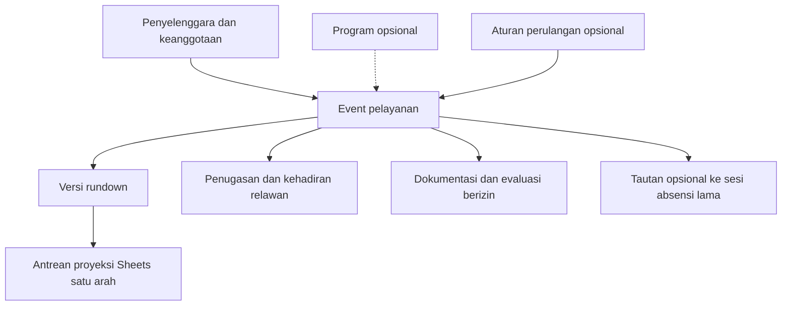

# ABC | Ministry Service App — visi produk dan rencana arsitektur

**Tanggal kajian awal:** 24 Oktober 2026; status Stage 8/9A/9B.1/9B.2 diperbarui 26 Oktober 2026 di bawah. **Modul lanjutan setelah Stage 9B.2: PLANNED / NOT IMPLEMENTED. Pengecualian terbatas: fondasi AUTH A1/A2.1/A2.2/A2.3 akun fiktif/emulator di balik flag mati secara default serta branding dasar sudah IMPLEMENTED.** Kontrak aktual autentikasi ada pada [MSA_ACCOUNT_ARCHITECTURE.md](MSA_ACCOUNT_ARCHITECTURE.md#auth-a1--kontrak-implementasi-lokal), bukti tes pada PROJECT_STATUS.md. Rincian kajian di bawah tetap arah lanjutan; tidak ada registrasi umum, migrasi akun/perangkat atau modul MSA yang diaktifkan.

Dokumen ini berisi rencana, bukan izin implementasi atau perubahan schema. [MASTER_BRIEF.md](MASTER_BRIEF.md) tetap acuan kebutuhan; dokumen ini merinci arsitektur dan roadmap usulannya. [PROJECT_STATUS.md](PROJECT_STATUS.md) mencatat implementasi serta bukti pengujian. Stage 1–6 tetap berlaku; Stage 6 **Backup Mentor / Temporary Group Merge** sudah tersedia dalam lingkup lokal/emulator. Stage 7 **Testing, security, documentation** kini diverifikasi pada lingkup lokal/emulator (hasil dan batasnya di PROJECT_STATUS.md); kajian akun personal tidak mengganti tahap asli atau memberi izin implementasi.

**Pembacaan status:** bagian bertanggal di bawah adalah checkpoint historis; bagian 11 dan revisi terbaru PROJECT_STATUS.md mengatasi pernyataan status tahap yang telah diperbarui kemudian.

## Portal MSA lokal — 27 Oktober 2026

Launcher utama Start MSA / Stop MSA menggantikan shortcut demo/pilot lama. Portal username tanpa pilihan peran memakai sesi server bersama pada origin Admin, dengan modul dari capabilities terverifikasi. Peninjau dan PIC terbatas dibuat lewat setup terminal trusted dengan password berbeda, membership/grants eksplisit dan data fresh fiktif. Backend serta snapshot legacy tetap untuk regresi/migrasi; tidak ada cutover operasional. Alur Mentor tetap memerlukan aktivasi/proof perangkat terpisah. Kontrak sesi ada di MSA_ACCOUNT_ARCHITECTURE.md, penggunaan di README.md, bukti aktual di PROJECT_STATUS.md. Berhenti sebelum Stage 10A.

Penyelarasan UI 27 Oktober menambahkan headline lengkap, beranda berbasis API berizin, label Admin/penanggung jawab pelayanan, sidebar desktop dan navigasi bawah mobile. Login pengelolaan berbagi sesi; Mentor tetap memakai login serta proof pada origin terpisah. Ini perubahan presentasi, bukan migrasi role atau implementasi Stage 10A. Referensi publik, batas dan verifikasi aktual tercatat di README/PROJECT_STATUS.

## Stage 9B.2 — jadwal berulang terbatas dan beranda, 26 Oktober 2026

Implementasi terbatas melalui gate independen `ABC_MSA_STAGE9B2` mati default, khusus Auth/Firestore Emulator fiktif dan bergantung Stage 9B.1/9A/8. Jadwal sekali/mingguan wajib tanggal mulai/hari/zona eksplisit/tanggal akhir, maksimal 12 occurrence dalam 90 hari inklusif, pratinjau semua tanggal dan konfirmasi sebelum transaksi atomik. Semua event mulai sebagai draf dan memiliki ID stabil, parent seriesId, revisi serta audit sendiri. PIC/program/organisasi/grant diperiksa ulang server; preview stale ditolak, retry memakai receipt tanpa duplikasi. Edit/publish/cancel individual mengikuti kontrak lama; occurrence historis tidak ditulis ulang. Tidak ada edit seluruh seri, publikasi otomatis, sesi absensi atau assignment baru.

Beranda memakai data server berscope: published mendatang 90 hari, pelayanan PIC pengguna sendiri, dan draf perhatian hanya bagi pembaca internal dengan izin tindakan. Calendar-only tidak membaca draf; role legacy tidak memberi akses MSA. Query/total unik dibatasi 200 dan overflow menjadi error eksplisit. UI menggunakan komponen/brand lama, pratinjau konfirmasi serta loading/kosong/koneksi/izin. Ekspor Google/ICS manual tetap terpisah per occurrence terbit. Kontrak rinci: MSA_ACCOUNT_ARCHITECTURE.md bagian Stage 9B.2; bukti aktual: PROJECT_STATUS.md. Produksi NO-GO; berhenti sebelum Stage 10. Bagian tahap lama berikut adalah checkpoint historis.

## Stage 9B.1 — pembaruan status terbatas, 26 Oktober 2026

Publikasi draft→published, pembatalan published→cancelled dan kalender gabungan kini IMPLEMENTED hanya pada emulator fiktif dengan gate `ABC_MSA_STAGE9B1` mati default. Grant publish/cancel eksplisit terpisah; edit terbit memerlukan edit+publish. Kalender read-only terbatas dapat diberikan tanpa membuka draf/riwayat draf. Filter server, revisi/audit/receipt, waktu UTC/zona lokal dan ID stabil dipertahankan. Tidak ada hard delete, restore event batal, public sharing, attendance/device/role otomatis atau mapping legacy. Agenda mobile/per hari desktop memakai UI lama. Kontrak/batas provisional dan hasil aktual: MSA_ACCOUNT_ARCHITECTURE.md dan PROJECT_STATUS.md. Stage 9B.2, recurrence, rundown/BibleMax, Sheets, volunteer attendance/analytics dan Christmas workflow tetap PLANNED / NOT IMPLEMENTED; produksi NO-GO. Bagian Stage 9A dan alur konseptual di bawah adalah checkpoint/target yang lebih luas, bukan pernyataan bahwa publikasi dasar ini belum tersedia.

## Stage 9A — pembaruan status terbatas, 26 Oktober 2026

Alur **Buat Pelayanan Baru**, daftar/filter, detail dan edit **draf** kini IMPLEMENTED hanya pada emulator fiktif melalui gate `ABC_MSA_STAGE9A` mati default. Organisasi, nama, tanggal/waktu/zona, tempat dan PIC internal berizin wajib; program nullable. ID stabil, revisi, receipt dan audit disimpan tanpa membuat sesi absensi, credential, program atau hak baru. Grant read/create/edit dan kelayakan PIC eksplisit per organisasi, tidak diwarisi dari role legacy atau ownership. Detail kontrak provisional dan batas zona waktu: MSA_ACCOUNT_ARCHITECTURE.md; hasil aktual: PROJECT_STATUS.md. Tahap 9B publikasi, unified calendar/recurrence dan seluruh rundown/Sheets/relawan tetap PLANNED / NOT IMPLEMENTED; cutover produksi NO-GO. Bagian alur konseptual di bawah memuat target yang lebih luas dari draf ini.

## Stage 8 — pembaruan status terbatas, 26 Oktober 2026

Fondasi organisasi/program, ownership/membership berscope, grant platform terpisah dan adapter legacy baca-saja kini **IMPLEMENTED hanya pada namespace fiktif/emulator** dengan gate `ABC_MSA_STAGE8` mati default. Grant fixture diberikan eksplisit; contoh organisasi/program di visi tidak menetapkan kepemilikan operasional atau akses lintas organisasi. Kontrak aktual/koleksi/permission sementara ada di MSA_ACCOUNT_ARCHITECTURE.md bagian Stage 8; hasil tes di PROJECT_STATUS.md. AUTH A2.4C tetap asesmen tanpa cutover, dan produksi tetap NO-GO. Draf event Stage 9A dan publikasi/kalender Stage 9B.1 memakai gate/grant terpisah di atas. Bagian konseptual berikut tetap rencana lanjutan untuk recurrence/perluasan kalender/rundown/Sheets/kehadiran relawan/Christmas workflow.

## AUTH A2.3 — pembaruan status terbatas

Alur personal Mentor dengan link A2.2 dan asosiasi perangkat Stage 4–6 kini diimplementasikan hanya pada namespace fiktif `test-*`, di balik flag A1/A2.2/A2.3 yang tetap mati default. Login bukan grant absensi; perangkat tertaut memerlukan sesi/link/akun/proof sah dan pemeriksaan transaksi. Perangkat legacy yang belum tertaut tetap terpisah. Tidak ada public registration, linking operasional, recovery atau cutover; modul MSA lain tetap PLANNED. Kontrak dan hasil aktual: MSA_ACCOUNT_ARCHITECTURE.md dan PROJECT_STATUS.md.

## AUTH A2.2 — pembaruan status terbatas

Pendaftaran pending, review identitas berscope dan link UID–Mentor kini diimplementasikan hanya pada namespace fiktif `test-*` dengan A1 + flag A2.2 eksplisit, nonaktif secara default. Resolusi default baca-saja tidak memberi role/akses absensi/perangkat. Tidak ada registrasi publik, linking operasional, asosiasi akun-perangkat, recovery atau cutover; modul produk tetap PLANNED. Bagian A2.1/kajian berikut mencatat keadaan tahap sebelumnya. Kontrak aktual: MSA_ACCOUNT_ARCHITECTURE.md; hasil aktual: PROJECT_STATUS.md.

## AUTH A2.1 — pembaruan status terbatas

Identitas aplikasi/header/login/PWA **ABC | Ministry Service App** sudah diimplementasikan dengan logo ABC asli; Goes to School tetap nama program. Pilot pengikatan username ke UID Admin/PIC lama tersedia hanya pada namespace tes `test-*`, melalui helper trusted dan reautentikasi, dengan flag A1 + pilot eksplisit. Login email tetap default; akun/registry operasional tidak diikat atau diperiksa. Kontrak dan prosedur binding nyata yang belum dijalankan ada di [MSA_ACCOUNT_ARCHITECTURE.md](MSA_ACCOUNT_ARCHITECTURE.md#auth-a21--branding-dan-pilot-username-uid-lama); bukti aktual di PROJECT_STATUS.md. Bagian visi merek di bawah kini merujuk rencana UX/modul lanjutan, bukan menyatakan branding dasar masih belum tersedia. Modul pelayanan, registrasi umum, linking Mentor, recovery dan cutover tetap belum diimplementasikan. Stage 7 memverifikasi fondasi, bukan mengaktifkan modul.

## 1. Kondisi yang diperiksa

| Kondisi saat ini, bukan fitur MSA | Bukti kode yang diperiksa |
|---|---|
| JavaScript ES modules/Node.js; prototipe demo dan jalur Admin/Mentor emulator terpisah | [package.json](package.json), [admin-server.mjs](admin-server.mjs), [secure-admin.js](secure-admin.js) |
| Jadwal semua hari menggunakan `serviceSessionId`, sekolah dan kelompok; sesi bertanggal sama tetap berbeda; revisi, receipt dan audit melindungi perubahan | [backend/service-calendar.mjs](backend/service-calendar.mjs), [tests/emulator/flexible-calendar.test.mjs](tests/emulator/flexible-calendar.test.mjs) |
| Peran Superadmin/PIC serta izin pairing yang dibatasi server; izin `pairing:issue` saat ini juga dipakai untuk jadwal dalam cakupan kelompok operator | [backend/admin-accounts.mjs](backend/admin-accounts.mjs), [backend/service-calendar.mjs](backend/service-calendar.mjs) |
| Admin memakai email/password Auth Emulator dan admission per-login; Mentor memakai device capability, belum akun personal/username. Backup Stage 6 terikat perangkat, primary/target assignment dan credential | [backend/admin-auth.mjs](backend/admin-auth.mjs), [backend/backup-assignments.mjs](backend/backup-assignments.mjs), [MSA_ACCOUNT_ARCHITECTURE.md](MSA_ACCOUNT_ARCHITECTURE.md) |
| Kode Stage 4 berlaku tepat 48 jam, sekali pakai; perangkat terikat kunci/proof dan scope, akses maksimal satu jam serta akhir tanggal pelayanan WIB | [backend/device-pairing.mjs](backend/device-pairing.mjs), [backend/firestore-emulator.mjs](backend/firestore-emulator.mjs) |
| Absensi memakai revisi, idempotensi, kunci transaksi per sesi dan riwayat versi; roster Mentor memakai proyeksi field terbatas | [backend/attendance.mjs](backend/attendance.mjs), [backend/roster.mjs](backend/roster.mjs) |
| Laporan dan XLSX demo tersedia; rekap/ekspor Admin server belum dimigrasikan | [reports.js](reports.js), [secure-admin.js](secure-admin.js), status Stage 5 |

Pada kajian awal sebelum Stage 8/9A, belum ditemukan modul organisasi/program, event umum, rundown, kehadiran relawan atau integrasi Google Sheets dalam aplikasi. `PROJECT.md` tidak ditemukan di root; tidak dibuat dokumen pengganti yang menduplikasi rencana ini. Angka tes Stage 5–6 yang sudah dicatat merupakan bukti historis implementasi, bukan pengujian baru dalam pekerjaan dokumentasi ini. Seluruh aplikasi masih lokal/emulator dan khusus data fiktif; bukan sistem produksi yang telah disahkan untuk data anak nyata.

## 2. Cakupan produk — PLANNED / NOT IMPLEMENTED

MSA menyatukan perencanaan, penugasan, pelaksanaan, dokumentasi dan evaluasi pelayanan. Contoh berikut adalah data konfigurasi, bukan kategori atau daftar organisasi yang ditanam dalam kode:

- **ABC Movement:** Goes to School, pelayanan Natal, pelayanan khusus seperti SD Elyon.
- **Yayasan Anak Bintang Cemerlang:** Pojok Ceria, Bangkit Indonesia seperti kegiatan di LPKA Blitar, dan kegiatan lain.

Penyelenggara adalah pihak pemilik/pengelola kegiatan; program adalah pengelompokan kegiatan yang opsional. Event pelayanan adalah kejadian konkret dengan ID sendiri. Mitra, tempat, PIC internal, PIC eksternal dan relawan mempunyai relasi terpisah; sebuah sekolah atau tempat tidak otomatis menjadi penyelenggara. Program boleh tidak dipilih. Kegiatan reguler, berulang, satu kali dan ad hoc dapat memakai model event yang sama.

MSA tidak otomatis menyatukan izin atau data kedua organisasi. Kepemilikan data, kerja sama lintas organisasi dan siapa yang boleh melihatnya perlu disetujui sebelum implementasi multi-organisasi. Evaluasi awal berupa catatan hasil/tindak lanjut berizin dan agregat sumber yang jelas; tidak mengarang skor dampak pelayanan.

## 3. Alur Buat Pelayanan Baru — PLANNED / NOT IMPLEMENTED

1. Pengguna yang sudah diotorisasi memilih **Buat Pelayanan Baru**. Server membatasi daftar penyelenggara sesuai keanggotaannya; pilihan atau klaim browser tidak memberi kewenangan baru.
2. Form awal hanya mewajibkan **penyelenggara, nama pelayanan, tanggal/waktu mulai, tempat, dan PIC internal**. Zona waktu terlihat jelas, dengan WIB sebagai default awal yang kompatibel. Waktu selesai/durasi acara dapat dilengkapi kemudian. Tempat dapat diisi sebagai label singkat agar tidak harus membuat katalog tempat terlebih dahulu; alamat rinci bukan syarat awal.
3. **Program boleh kosong** dengan pilihan Tanpa program. Mitra, PIC eksternal, relawan, peran, rundown, perulangan dan catatan juga opsional. Menyimpan pelayanan tanpa program tidak membuat program baru secara diam-diam.
4. Simpan sebagai draf ber-ID stabil setelah lima isian minimum valid. Membuka form, memilih tanggal atau menyimpan draf tidak membuat sesi absensi sekolah, kode aktivasi, penugasan relawan atau hak akses otomatis. Pengisian parsial sebelum minimum terpenuhi belum menjadi event tersimpan; kebutuhan autosave parsial masih keputusan terbuka.
5. Lengkapi detail nanti, periksa benturan sebagai informasi operasional, lalu publikasikan dengan izin yang sesuai. Publikasi jadwal dan publikasi rundown mempunyai versi/status terpisah; tidak semua kegiatan harus memiliki rundown.
6. Jadwal gabungan menampilkan event yang berhak dilihat pengguna, dengan filter penyelenggara/program, status dan rentang waktu. Dua event pada waktu/tanggal sama tetap berbeda. Pengeditan memakai revisi dan receipt idempotensi; reschedule tidak mengganti ID.

PIC internal adalah penanggung jawab event, bukan otomatis administrator aplikasi. PIC eksternal adalah kontak mitra dan tidak otomatis mendapat akun atau izin. Mengubah PIC memerlukan aturan server tersendiri, bukan mengganti scope melalui field form.

Perulangan disimpan sebagai aturan terpisah dari kejadian. Pembuatan kejadian harus melalui pratinjau rentang, pengecualian dan konfirmasi yang dibatasi, bukan menghasilkan tanggal tanpa batas. Setiap kejadian mempunyai ID sendiri. Edit satu kejadian atau kejadian mendatang harus dibedakan; riwayat kejadian lampau tidak ditulis ulang. Perulangan tidak menerbitkan kode/perangkat secara otomatis.

## 4. Arsitektur konseptual — PLANNED / NOT IMPLEMENTED

Usulan: pertahankan aplikasi JavaScript/Node.js dan pisahkan modul domain secara bertahap dalam aplikasi yang sama. Tidak ada usulan microservices, penggantian framework/database atau pemasangan dependensi pada tahap ini. Repository/adapter memisahkan model MSA dari kontrak absensi lama; kebutuhan penyimpanan fisik, index dan API harus dirancang serta disetujui pada tahap implementasinya.

Nama di bawah adalah konsep, bukan koleksi/schema yang sudah dibuat atau kontrak API final.

| Konsep usulan | Identitas, relasi dan aturan utama |
|---|---|
| Penyelenggara (`organizations`) | ID stabil, nama dan status. Satu penyelenggara utama per event sebagai usulan awal; kerja sama tidak melebur tenant. |
| Keanggotaan/izin (`organizationMemberships`) | Identitas pengguna + organisasi + tindakan/cakupan + status/revisi. Organisasi terpilih pada UI bukan sumber otorisasi. |
| Program (`programs`) | Milik penyelenggara; nama/metode/template yang dikonfigurasi. `programId` pada event boleh kosong. |
| Event (`serviceEvents`) | ID stabil, penyelenggara, program opsional, nama, waktu/zona, tempat, PIC internal, status/revisi dan riwayat perubahan. Tidak mensyaratkan sekolah atau kelompok. |
| Seri (`recurrenceRules`) | Aturan/rentang/pengecualian serta relasi ke kejadian yang sudah dimaterialisasi. Bukan pengganti ID event. |
| Mitra/tempat/kontak | Mitra, venue dan kontak PIC eksternal dipisahkan. Label tempat dapat di-snapshot pada event; detail kontak/lokasi sensitif dibatasi. |
| Referensi absensi lama (`eventAttendanceLinks`) | Tautan event ke namespace dan `serviceSessionId` lama. Satu sesi lama paling banyak dipetakan ke satu event kanonik; event umum dapat memiliki nol atau beberapa tautan yang disetujui. |
| Akun personal dan profil relawan (`volunteerProfiles`) | Target dikonfirmasi: satu akun personal per relawan, lintas peran, dengan profil/membership per organisasi. Profil arsip belum diklaim dapat tetap tanpa akun selama transisi. Hubungan dengan `mentorId` lama melalui pemetaan terverifikasi, bukan kesamaan nama; detail broker/registry masih usulan. |
| Penugasan/peran (`serviceAssignments`) | Event + relawan + satu/beberapa peran + status penugasan. Dapat direncanakan sebelum kehadiran diketahui. |
| Kehadiran relawan (`volunteerAttendance`) | Satu catatan per event dan relawan, dengan revisi/audit. Tidak memakai koleksi kehadiran anak. |
| Template dan versi rundown | Template dapat berlaku per program/metode; setiap versi mempunyai provenance dan lingkup akses. |
| Rundown event dan versi | Salinan kerja event, sumber versi template opsional, urutan aktivitas tersimpan, draf/publikasi dan revisi. |
| Dokumen/evaluasi pelayanan | Referensi berkas, izin, catatan hasil dan tindak lanjut; akses media tidak diasumsikan publik. |
| Koneksi/job sinkronisasi | Organisasi, target file/tab, versi proyeksi, status, checksum, retry/audit; rahasia koneksi dipisahkan dari data domain. |

Semua entitas baru yang berada dalam organisasi harus divalidasi server terhadap organisasi dan relasi induknya. Namespace emulator yang sekarang ada bukan tenant organisasi dan tidak cukup menjadi kontrol akses MSA. Identitas sekolah, kelompok, mentor, siswa, batch, pelayanan dan catatan lama tidak diubah menjadi ID organisasi/program.

### Jembatan ke Stage 1–6

- Modul absensi Goes to School tetap memakai sekolah, kelompok, mentor tetap, `serviceSessionId`, batch/record, snapshot serta jejak koreksi yang sudah ada. Jangan menggabungkan batch hanya karena tanggal/event sama.
- Pada awal adopsi, pemetaan event ke sesi lama dibuat eksplisit dan dapat dimulai satu banding satu. Tidak setiap event MSA mempunyai absensi anak. Pemetaan lebih dari satu sesi memerlukan aturan agregasi yang jelas agar satu pelayanan tidak dihitung berulang.
- Event baru yang membutuhkan absensi sekolah harus melewati adapter dan otorisasi lama, bukan membuat atau mengubah dokumen absensi dari form umum. Edit tanggal parent tidak boleh diam-diam memindahkan sesi lama atau mempertahankan kode yang semestinya ditolak.
- Waktu event diusulkan disimpan sebagai waktu mulai yang dapat dinormalisasi beserta zona IANA; tanggal lokal diturunkan secara konsisten. Kontrak sesi lama tetap date-only WIB. Batas kode 48 jam serta akses satu jam/akhir hari WIB tidak diinterpretasikan ulang dari waktu acara tanpa persetujuan perubahan kontrak.
- Saat ini Mentor tidak memerlukan login pribadi. Target akun personal menggantikan asumsi tersebut setelah penautan/migrasi disetujui; profil/registrasi saja tidak memberi akses. Default terverifikasi diwarisi setelah link yang sah, tanpa membuat ulang Mentor atau mengganti riwayat. Backup Stage 6 tetap izin sementara per perangkat/sesi, bukan penugasan tetap. Gate akun dan perangkat harus dirancang bersama sebelum cutover; lihat kajian akun.

## 5. Rundown Builder dan BibleMax — PLANNED / NOT IMPLEMENTED

**BibleMax adalah metodologi pelayanan anak yang terintegrasi. Dalam Goes to School, rundown BibleMax mewakili penerapan metodologi tersebut secara utuh; BibleMax bukan subbagian yang ditempelkan pada rundown generik.** Program lain dapat menggunakan metode rundown berbeda.

Template BibleMax adalah titik awal yang fleksibel. Pilihan aktivitas, urutan dan durasinya boleh berubah sesuai tujuan serta kebutuhan pelayanan. Dokumen ini tidak menetapkan tahapan internal, daftar aktivitas wajib, urutan baku atau durasi standar BibleMax. Isi template pertama harus berasal dari materi yang disetujui pemilik metodologi, bukan disimpulkan dari satu contoh Sheets.

Alur editor: pilih template atau mulai kosong → salin versi ke event → tambah/hapus/pindah aktivitas → atur waktu/durasi/PIC/catatan → simpan draf → tinjau → publikasikan versi → bagikan tampilan baca-saja. Menyimpan rundown sebagai template baru merupakan tindakan terpisah dengan pemeriksaan akses dan sanitasi data event.

Istilah sesi/aktivitas pada rundown adalah unit isi acara, bukan `serviceSessionId` pada domain absensi sekolah. Memindahkan aktivitas tidak membuat atau memindahkan sesi absensi.

Usulan aturan penyimpanan:

- Aktivitas mempunyai ID stabil. Urutan kanonik disimpan terpisah sebagai daftar ID berurutan, bukan dihitung kembali dari nama, waktu, tipe atau posisi awal template. Setiap aktivitas harus muncul tepat sekali dalam urutan; perubahan item dan urutan disimpan atomik pada revisi yang sama.
- Reload dan pembukaan perangkat lain harus mempertahankan hasil reorder. Pengubahan bersamaan memakai expectedRevision; konflik tidak diselesaikan dengan menimpa seluruh rundown terbaru. PIC/catatan aktivitas boleh belum diisi dan tetap tampak belum ditentukan, tanpa mengarang nama penanggung jawab.
- Waktu/durasi dapat disesuaikan per aktivitas. Tampilan menunjukkan total/estimasi selesai dan benturan; pengubahan satu durasi tidak diam-diam mengubah waktu event atau aturan akses perangkat.
- Rundown event merupakan salinan dengan provenance versi template, bukan referensi hidup ke isi template. Edit event tidak mengubah template asli. Update template hanya berlaku untuk pemakaian baru kecuali pengguna memilih menerapkan perubahan melalui pratinjau.
- Versi publikasi dibekukan. Revisi berikutnya menjadi draf baru dan tidak membocorkan perubahan belum dipublikasikan. Tampilan baca-saja awal diusulkan memerlukan otorisasi dan menunjuk versi publikasi tertentu; tautan tamu/versi terbaru memerlukan keputusan izin tersendiri.
- Template yang berasal dari rundown lama tidak otomatis membawa nomor kontak, relawan, lokasi rinci atau catatan privat ke event lain. Penghapusan aktivitas pada draf baru tidak menghapus versi publikasi/riwayat terdahulu.

Uji penerimaan kelak harus mencakup template BibleMax tanpa urutan wajib, reorder-save-reload, urutan yang sama di Sheets, konflik dua editor, isolasi event/template dan tidak bocornya draf melalui pembagian baca-saja.

## 6. Relawan dan sejarah pelayanan — PLANNED / NOT IMPLEMENTED

Pisahkan **ditugaskan** dari **hadir**. Seorang relawan dapat menjadi PIC dan pemimpin dua aktivitas tetapi tetap dihitung satu orang hadir pada event yang sama. Sumber hitungan kehadiran adalah catatan unik `(eventId, volunteerId)`; jumlah peran/penugasan adalah ukuran berbeda dan harus diberi label.

Profil minimal, penugasan, konfirmasi kesiapan, kehadiran aktual dan riwayat partisipasi merupakan modul terpisah. Pembatalan penugasan tidak menghapus sejarah kehadiran. Koreksi kehadiran membutuhkan pelaku, alasan dan versi sebelumnya. Kehadiran anak tetap berada di domain absensi lama, tidak digabung dengan daftar relawan.

Target akun personal tunggal tidak berarti profil/riwayat dua organisasi digabung berdasarkan nama/email/telepon secara otomatis. Identitas kanonik memerlukan verifikasi, sedangkan membership, izin dan profil privat tetap per organisasi. Riwayat awal diusulkan terbatas per organisasi; pelaporan lintas organisasi dan penautan lintas realm/tenant memerlukan keputusan tata kelola. Status penugasan yang belum dikonfirmasi tidak boleh menjadi Hadir/Tidak hadir secara otomatis.

## 7. Batas izin dan privasi — PLANNED / NOT IMPLEMENTED

Usulan tindakan MSA dipisahkan, misalnya membuat/mengedit/publikasi event, mengedit/publikasi rundown, mengelola relawan, mencatat kehadiran dan menghubungkan Sheets. Nama serta matriks izin final belum disahkan. Jangan memperluas `pairing:issue` lama menjadi hak membuat semua program/event/organisasi.

| Batas yang direncanakan | Perlakuan yang diusulkan |
|---|---|
| Admin platform, admin organisasi, PIC event, editor rundown, pembaca | Pisahkan kemampuan teknis, pengelolaan organisasi dan isi kegiatan. Admin platform bukan otomatis pembaca semua data sensitif lintas organisasi; pemetaan terhadap Superadmin lama harus disetujui. |
| Pengguna/PIC internal | Keanggotaan aktif dan izin tindakan/cakupan diperiksa ulang server untuk setiap request serta saat commit. Menjadi PIC event atau mempunyai profil relawan tidak otomatis memberi hak admin. |
| Kontak PIC eksternal/mitra | Field operasional terbatas; tidak otomatis menjadi akun, anggota organisasi atau penerima data anak. |
| Anak dan profil privat | Tetap hanya untuk admin berwenang, termasuk API, ekspor dan job integrasi. Rundown/Sheets tidak membawa roster/profil anak secara default. |
| Relawan dan lokasi sensitif | Kontak pribadi, lokasi rinci, catatan pendampingan dan media dibatasi per kebutuhan; kalender gabungan cukup memakai label tempat yang disetujui. |
| Pembagian rundown | Baca-saja bukan publik otomatis. Proyeksi yang dibagikan memisahkan konten pelayanan dari catatan privat; izin/revokasi berlaku pada server, bukan tombol tersembunyi atau tab browser. |

Setiap lintasan baru memerlukan validasi relasi organisasi/program/event, allowlist field, audit minimal tanpa rahasia, penolakan lintas organisasi, dan idempotensi untuk mutasi penting. Rahasia OAuth/credential tidak berada dalam localStorage, log, URL, dokumen domain atau Sheets. Kebijakan persetujuan dokumentasi, retensi, akses mitra dan penanganan insiden perlu ditetapkan pemilik data sebelum memakai data nyata. Ini persyaratan desain, bukan klaim kepatuhan atau kesiapan produksi.

### 7.1 Akun personal — kebutuhan dikonfirmasi; solusi teknis masih usulan

- CONFIRMED target: satu akun relawan untuk beberapa peran; registrasi nama lengkap, nomor HP, username dan password, tanpa email dalam UX login. Username unik case-insensitive; normalisasi nomor Indonesia +62 tidak sama dengan verifikasi. Undangan/pendaftaran umum menunggu verifikasi/persetujuan; pengguna baru tidak otomatis menjadi Mentor/PIC/admin.
- Mentor lama mewarisi default setelah explicit identity linking terverifikasi. PIC yang diberi wewenang hanya approve/link dalam scope, dengan promosi PIC/hak lebih luas melalui Superadmin atau delegasi eksplisit. Eligibility dapat dikonfigurasi tanpa syarat full-time/pengecualian individu. Pemberian role administratif berbeda dari penugasan operasional; suspend akun harus menutup akses personal dan legacy device terkait.
- UID lama, default/override/backup dan riwayat dipertahankan. Recovery tanpa email, suspension, duplikat akun dan keterikatan perangkat harus didesain sebelum onboarding luas.
- Broker username di backend dengan Firebase password provider, alias internal dan registry privat merupakan **rekomendasi teknis**, bukan keputusan final atau implementasi. Tidak mengganti Firebase dengan password store sendiri, tidak melepas rules/backend gate, dan tidak memperluas `pairing:issue` menjadi seluruh izin MSA.

[MSA_ACCOUNT_ARCHITECTURE.md](MSA_ACCOUNT_ARCHITECTURE.md) bagian 2.1–2.2 menjadi kontrak kandidat dan batas UI; kebijakan teknis tidak disalin ulang di visi ini. Rekomendasi 3–32 karakter/grammar, contoh normalisasi, uniqueness race, opsi Firebase/broker dan gate recovery/suspension ada di sana. Izin alias, validator, reviewer/delegasi, recovery, sesi dan transisi device tetap blocker implementasi. Autentikasi personal, approval/linking serta suspension lintas jalur berstatus NOT IMPLEMENTED; perapian UI PIC hanya memakai API email/password lama. Kajian awal ini tidak mengaktifkan modul MSA; status verifikasi Stage 7 terkini ada di PROJECT_STATUS.md.

## 8. Google Sheets — PLANNED / NOT IMPLEMENTED

### Kesesuaian dengan alur yang ada

Kode saat ini menghasilkan/membaca XLSX; ekspor XLSX bukan sinkronisasi Sheets. Tidak ada connector, OAuth Google, worker atau mapping file/tab MSA yang sudah diimplementasikan.

Catatan pekerjaan sebelumnya menyebut penggunaan tab rundown Goes to School yang diduplikasi dari template, dengan format/merge dipertahankan dan PIC yang belum diputuskan dibiarkan kosong. Catatan tersebut bersifat historis, **belum diverifikasi ulang terhadap workbook aktif** dalam pekerjaan ini. Tidak ada workbook/tab/range operasional yang dibuka atau diubah; struktur dan kepemilikan target harus dikonfirmasi kembali sebelum implementasi. Contoh itu bukan definisi urutan wajib BibleMax dan ID file/tab lama tidak ditanam dalam aplikasi.

Usulan awal: **MSA menjadi sumber utama event/rundown baru; sinkronisasi MSA → Sheets satu arah, bertahap, dan hanya ke target yang disetujui.** Workbook historis tetap menjadi arsip yang tidak ditimpa. Mulai dengan proyeksi versi rundown yang dipublikasikan ke tab baru dari template yang disetujui atau area khusus keluaran MSA. Draf internal tidak dikirim otomatis. Pemilihan file, tab dan area tulis harus eksplisit; tidak mengambil alih semua tab atau formula yang ada.

| Sumber MSA usulan | Proyeksi Sheets | Pengaman |
|---|---|---|
| ID penyelenggara/program/event, nama pelayanan | Metadata/header yang disetujui; program boleh kosong | Nama organisasi bukan kunci; tidak membuat program dari nama tab |
| Waktu mulai, zona, label tempat | Header waktu/tempat minimal | Format lokal jelas; lokasi rinci hanya bila diizinkan |
| ID rundown/versi, ID aktivitas, urutan kanonik | Identitas proyeksi + baris mengikuti urutan tersimpan | Nomor baris/nama tab bukan ID aktivitas |
| Nama aktivitas, durasi/waktu, PIC, catatan yang boleh dibagikan | Kolom sesuai mapping template | Penugasan belum ada tetap kosong; catatan privat tidak ikut |
| ID job/checksum/versi ekspor | Metadata operasional minimal | Tidak menyimpan token, profil anak atau rahasia |

Gunakan identitas file/tab dan mapping range berversi, disertai ID event/aktivitas di metadata atau area khusus bila template mendukung. Google menyediakan developer metadata untuk mengikat lokasi ke data aplikasi, tetapi metadata bukan tempat rahasia atau kontrol akses. [Dokumentasi metadata Sheets](https://developers.google.com/workspace/sheets/api/guides/metadata).

### Otorisasi dan kepemilikan

Koneksi harus disetujui pengelola organisasi dan pemilik file; identitas integrasi berbeda dari kode perangkat Mentor. Utamakan scope sesempit mungkin untuk file yang dipilih, dengan `drive.file` sebagai kandidat yang harus diuji pada skenario file/template yang disetujui. Google menyatakan scope Sheets berlaku untuk satu file spreadsheet, tidak dapat dibatasi ke satu tab. Karena itu tab terpisah tidak memberikan isolasi privasi; file keluaran terpisah yang disanitasi mungkin diperlukan. [Scope resmi Sheets API](https://developers.google.com/workspace/sheets/api/scopes).

Model OAuth pengguna versus identitas layanan, kepemilikan file bersama, penyimpanan/rotasi/revokasi token dan lingkungan worker belum diputuskan. Jangan menambah credential cloud atau mengubah batas loopback emulator saat ini agar integrasi tampak tersedia. Integrasi berjalan hanya setelah prasyarat serta izin terpisah disetujui; koneksi dicabut harus menghentikan job berikutnya.

### Status, retry dan konflik

- Saat publikasi disimpan, catat intent/outbox secara atomik bersama versi sumber dalam desain yang dipilih. Job usulan menyimpan organisasi, event/versi, target/mapping, checksum, jumlah percobaan dan hasil aman. Status yang diusulkan: menunggu, berjalan, tersinkron, konflik, gagal/perlu tindakan, atau koneksi dicabut.
- Tidak ada transaksi tunggal lintas database MSA dan Sheets. Gunakan kunci job stabil per target/versi, pemeriksaan hasil dan read-back agar retry setelah timeout tidak menggandakan tab/baris. Jangan menjanjikan exactly-once dari API provider. Job versi lama tidak boleh menimpa proyeksi versi lebih baru; serialisasi pekerjaan per target dan periksa versi sumber terakhir.
- Bedakan kegagalan sementara dari izin dicabut/mapping berubah. Retry dibatasi dengan exponential backoff dan jitter; status gagal tetap terlihat dan dapat diulang secara eksplisit. Google mendokumentasikan kuota dan truncated exponential backoff, sehingga budget perlu disesuaikan saat implementasi, bukan diasumsikan tanpa batas. [Batas penggunaan Sheets API](https://developers.google.com/workspace/sheets/api/limits).
- Sebelum menulis ulang area keluaran, bandingkan checksum/struktur terhadap hasil sinkron terakhir. Perubahan manual pada area itu menjadi konflik yang memerlukan pratinjau/persetujuan; tidak otomatis ditimpa atau ditarik menjadi data MSA. Jangan memakai last-write-wins lintas sistem.
- Pertahankan merge, formula dan area template di luar mapping. Teks pengguna diperlakukan sebagai data, bukan formula yang dieksekusi. Read-back memeriksa urutan, jumlah aktivitas, waktu, PIC kosong dan versi sebelum menyatakan berhasil.
- Sinkronisasi dua arah tetap rencana lanjutan: membutuhkan kepemilikan per field, pemetaan ID stabil, deteksi hapus/reorder, three-way merge terhadap versi dasar, dan penyelesaian konflik berizin. Jangan mengaktifkannya sebagai efek samping retry satu arah.

## 9. UX dan merek — PLANNED / NOT IMPLEMENTED

Nama tampilan direncanakan **ABC | Ministry Service App**, menggunakan logo ABC asli dan pemisah vertikal sebagai elemen tata letak. Tidak mengganti asset, manifest, cache, domain atau nama paket saat ini. Penyesuaian merek/PWA dipisahkan dari migrasi data dan baru dilaksanakan pada tahap yang disetujui.

Navigasi usulan: dashboard, jadwal, **Buat Pelayanan Baru**, program/penyelenggara, rundown dan relawan sesuai izin; modul absensi Goes to School tetap mempunyai pintu masuk yang jelas. Identitas penyelenggara/program tampak pada kartu/detail; kegiatan tanpa program diberi label yang wajar, bukan dianggap data rusak. Dashboard menampilkan tugas/jadwal/status yang benar-benar tersedia dan berizin, bukan grafik contoh seolah data operasional.

Utamakan satu kolom pada ponsel, tombol simpan/status yang jelas, input opsional yang dapat dibuka bertahap, serta daftar/tabel yang layak di desktop. Editor rundown menyediakan drag-and-drop dan tombol Naik/Turun yang dapat dipakai tanpa drag, indikator perubahan belum tersimpan, pratinjau publikasi dan penanganan konflik. Mengadopsi pola umum PWA membership diperbolehkan sebagai inspirasi kegunaan; tidak menyalin desain, asset atau identitas BP. Referensi visual BP yang spesifik belum diberikan dan tidak perlu ditebak untuk rencana ini.

## 10. Migrasi bertahap — PLANNED / NOT IMPLEMENTED

1. Inventarisasi ulang kontrak, gap server/demo dan bukti Stage 1–6; Stage 6 telah selesai lokal, Stage 7 telah memverifikasi fondasi lokal/emulator; bukan persetujuan onboarding atau produksi. Sebelum implementasi MSA, tetapkan pemilik data, matriks izin, definisi event dan persetujuan organisasi. Kajian akun personal hanya memperjelas kebutuhan/dependensi, bukan mengaktifkan fase implementasi baru.
2. Tambahkan fondasi MSA secara additive melalui modul/adapter di masa depan, dengan fitur belum aktif secara default dan jalur legacy tetap tersedia. Uji data fiktif; tidak langsung backfill semua record atau mengubah root/namespace.
3. Buat pemetaan organisasi/program/event untuk data lama melalui pratinjau dan persetujuan. Jangan mengasumsikan setiap sekolah adalah organisasi, atau setiap sesi harus mempunyai program. Pemetaan diulang secara idempoten dengan kunci unik; ID absensi lama tetap sama. Nilai yang belum diketahui tetap belum dipetakan, bukan ditebak dari nama/tanggal.
4. Setiap batch migrasi kelak memerlukan snapshot yang diverifikasi, dry-run, rekonsiliasi jumlah/relasi/revisi dan laporan perubahan; simpan provenance serta catatan sebelum/sesudah. Perubahan penugasan atau penggabungan kelompok bukan pekerjaan migrasi MSA ini.
5. Uji rollback pada data fiktif. Utamakan menonaktifkan adapter/fitur baru tanpa menghapus data MSA atau memulihkan ulang seluruh namespace. Restore snapshot lama dapat menghidupkan izin yang telah dicabut; peninjauan/revokasi ulang tetap diperlukan. Jangan memakai rollback untuk membuka kembali credential lama secara otomatis.
6. Aktifkan modul per organisasi setelah gate fungsional, keamanan, privasi dan operasi lulus. Cutover tidak dianggap selesai hanya karena UI sudah memakai nama MSA; tidak ada deployment yang diizinkan oleh dokumen ini.

## 11. Roadmap dan urutan — status 29 Oktober 2026

Penomoran Stage 1–13 tetap; workstream tambahan tidak menggantikan Stage. Status dan bukti aktual berada di [PROJECT_STATUS.md](PROJECT_STATUS.md); setiap pekerjaan baru di bawah **PLANNED**, bukan izin implementasi. Semua implementasi yang sudah ada tetap terbatas pada lokal/emulator dan data fiktif; produksi NO-GO.

| Tahap | Status dan lingkup saat ini / target |
|---|---|
| Stage 1–5 | **IMPLEMENTED / TESTED** dalam batas lokal/emulator; jalur legacy dan keterbatasan backend tetap berlaku. |
| Stage 6 | **IMPLEMENTED / TESTED** lokal/emulator: Backup Mentor / Temporary Group Merge, dengan scope, TTL dan histori yang ada. |
| Stage 7 | **TESTED** pada lingkup lokal/emulator; bukan sertifikasi produksi. |
| Stage 8 | **PARTIAL: IMPLEMENTED / TESTED** fondasi organisasi/program, membership/grant dan adapter baca-saja pada emulator; governance dan migrasi operasional belum selesai. |
| Stage 9 | **PARTIAL: IMPLEMENTED / TESTED** 9A, 9B.1 dan recurrence/beranda 9B.2 dalam batas gate emulator. Ekspor kalender manual bukan sinkronisasi; perluasan di luar kontrak itu tetap PLANNED. |
| Stage 10 — Rundown Builder / BibleMax | **PLANNED:** Core, Templates dan Publish/Sharing sebagaimana dirinci di bawah. |
| Stage 11 — Google Sheets | **PLANNED:** proyeksi awal satu arah MSA → Sheets; mapping, owner/OAuth, read-back, retry, konflik dan revokasi harus diuji. XLSX dan ekspor kalender manual bukan sinkronisasi. |
| Stage 12 — Volunteers | **PLANNED:** profil, penugasan, kehadiran aktual, riwayat dan laporan relawan; assignment tidak sama dengan hadir dan satu orang dengan banyak peran tidak dihitung ganda. |
| Stage 13 — Special Programs | **PLANNED:** kebutuhan khusus termasuk Natal, berdasarkan kebutuhan yang disetujui; bukan target mendesak. |

### Workstream tambahan — semuanya PLANNED

| Workstream | Dependensi dan kriteria penerimaan |
|---|---|
| P0 — Stabilization & Visual Studio acceptance | Berangkat dari Visual Studio yang **sudah IMPLEMENTED / TESTED terarah** pada emulator, bukan fitur baru. Terima alur terbaru pilih/atur gambar → Terapkan → Simpan, teks, preview Opsi G empat slot, fallback, isolasi draf privat, revisi/konflik, retry body dan ID identik, izin Superadmin server, CSRF, kehilangan izin dan audit. Validasi restart/namespace fresh serta penerimaan operator, perangkat/browser dan aksesibilitas yang relevan; catat cakupan dan gap aktual. Jangan menganggap publikasi bertahan lintas Stop → Start pada pilot fresh. |
| AUTH-UX 1 — Welcome, Sign In, Sign Up terpisah | Setelah P0 dan kontrak navigasi disetujui: tiga tujuan dan transisi jelas pada mobile/desktop, state loading/error/izin dan akses keyboard. Gunakan branding/slot yang ada; pertahankan registrasi pending, review dan jalur Mentor/perangkat. Pemisahan halaman adalah target, bukan klaim UI baru sudah ada. |
| AUTH-SESSION 1 — Persistent Mentor authentication | Bergantung pada kontrak sesi, expiry, revocation, recovery dan lintas origin yang disetujui. Kriteria: sesi bertahan sesuai kebijakan yang disepakati, logout/expiry/suspension/revoke segera ditegakkan server, restart/offline/error ditangani fail-closed, dan tidak ada token bearer di URL atau localStorage. Login tetap tidak memberikan aktivasi, proof, grant perangkat atau izin absensi; uji regresi Stage 4–6 dan batas akun/link. |
| AUTH-GOOGLE 1 — Provider integration | Bergantung pada keputusan provider, identitas/realm, konfigurasi dan lingkungan uji terisolasi. Uji login, pembatalan, error dan akun pending tanpa kenaikan hak; provider identity tidak membuktikan izin domain. Jangan mengaktifkan provider operasional, billing atau produksi dari rencana ini. |
| AUTH-GOOGLE 2 — Safe account linking | Bergantung pada AUTH-GOOGLE 1 dan kebijakan bukti, reautentikasi, konflik serta recovery yang disetujui. Linking eksplisit dan diaudit harus menjaga UID, role, scope, perangkat dan histori; uji duplikasi/race, provider sudah tertaut, akun salah, revoke dan partial failure. Email/nama/nomor yang sama tidak cukup untuk auto-merge atau memberi izin. |
| Production Readiness — lintas tahap | **PLANNED; produksi NO-GO.** Bergantung pada governance/pemilik data dan izin, hardening server/TLS/session/CSRF, rate limit dan audit, recovery lintas proses/worker fencing, trusted owner/step-up, anti-rollback/revocation eksternal, rekonsiliasi dan retirement/rebind legacy, serta review izin snapshot. Migrasi emulator ke operasional memerlukan inventaris dan pemetaan UID/ID/role/grant terverifikasi, penanganan konflik dan perangkat unresolved, backup/restore yang diuji, prosedur rollback dan cutover, verifikasi privasi, monitoring serta keputusan GO eksplisit. Dry run A2.4C adalah asesmen fiktif, bukan migrasi atau otorisasi restore. |

### Stage 10 — pembagian PLANNED

- **Core:** editor aktivitas, waktu/durasi, PIC dan catatan; reorder bertahan setelah simpan/reload, dengan revisi dan otorisasi event. Tidak mengubah ID atau histori absensi.
- **Templates:** template reusable terpisah dari salinan event; edit event tidak mengubah sumber. Materi dan versi BibleMax harus disetujui pemilik metodologi; urutan internal tidak diasumsikan wajib.
- **Publish/Sharing:** versi draft/published dan pembaca berizin, dengan uji isolasi draft, revisi, pencabutan dan proyeksi minimal. Guest link, masa berlaku dan kebijakan pencabutan perlu keputusan sebelum diimplementasikan.

Urutan yang disarankan: P0 → AUTH-UX 1 → AUTH-SESSION 1 → AUTH-GOOGLE 1 → AUTH-GOOGLE 2 → Stage 10 Core → Templates → Publish/Sharing → Stage 11 → Stage 12 → Stage 13. Production Readiness berjalan lintas tahap dan menjadi gate tersendiri sebelum penggunaan operasional, bukan konsekuensi otomatis selesainya urutan fitur. Dependensi keamanan atau keputusan terbuka dapat mengubah urutan setelah disetujui; setiap lingkup tetap memerlukan otorisasi terpisah.

Fondasi identitas relawan minimal dapat dipakai modul sebelumnya setelah keputusan desain, tanpa mempercepat seluruh Volunteer Management. Tidak ada tanggal, anggaran atau deployment yang ditetapkan.

## 12. Risiko, dependensi dan keputusan terbuka

Keputusan dan mitigasi lanjutan berikut **PLANNED / NOT IMPLEMENTED**; keputusan ini tidak menghalangi penyelesaian dokumen, tetapi dapat menghalangi tahap implementasi terkait.

| Keputusan/risiko | Usulan awal dan pihak yang perlu menyetujui |
|---|---|
| Hubungan ABC Movement dan yayasan; kepemilikan/kerja sama lintas organisasi | Pisahkan batas data secara default; pemilik organisasi menetapkan akses bersama dan siapa yang boleh mengelola organisasi |
| Pemetaan Superadmin/PIC lama ke peran MSA | Pertahankan izin lama; pemilik aplikasi menyetujui tindakan baru dan cakupannya, tanpa kenaikan hak otomatis |
| Satu event terkait beberapa sesi sekolah | Awali pemetaan sederhana; admin domain menetapkan kardinalitas dan cara hitung event/partisipasi agar tidak berulang |
| Jam/zona, durasi dan perulangan | WIB default, waktu selesai opsional, kejadian eksplisit/rentang terbatas; penanggung jawab operasional menyetujui aturan konflik dan edit seri |
| Minimum draf dan publikasi | Lima isian awal tetap minimum; kebutuhan autosave parsial atau persetujuan publikasi tambahan diputuskan pemilik produk |
| Materi/template BibleMax dan metode program lain | Pemilik metodologi menyediakan contoh/versi yang boleh dipakai; tidak menyimpulkan tahapan dari nama metode atau urutan contoh |
| Workbook Sheets aktif, layout, formula, pemilik dan tab keluaran | Konfirmasi ulang dengan pemilik file sebelum mapping; catatan kerja lama belum membuktikan kompatibilitas workbook sekarang |
| OAuth, identitas worker, secret storage dan akses jaringan | Keputusan arsitektur/operasi terpisah; connector cloud tidak boleh membypass safeguard emulator lokal |
| Benturan edit MSA/Sheets, reorder atau penghapusan | Proyeksi satu arah ber-checksum; konflik ditinjau manusia. Bidir menunggu kebijakan per-field dan versi dasar |
| AUTH-SESSION / Google | Tetapkan durasi dan model sesi Mentor, batas lintas origin, revocation dan recovery; pilih provider/realm, bukti linking, penanganan konflik dan unlink sebelum implementasi. |
| Akun personal, identitas lintas organisasi/realm dan laporan agregat | Satu akun lintas peran dikonfirmasi; jangan auto-merge orang/profil. Broker/alias, verifikasi/linking, kebijakan telepon/recovery, reviewer dan izin agregasi masih memerlukan keputusan; lihat kajian akun |
| Media anak, kontak relawan/mitra dan lokasi sensitif | Persetujuan, proyeksi minimal, akses, retensi dan prosedur insiden ditetapkan pemilik data sebelum data nyata |
| Tautan tamu baca-saja | Mulai dengan pembaca terotorisasi; guest link, masa berlaku, pencabutan dan field publik memerlukan persetujuan |
| Gap rekap/ekspor server dan skala izin/jadwal saat ini | Masuk inventaris P0; jangan menganggap tab placeholder, batas lokal 256 tuple atau XLSX demo sudah menjadi backend MSA yang skalabel |

Rencana dinilai konsisten bila kebutuhan MSA, fleksibilitas BibleMax, pemetaan legacy, batas izin, kebijakan sinkron awal serta keputusan terbuka tercatat tanpa menyatakan fitur telah dibuat. Verifikasi implementasi, migrasi dan penerimaan fitur baru adalah pekerjaan tahap berikutnya; pekerjaan sekarang berhenti pada dokumentasi.
